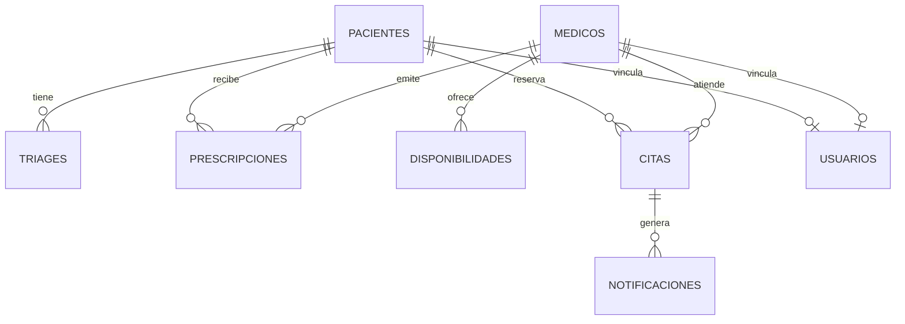

# Análisis de Datos aplicado a SaludWEB

**Materia:** Análisis de Datos<br>
**Carrera:** Tecnicatura en Programación<br>
**Institución:** UTN Facultad Regional Paraná<br>
**Autora:** Ailen Adriana Quaglino Fail<br>
**Proyecto:** SaludWEB (Backend PHP/SQLite, Web React y Mobile React Native/Expo)<br>
**Fecha de la aplicación:** 25/10/2026<br>
**Corte de datos:** 25/10/2026, base `storage/saludweb.sqlite`

---

## Índice

0. [Introducción y alcance](#0-introducción-y-alcance)
1. [Problema, preguntas y unidades de análisis](#1-problema-preguntas-y-unidades-de-análisis)
2. [Inventario y diccionario de datos](#2-inventario-y-diccionario-de-datos)
3. [Calidad de datos](#3-calidad-de-datos)
4. [Análisis descriptivo del proyecto](#4-análisis-descriptivo-del-proyecto)
5. [Probabilidad, inferencia y límites](#5-probabilidad-inferencia-y-límites)
6. [Indicadores para el tablero](#6-indicadores-para-el-tablero)
7. [Visualizaciones y comunicación](#7-visualizaciones-y-comunicación)
8. [Hallazgos y recomendaciones](#8-hallazgos-y-recomendaciones)
9. [Conclusión](#9-conclusión)
10. [Trazabilidad, límites y bibliografía](#10-trazabilidad-límites-y-bibliografía)

---

## 0. Introducción y alcance

Este documento aplica al proyecto **SaludWEB** el recorrido de Análisis de Datos: identificación de fuentes, inventario, calidad, análisis descriptivo, probabilidad, indicadores, visualización y conclusiones. No reemplaza el código ni las consignas de la cátedra. Es un informe de aplicación sobre los datos reales del sistema y sobre la muestra de la Guía N.º 2.

Hay tres niveles de afirmación:

1. **Hecho verificado:** se obtuvo de la base, de un archivo o de una consulta reproducible.
2. **Resultado derivado:** surge de un cálculo sobre esos datos; se informa la fórmula o el denominador.
3. **Recomendación:** es una mejora propuesta, no una función ya implementada.

### 0.1 Fuentes usadas

| Fuente | Tipo | Uso |
|---|---|---|
| `storage/saludweb.sqlite` | Base SQLite | Población real de pacientes, médicos, agenda, citas, triages y prescripciones |
| `db.php` | Esquema | Tablas, claves, restricciones y tipos |
| `/api/estadisticas` | API JSON | Indicadores que ya calcula el backend |
| `SaludWEB_Web/src/components/Dashboard/Dashboard.jsx` | Interfaz | Presentación de indicadores |
| `SaludWEB_Web/src/hooks/useEventosRealtime.js` | Cliente | Avisos de actualización |
| `storage/logs/*.jsonl` | Logs | Eventos técnicos y correlación |
| `QA/04_registro_de_resultados.md` | Evidencia | Pruebas, build y estado de calidad |
| `estudiantes_prog_500.csv` | CSV | Muestra de la Guía N.º 2 |
| `AGENDA_DE_TRABAJO.md` | Planificación | Alcance y fases del proyecto |

### 0.2 Aclaración importante

SaludWEB es un proyecto académico funcional. La base de desarrollo tiene **datos de prueba** y un volumen pequeño. Varias conclusiones no se pueden generalizar a una clínica real: sirven para aprender a medir, detectar problemas de calidad y diseñar un tablero honesto.

**No se modificó el código de la aplicación.** Las consultas se ejecutaron en modo lectura sobre una copia o sobre la base de desarrollo.

---

## 1. Problema, preguntas y unidades de análisis

### 1.1 Problema

El sistema registra pacientes, médicos, disponibilidades, turnos, triages y prescripciones, pero no todo lo que registra se explota como información. El problema de análisis es:

> ¿Qué se puede afirmar sobre la demanda, la oferta de turnos, el perfil de los pacientes y la calidad de los datos de SaludWEB, sin confundir una base de demostración con una operación real?

### 1.2 Preguntas

1. ¿Cuántos pacientes, médicos, agendas, citas y prescripciones hay?
2. ¿Cómo se distribuyen los pacientes por obra social y estado?
3. ¿Cuánta capacidad semanal ofrece la agenda y cómo se concentra?
4. ¿Los niveles de triage respetan una escala válida?
5. ¿Hay datos suficientes para estimar ausentismo, ocupación o demanda?
6. ¿Qué indicadores puede mostrar el tablero sin inducir a error?
7. ¿Qué problemas de calidad deben corregirse antes de analizar?
8. ¿Qué relación hay entre sistema operativo y uso de Git en la muestra de la Guía N.º 2?

### 1.3 Unidades de análisis

| Unidad | Tabla | Cantidad | Qué representa |
|---|---|---:|---|
| Paciente | `pacientes` | 223 | Persona registrada |
| Médico | `medicos` | 8 | Profesional |
| Bloque de disponibilidad | `disponibilidades` | 25 | Franja semanal ofrecida |
| Cita | `citas` | 1 | Turno reservado |
| Triaje | `triages` | 17 | Clasificación de urgencia |
| Prescripción | `prescripciones` | 2 | Receta médica |
| Usuario | `usuarios` | 10 | Cuenta de acceso |
| Notificación | `notificaciones` | 0 | Aviso generado |
| Evento realtime | `eventos_realtime` | 8 | Aviso para el tablero |
| Auditoría | `auditoria` | 28 | Registro declarado de acciones |

La unidad de análisis cambia según la pregunta. No es lo mismo “porcentaje de pacientes activos” que “porcentaje de citas canceladas”: la primera se calcula sobre 223 pacientes y la segunda sobre un universo de citas que, en este corte, es de una sola.

---

## 2. Inventario y diccionario de datos

### 2.1 Tablas del sistema

| Tabla | Rol | Claves y vínculos principales |
|---|---|---|
| `obras_sociales` | Catálogo | `id` |
| `pacientes` | Datos demográficos mínimos | `id`, `dni` único, `id_obra_social` |
| `triages` | Urgencia | `id_paciente` → `pacientes` |
| `medicos` | Profesionales | `id`, `especialidad` |
| `medicamentos` | Catálogo | `id` |
| `prescripciones` | Recetas | `id_paciente`, `id_medico`, `medicamentos` JSON |
| `auditoria` | Registro de acciones | `accion`, `fecha` |
| `usuarios` | Autenticación y rol | `email` único, `id_paciente`, `id_medico` |
| `especialidades` | Catálogo | `id` |
| `disponibilidades` | Agenda semanal | `id_medico`, día, hora, duración |
| `citas` | Turnos | `id_paciente`, `id_medico`, fecha, hora, estado |
| `notificaciones` | Avisos | cita, canal, estado |
| `eventos_realtime` | Cola de avisos | canal, tipo, payload |

### 2.2 Diccionario resumido

| Campo | Tipo | Regla actual | Observación |
|---|---|---|---|
| `pacientes.dni` | TEXT NULL | UNIQUE | SQLite permite varios NULL en un índice único |
| `pacientes.nombre` | TEXT NOT NULL | Obligatorio | No se separa en nombre y apellido |
| `pacientes.id_obra_social` | INTEGER NOT NULL | FK, DEFAULT 1 | Siempre tiene obra social, aunque sea “Particular” |
| `pacientes.activo` | INTEGER | DEFAULT 1 | 1 activo, 0 inactivo |
| `triages.nivel_gravedad` | INTEGER NOT NULL | Sin CHECK | Admite 1–10 y también valores fuera de escala |
| `prescripciones.medicamentos` | TEXT NOT NULL | JSON serializado | No hay validación de esquema JSON |
| `prescripciones.estado` | TEXT | DEFAULT `activa` | Sin CHECK de estados permitidos |
| `prescripciones.firma_digital` | TEXT NULL | Sin uso | La columna existe, pero no se completa |
| `citas.fecha` | TEXT | ISO `YYYY-MM-DD` | Fecha como texto, no tipo DATE |
| `citas.hora` | TEXT | `HH:MM` | Hora como texto |
| `citas.estado` | TEXT | DEFAULT `pendiente` | Sin CHECK de estados |
| `disponibilidades.duracion_turno` | INTEGER | Minutos | En los datos actuales, 30 |
| `auditoria.accion` | TEXT NOT NULL | — | No guarda usuario, IP, entidad ni antes/después |

### 2.3 Diagrama relacional simplificado



El diagrama muestra las relaciones principales. No incluye catálogos menores ni la cola de eventos.

---

## 3. Calidad de datos

La calidad se evalúa con seis dimensiones: completitud, validez, consistencia, unicidad, integridad y actualidad.

### 3.1 Completitud

| Problema | Evidencia | Impacto |
|---|---|---|
| No hay edad ni fecha de nacimiento | `db.php:211-218` | No se pueden analizar franjas etarias ni verificar menores |
| No hay teléfono ni email del paciente | `db.php:211-218` | No hay contacto para recordatorios ni seguimiento |
| `dni` puede ser NULL | `db.php:213` | Pacientes sin identificador confiable |
| No hay notificaciones | 0 registros | No se puede medir entrega, apertura ni efectividad |
| Solo hay una cita | 1 registro | No se puede estimar demanda, ocupación ni ausentismo |

**Conclusión:** el sistema está optimizado para demostrar el flujo, no para analizar una operación. Faltan variables de caracterización y hay muy pocos eventos.

### 3.2 Validez

| Problema | Evidencia | Impacto |
|---|---|---|
| `nivel_gravedad` no tiene CHECK | `db.php:229` | Se aceptan valores fuera de la escala |
| 7 de 17 triages están fuera de 1–5 | Consulta de distribución | El 41,18 % de los triages no respeta una escala convencional de cinco niveles |
| `estado` de cita y prescripción sin CHECK | `db.php:269`, `db.php:394` | Estados arbitrarios o inconsistentes |
| Fechas y horas como TEXT | `db.php:231`, `db.php:267` | Comparaciones y ordenamientos dependen del formato |
| Especialidad duplicada | “Cardiología” y “Cardiologia” | Dos categorías para el mismo concepto; 3 médicos si se normaliza |

La escala de triage no está documentada en el esquema. Una escala de 1 a 5 y otra de 1 a 10 pueden ser válidas, pero no pueden convivir sin una regla explícita.

### 3.3 Consistencia

| Problema | Evidencia | Impacto |
|---|---|---|
| `medicamentos` es JSON en TEXT | `db.php:265` | No se puede consultar por medicamento sin parsear |
| `indicaciones` es texto libre | `db.php:266` | Difícil de codificar y analizar |
| `obra_social` depende de un catálogo | `db.php:202-205` | Correcto, pero no hay control de calidad de nombres |
| Agenda con 5 bloques por médico | `disponibilidades` | La oferta está concentrada en 5 médicos |

### 3.4 Unicidad

- `pacientes.dni` es UNIQUE, pero acepta múltiples NULL (`db.php:208-213`).
- `usuarios.email` es UNIQUE y NOT NULL (`db.php:287`).
- `citas` usa `UNIQUE (id_medico, fecha, hora, slot_reservado)` para evitar superposición (`db.php:407`).
- No hay una restricción que normalice especialidades; el duplicado es un problema de datos, no de esquema.

### 3.5 Integridad y ciclo de vida

- Las claves foráneas están activas (`db.php:147`).
- `triages` y `prescripciones` usan `ON DELETE CASCADE` desde pacientes.
- `id_medico` en prescripciones usa `ON DELETE SET NULL`.

**Riesgo:** borrar un paciente elimina sus triages y prescripciones. Para una historia clínica real, la conservación legal y la trazabilidad pueden exigir no borrar el registro clínico, sino anonimizarlo o archivarlo con control de acceso.

### 3.6 Actualidad

El corte es una foto del 25/10/2026. La única cita es del 29/09/2026 y ya pasó. El tablero puede mostrar “100 % pendiente” porque no hay estados posteriores, no porque el 100 % de la operación esté pendiente.

### 3.7 Matriz de calidad

| Dimensión | Estado | Evidencia | Acción prioritaria |
|---|---|---|---|
| Completitud | Baja | Sin edad, contacto ni notificaciones | Definir variables mínimas y recolectarlas |
| Validez | Media-baja | Triage 1–10 sin CHECK; 7/17 fuera de 1–5 | Fijar escala y agregar CHECK |
| Consistencia | Media | JSON y TEXT libre | Validar JSON y normalizar catálogos |
| Unicidad | Media | DNI nullable; especialidad duplicada | DNI obligatorio o justificar; normalizar |
| Integridad | Media | FK activas; CASCADE clínico | Definir retención y borrado lógico |
| Actualidad | Baja | 1 cita pasada; 0 notificaciones | Cargar un conjunto operativo de prueba o declarar demo |

---

## 4. Análisis descriptivo del proyecto

### 4.1 Pacientes

| Obra social | Total | Activos | Inactivos | % del total | % activo dentro de la obra |
|---|---:|---:|---:|---:|---:|
| OSDE | 88 | 43 | 45 | 39,46 % | 48,86 % |
| PAMI | 67 | 35 | 32 | 30,04 % | 52,24 % |
| Particular | 68 | 36 | 32 | 30,49 % | 52,94 % |
| **Total** | **223** | **114** | **109** | **100 %** | **51,12 %** |

Lectura:

- La distribución por obra social es equilibrada: ninguna supera el 40 %.
- Algo más de la mitad de los pacientes está activo (114/223 = 51,12 %).
- La proporción de activos es similar entre obras sociales; no se observa una concentración fuerte.
- `P(OSDE o PAMI) = 155/223 = 69,51 %`.
- `P(OSDE | activo) = 43/114 = 37,72 %`; `P(activo | OSDE) = 43/88 = 48,86 %`.

**Cuidado:** “activo” es un campo cargado, no una conducta observada. No significa que el paciente haya usado el sistema.

### 4.2 Médicos y oferta

| Especialidad normalizada | Médicos | % |
|---|---:|---:|
| Cardiología | 3 | 37,50 % |
| Medicina General | 2 | 25,00 % |
| Dermatología | 1 | 12,50 % |
| Pediatría | 1 | 12,50 % |
| Neurología | 1 | 12,50 % |
| **Total** | **8** | **100 %** |

- Médicos activos: 5/8 = 62,50 %.
- Médicos con agenda: 5/8 = 62,50 %.
- Médicos sin agenda: 3/8 = 37,50 %.
- Bloques: 25, distribuidos de lunes a viernes, 5 por médico con agenda.
- Cada bloque es de 4 horas (08:00 a 12:00) y se divide en turnos de 30 minutos.
- Capacidad: 5 médicos × 5 bloques × 8 turnos = **200 turnos semanales**.
- Horas: 5 médicos × 20 horas = **100 horas semanales**.

La oferta no es continua: se concentra en la mañana y en cinco profesionales. Tres médicos activos no tienen agenda cargada, lo que reduce la oferta real y puede explicar demoras si el sistema se usara en producción.

### 4.3 Triages

| Nivel | Frecuencia | % |
|---:|---:|---:|
| 1 | 2 | 11,76 % |
| 2 | 1 | 5,88 % |
| 3 | 2 | 11,76 % |
| 4 | 1 | 5,88 % |
| 5 | 4 | 23,53 % |
| 6 | 1 | 5,88 % |
| 7 | 1 | 5,88 % |
| 8 | 2 | 11,76 % |
| 9 | 1 | 5,88 % |
| 10 | 2 | 11,76 % |
| **Total** | **17** | **100 %** |

Medidas:

- Media: **5,4118**
- Mediana: **5**
- Moda: **5** (4 casos)
- Q1: **3**; Q3: **8**; IQR: **5**
- Mínimo: **1**; máximo: **10**; rango: **9**
- Varianza muestral: **8,5074**
- Desvío muestral: **2,9167**
- Coeficiente de variación: **53,90 %**

Lectura:

- La distribución es dispersa y no tiene forma de campana.
- El 41,18 % (7/17) está fuera de una escala 1–5.
- Los niveles 9–10 suman 3/17 = 17,65 %.
- No se debe calcular un “promedio de gravedad” sin definir si la escala es ordinal. Un promedio de 5,41 no significa “gravedad media” si los niveles no son equidistantes.

### 4.4 Citas

| Variable | Valor |
|---|---|
| Total | 1 |
| Fecha | 29/09/2026 |
| Hora | 10:00 |
| Especialidad | Dermatología |
| Estado | Pendiente |
| Duración | 30 minutos |
| Creada por paciente | Sí |
| Recordatorio enviado | No |
| Citas pasadas | 1 |
| Citas futuras | 0 |

Con una sola cita:

- No se puede estimar ausentismo: no hay canceladas ni ausentes.
- No se puede estimar ocupación semanal de forma válida: la cita no pertenece a una semana de agenda completa.
- No se puede comparar demanda por especialidad.
- El “100 % pendiente” es un artefacto del tamaño de la muestra.

### 4.5 Prescripciones

| Estado | Frecuencia |
|---|---:|
| Activa | 1 |
| Dispensada | 1 |
| **Total** | **2** |

Las prescripciones contienen datos clínicos (medicamentos e indicaciones). Son datos sensibles. Para analítica se deben usar agregados o seudónimos, nunca el detalle clínico identificable.

### 4.6 Notificaciones y eventos

- Notificaciones: **0**. No hay evidencia de envío, entrega ni respuesta.
- Eventos realtime: **8**. Son avisos técnicos para actualizar el tablero, no una fuente de verdad.
- El frontend usa sondeo cada 5 segundos; el SSE real depende de un servidor con concurrencia.

### 4.7 Muestra de la Guía N.º 2

La Guía N.º 2 trabaja con **500 estudiantes** y 16 variables. No es la base de SaludWEB; es una muestra independiente para aplicar estadística descriptiva y pruebas de asociación.

| Variable | Resultado principal |
|---|---|
| SO | Windows 263 (52,6 %), Linux 180 (36,0 %), MacOS 57 (11,4 %) |
| Sexo | M 265 (53,0 %), F 224 (44,8 %), X 11 (2,2 %) |
| Lenguaje favorito | Python 211 (42,2 %), JavaScript 139 (27,8 %), Java 77 (15,4 %), C++ 50 (10,0 %), Otro 23 (4,6 %) |
| Modalidad | Presencial 280 (56,0 %), Híbrida 133 (26,6 %), Virtual 87 (17,4 %) |
| Trabaja | No 224 (44,8 %), Part-time 173 (34,6 %), Full-time 103 (20,6 %) |
| Usa Git | Sí 337 (67,4 %), No 163 (32,6 %) |
| Edad | Media 26,688; mediana 26; moda 19; s = 6,7208; CV = 25,18 % |
| Horas de estudio | Media 14,012; mediana 14; moda 14; s = 5,8186; CV = 41,53 % |
| Asistencia | Media 82,0762 %; mediana 81,65 %; s = 11,2608; CV = 13,72 % |
| Nota | Media 6,442; mediana 6; moda 6; s = 0,6224; CV = 9,66 % |

La nota media de quienes trabajan full-time es 5,9709; la de quienes no trabajan es 6,5938; la de part-time es 6,526. Es una diferencia descriptiva, no una prueba de causalidad.

---

## 5. Probabilidad, inferencia y límites

### 5.1 Probabilidad en el proyecto

Con los conteos del proyecto se pueden calcular probabilidades empíricas:

- `P(OSDE) = 88/223 = 0,3946`.
- `P(activo) = 114/223 = 0,5112`.
- `P(OSDE y activo) = 43/223 = 0,1928`.
- `P(OSDE | activo) = 43/114 = 0,3772`.
- `P(activo | OSDE) = 43/88 = 0,4886`.
- `P(OSDE o PAMI) = 155/223 = 0,6951`.

Estas probabilidades describen la base de desarrollo. No son parámetros poblacionales de una clínica real.

### 5.2 Asociación en la Guía N.º 2

Se cruzó **SO** con **Usa Git**:

| SO | Usa Git: Sí | Usa Git: No | Total |
|---|---:|---:|---:|
| Windows | 176 | 87 | 263 |
| Linux | 121 | 59 | 180 |
| MacOS | 40 | 17 | 57 |
| **Total** | **337** | **163** | **500** |

Resultado: `χ² = 0,23`, `gl = 2`, `p ≈ 0,891`, `V de Cramér = 0,0214`.

Interpretación:

- No se rechaza la hipótesis de independencia.
- La asociación observada es muy débil.
- El valor esperado mínimo es 18,582, por encima de 5; la aproximación es razonable.
- No se puede concluir causalidad ni generalizar a toda la población de estudiantes.

### 5.3 Límites del proyecto

- **n = 1** para citas: cualquier porcentaje de estados es trivial.
- **n = 17** para triages: las medidas son sensibles a un solo caso.
- **n = 2** para prescripciones: no hay tendencia.
- No hay serie temporal: una foto no muestra evolución.
- No hay edad ni sexo de pacientes: no se pueden cruzar variables demográficas.
- Los datos son de desarrollo y pueden haber sido cargados manualmente.
- La base no distingue datos reales de datos de prueba.

---

## 6. Indicadores para el tablero

Un indicador necesita fórmula, denominador, período y fuente. Sin esas cuatro cosas, un número es una opinión con formato de tarjeta.

| Indicador | Fórmula | Valor actual | Lectura | Cautela |
|---|---|---:|---|---|
| Pacientes activos | Activos / total | 114/223 = 51,12 % | Mitad activa | “Activo” es un campo, no uso real |
| Cobertura de agenda | Médicos con agenda / médicos | 5/8 = 62,50 % | Tres médicos sin agenda | No mide horas disponibles |
| Capacidad semanal | Bloques × turnos por bloque | 200 turnos | Oferta teórica | No descuenta feriados ni licencias |
| Horas semanales | Médicos con agenda × 20 h | 100 h | Oferta teórica | Turnos de 30 min |
| Ocupación | Turnos reservados / turnos disponibles | No estimable | 1 cita no representa una semana | Requiere período y agenda |
| Ausentismo | Ausentes / citas resueltas | No estimable | No hay ausentes ni canceladas | Requiere citas pasadas resueltas |
| Autogestión | Citas creadas por paciente / total | 1/1 = 100 % | Solo una cita | n = 1 |
| Calidad de triage | Triages fuera de 1–5 / total | 7/17 = 41,18 % | Problema de validez | Definir escala antes |
| Prescripciones activas | Activas / total | 1/2 = 50 % | Mitad activa | n = 2 |
| Notificaciones entregadas | Entregadas / generadas | No estimable | 0 generadas | Falta operación real |

### 6.1 Cómo debe cambiar el tablero

1. Mostrar siempre **n** junto al indicador.
2. Si no hay datos, mostrar “sin datos”, no “0 %”.
3. Separar **datos de demostración** de **datos operativos**.
4. No usar tartas con denominadores menores a 20 sin advertencia.
5. No sumar períodos heterogéneos.
6. Explicar la fórmula en un tooltip o en la documentación.
7. Evitar el “porcentaje de avance” si no hay una línea base y un alcance cerrado.

### 6.2 Lo que ya calcula el backend

`/api/estadisticas` (`routes.php:726`) calcula demanda, ocupación, ausentismo y autogestión. El dashboard las presenta en tarjetas. La existencia del cálculo no garantiza que el dato sea interpretable: con una cita, la ocupación y el ausentismo no tienen base suficiente.

---

## 7. Visualizaciones y comunicación

### 7.1 Gráficos recomendados

| Pregunta | Gráfico | Por qué |
|---|---|---|
| ¿Cómo se distribuyen las obras sociales? | Barras horizontales | Compara tres categorías sin competir por ángulo |
| ¿Cómo se distribuye el triage? | Barras ordenadas por nivel | Muestra la escala y los valores atípicos |
| ¿Cómo se concentra la agenda? | Barras por médico | Hace visible que 3 médicos no tienen bloques |
| ¿Cómo varía la edad en la Guía N.º 2? | Histograma y boxplot | Muestra forma, mediana y outliers |
| ¿Hay relación SO–Git? | Barras 100 % apiladas | Comunica proporciones condicionales |
| ¿Cómo evoluciona la demanda? | Línea temporal | Requiere serie de citas; hoy no hay datos |

### 7.2 Reglas de comunicación

- Título con la pregunta, no con el tipo de gráfico.
- Eje Y desde cero en barras.
- Etiquetas con `n` y porcentaje.
- No usar 3D, sombras ni colores que sugieran jerarquía inexistente.
- No usar rojo/verde como única codificación: agregar texto o patrón.
- Indicar la fecha de corte.
- Distinguir “dato faltante” de “valor cero”.

### 7.3 Qué no mostrar todavía

No conviene publicar:

- Un KPI de ausentismo con una cita.
- Un ranking de especialidades con una cita.
- Un “promedio de gravedad” sin definir la escala.
- Un porcentaje de notificaciones entregadas con cero notificaciones.
- Un gráfico de evolución con un solo punto.

---

## 8. Hallazgos y recomendaciones

### 8.1 Hallazgos prioritarios

| Prioridad | Hallazgo | Evidencia | Consecuencia |
|---|---|---|---|
| Alta | No hay datos suficientes para estimar ausentismo u ocupación | 1 cita | El tablero puede inducir a error |
| Alta | El triage no tiene escala validada | 7/17 fuera de 1–5; sin CHECK | Medidas de gravedad no comparables |
| Alta | Datos clínicos sensibles sin política de acceso visible | Prescripciones y triages | Riesgo de privacidad |
| Media | No hay edad, sexo ni contacto | Esquema de pacientes | Análisis demográfico y seguimiento limitados |
| Media | Especialidad duplicada | Cardiología/Cardiologia | Conteos subestimados |
| Media | JSON clínico sin validación | `medicamentos` TEXT | Datos inconsistentes |
| Media | Fechas como TEXT | `fecha`, `hora` | Errores de formato y comparación |
| Baja | Sin notificaciones | 0 registros | No se puede medir comunicación |
| Baja | Auditoría sin contexto | `auditoria` solo acción/fecha | Poca trazabilidad legal |

### 8.2 Plan de mejora

1. **Definir la escala de triage**: 1–5 o 1–10, con significado por nivel y `CHECK`.
2. **Normalizar especialidades**: catálogo con ID y nombre único; migrar “Cardiologia”.
3. **Completar variables mínimas**: fecha de nacimiento, contacto y consentimiento, solo si hay finalidad.
4. **Validar JSON**: esquema de medicamentos y dosis; pruebas de integridad.
5. **Fechas y horas**: usar formatos ISO y validar en escritura.
6. **Separar demo de producción**: bandera `es_demo` o base distinta.
7. **Cargar un conjunto operativo**: al menos 30–50 citas en varias semanas para probar indicadores.
8. **Agregar pruebas de calidad**: conteos, nulos, duplicados y rangos.
9. **Documentar cada KPI**: fórmula, fuente, período y limitación.
10. **Revisar privacidad**: agregación, acceso por rol y minimización.

### 8.3 Consultas de reproducción

```sql
-- Conteo general
SELECT 'pacientes' AS tabla, COUNT(*) AS total FROM pacientes
UNION ALL SELECT 'medicos', COUNT(*) FROM medicos
UNION ALL SELECT 'disponibilidades', COUNT(*) FROM disponibilidades
UNION ALL SELECT 'citas', COUNT(*) FROM citas
UNION ALL SELECT 'triages', COUNT(*) FROM triages
UNION ALL SELECT 'prescripciones', COUNT(*) FROM prescripciones;

-- Pacientes por obra social y estado
SELECT o.nombre_obra, p.activo, COUNT(*) AS total
FROM pacientes p
JOIN obras_sociales o ON o.id = p.id_obra_social
GROUP BY o.nombre_obra, p.activo
ORDER BY o.nombre_obra, p.activo DESC;

-- Distribución de triage
SELECT nivel_gravedad, COUNT(*) AS total
FROM triages
GROUP BY nivel_gravedad
ORDER BY nivel_gravedad;

-- Capacidad semanal por médico
SELECT m.nombre, COUNT(d.id) AS bloques,
       COUNT(d.id) * 8 AS turnos_semanales,
       COUNT(d.id) * 120 AS minutos_semanales
FROM medicos m
LEFT JOIN disponibilidades d ON d.id_medico = m.id
GROUP BY m.id, m.nombre
ORDER BY bloques DESC;
```

---

## 9. Conclusión

SaludWEB tiene una base ordenada y un tablero que ya calcula indicadores, pero el volumen de datos no alcanza para sacar conclusiones operativas fuertes. La contribución principal de Análisis de Datos no es “calcular un promedio”, sino aprender a distinguir **dato**, **medida**, **indicador** y **decisión**.

Los tres resultados más importantes son:

1. La distribución de pacientes es equilibrada, con algo más de la mitad activos.
2. La oferta semanal es de 100 horas y 200 turnos teóricos, concentrada en cinco médicos.
3. La calidad del triage es el problema más visible: 7 de 17 registros quedan fuera de una escala 1–5.

El tablero debe ser honesto: mostrar `n`, fecha de corte y “sin datos” cuando corresponde. Un gráfico lindo con una sola cita no es análisis; es decoración.

---

## 10. Trazabilidad, límites y bibliografía

### 10.1 Evidencia

| Afirmación | Evidencia |
|---|---|
| Esquema y tablas | `db.php:202-521` |
| Pacientes y obras sociales | Consulta sobre `storage/saludweb.sqlite` |
| Agenda y capacidad | `db.php:357-389`; consulta de disponibilidades |
| Citas | `db.php:392-455`; consulta sobre `citas` |
| Triages | `db.php:226-232`; consulta de distribución |
| Prescripciones | `db.php:261-272`; consulta de estados |
| Endpoint de estadísticas | `routes.php:726` |
| Dashboard | `SaludWEB_Web/src/components/Dashboard/Dashboard.jsx` |
| Guía N.º 2 | `estudiantes_prog_500.csv`; `guia2_stats.json` |
| Pruebas y build | `QA/04_registro_de_resultados.md:21-80` |

### 10.2 Límites

- Corte único, sin serie temporal.
- Datos de desarrollo, no de una operación real.
- Una cita y dos prescripciones: inferencia no paramétrica inviable.
- No se midió calidad de registro en origen (quién cargó cada dato).
- No se hizo análisis de texto libre ni de medicamentos.
- No se auditó la veracidad de los datos personales.
- La muestra de la Guía N.º 2 no pertenece a SaludWEB.

### 10.3 Bibliografía

1. Anderson, D. R., Sweeney, D. J., & Williams, T. A. (2016). *Estadística para negocios y economía* (12.ª ed.). Cengage.
2. Devore, J. L. (2016). *Probabilidad y estadística para ingeniería y ciencias* (9.ª ed.). Cengage.
3. Montgomery, D. C., & Runger, G. C. (2018). *Applied Statistics and Probability for Engineers* (7.ª ed.). Wiley.
4. Few, S. (2012). *Show Me the Numbers: Designing Tables and Graphs to Enlighten* (2.ª ed.). Analytics Press.
5. Knaflic, C. N. (2015). *Storytelling with Data: A Data Visualization Guide for Business Professionals*. Wiley.
6. McKinney, W. (2022). *Python for Data Analysis* (3.ª ed.). O'Reilly.
7. ISO/IEC. (2011). *ISO/IEC 25012:2008 — Data quality model*.
8. OWASP. (2023). *OWASP API Security Top 10*.
