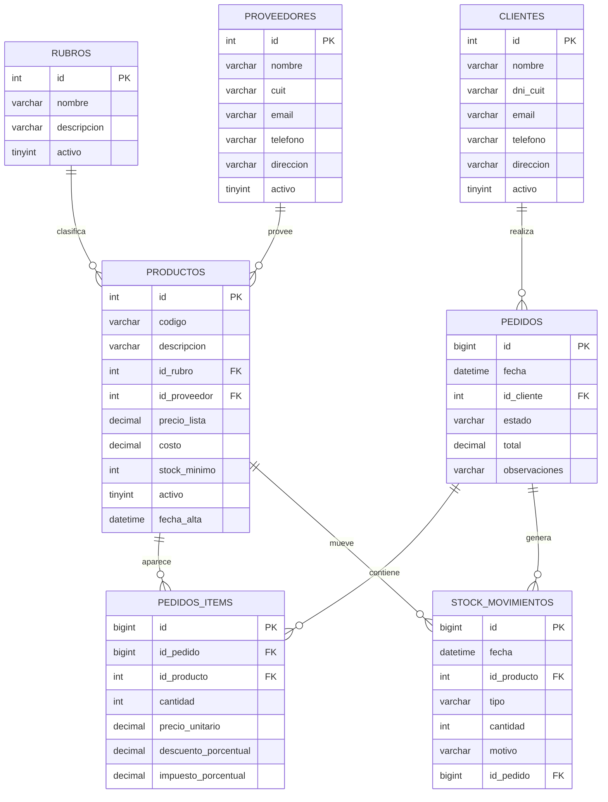

# Bases de Datos I: gestión de pedidos y stock aplicada a SaludWEB

**Materia:** Bases de Datos I<br>
**Docente:** Oscar Londero<br>
**Carrera:** Tecnicatura Universitaria en Programación (UTN)<br>
**Autora:** Ailen Adriana Quaglino Fail<br>
**Proyecto:** SaludWEB (Backend PHP/SQLite, Web React y Mobile React Native/Expo)<br>
**Tema del Parcial II:** Gestión de Pedidos y Stock<br>
**Fecha de la aplicación:** 25/10/2026<br>
**Entrega original del parcial:** 07/11/2025 - 23:59 hs

**Alcance:** este es un documento de aplicación de los conceptos del Parcial II al proyecto SaludWEB. No es el archivo `.sql` de entrega ni el PDF del parcial. Los fragmentos SQL son de referencia y no se ejecutaron sobre la base SQLite del proyecto.

---

## Índice

0. [Introducción y alcance](#0-introducción-y-alcance)
1. [El Parcial II y su traducción a SaludWEB](#1-el-parcial-ii-y-su-traducción-a-saludweb)
2. [Estado actual del modelo de SaludWEB](#2-estado-actual-del-modelo-de-saludweb)
3. [Modelo propuesto y equivalencias](#3-modelo-propuesto-y-equivalencias)
4. [DER del módulo de pedidos y stock](#4-der-del-módulo-de-pedidos-y-stock)
5. [Diccionario de datos](#5-diccionario-de-datos)
6. [Normalización hasta 3FN](#6-normalización-hasta-3fn)
7. [DDL de referencia](#7-ddl-de-referencia)
8. [Integridad, restricciones y stock no negativo](#8-integridad-restricciones-y-stock-no-negativo)
9. [Índices y rendimiento](#9-índices-y-rendimiento)
10. [Vistas obligatorias](#10-vistas-obligatorias)
11. [Las 15 consultas obligatorias aplicadas](#11-las-15-consultas-obligatorias-aplicadas)
12. [Carga masiva reproducible](#12-carga-masiva-reproducible)
13. [Verificación de la entrega](#13-verificación-de-la-entrega)
14. [Decisiones de diseño y límites](#14-decisiones-de-diseño-y-límites)
15. [Recursos académicos utilizados](#15-recursos-académicos-utilizados)
16. [Conclusiones](#16-conclusiones)
17. [Trazabilidad en SaludWEB](#17-trazabilidad-en-saludweb)

---

## 0. Introducción y alcance

El Parcial II de Bases de Datos I pide modelar un dominio de **Gestión de Pedidos** con compras, ventas y stock. El modelo mínimo incluye rubros, proveedores, productos, clientes, pedidos, ítems de pedido y movimientos de stock. Además exige integridad referencial, normalización, índices, vistas, carga masiva y consultas de reporte.

SaludWEB es un sistema de turnos y prescripciones. No tiene hoy un módulo de pedidos, proveedores ni inventario. Por eso, este documento hace dos cosas:

1. **Traduce el modelo del parcial** a una extensión posible de SaludWEB, sin afirmar que esa extensión ya exista.
2. **Usa el modelo genérico del parcial** para explicar el DER, el diccionario, la normalización, el DDL, las vistas y las 15 consultas.

Las tablas `rubros`, `proveedores`, `clientes`, `productos`, `pedidos`, `pedidos_items` y `stock_movimientos` son el **modelo de referencia**. En la sección 3 se indica qué tabla de SaludWEB cumple cada rol y qué tablas habría que crear.

La base real del proyecto es SQLite. El parcial pide MySQL 8.x, o MariaDB si se indica la versión. En este documento se usa sintaxis compatible con MySQL 8.x y MariaDB 10.4, y se marcan las diferencias con SQLite. La base de desarrollo tiene **223 pacientes, 8 médicos, 5 medicamentos y 2 prescripciones**: no alcanza para los volúmenes del parcial, que pertenecen a una base de laboratorio llamada `tp_pedidos`.

---

## 1. El Parcial II y su traducción a SaludWEB

### 1.1 Qué pide el parcial

| Componente | Exigencia |
|---|---|
| Modelo | Rubros, proveedores, productos, clientes, pedidos, ítems y movimientos de stock |
| Integridad | PK, FK, `CHECK` o validaciones equivalentes |
| Normalización | Hasta 3FN como mínimo |
| Índices | Código único de producto, claves foráneas y búsquedas por fecha |
| Vistas | `vw_stock_actual` y `vw_reportes_pedidos` |
| Datos | 50 rubros, 25 proveedores, 100 clientes, 1.000 productos, 500 pedidos |
| Ítems | 2 a 8 ítems por pedido, en promedio |
| Stock | Ingresos iniciales y egresos por cada ítem confirmado |
| Consultas | Al menos 15 reportes explicados |
| Reproducibilidad | Un `.sql` que corra completo sobre una base vacía |
| Documento | PDF con portada, DER, diccionario, consultas y resultados |

### 1.2 Qué significa aplicarlo a SaludWEB

SaludWEB ya tiene pacientes, médicos, medicamentos y prescripciones. Esas tablas permiten explicar el valor de un modelo relacional, pero no cubren el circuito comercial del parcial. La aplicación razonable es un **módulo futuro de farmacia e insumos**:

- los **pacientes** pueden actuar como clientes de una dispensa;
- los **medicamentos** pueden actuar como productos;
- los **proveedores** y **rubros** faltan y habría que crearlos;
- los **pedidos** y sus ítems permitirían registrar una dispensa o una compra;
- los **movimientos de stock** permitirían saber cuánto hay de cada producto.

No se propone reemplazar el módulo clínico de prescripciones. Una prescripción es un acto médico; un pedido es un acto administrativo y comercial. Pueden estar relacionados, pero no son la misma entidad.

### 1.3 Lo que el parcial enseña y el proyecto ya usa

| Concepto | Evidencia en SaludWEB |
|---|---|
| Clave primaria | `pacientes.id`, `medicos.id`, `citas.id` en `db.php` |
| Clave foránea | `citas.id_paciente` referencia a `pacientes(id)` |
| Índice | `idx_citas_paciente`, `idx_citas_medico_dia`, `idx_citas_estado_fecha` |
| Restricción de unicidad | `pacientes.dni UNIQUE`, `citas (id_medico, fecha, hora, slot_reservado)` |
| Integridad por trigger | `trg_citas_actualizado_at` actualiza `actualizado_at` |
| Consulta con `JOIN` | Prescripciones con nombre del paciente y del médico |
| Vista lógica | La API arma respuestas agregadas con `JOIN` y `COUNT` |
| Dato derivado | `edad` y estadísticas se calculan, no se guardan |

El proyecto ya aplica ideas relacionales, pero no tiene el circuito de stock. El parcial permite mostrar cómo se completaría.

---

## 2. Estado actual del modelo de SaludWEB

### 2.1 Tablas relevantes

| Tabla | Rol actual | Límite para el parcial |
|---|---|---|
| `pacientes` | Personas atendidas | No tiene email, teléfono ni dirección |
| `medicos` | Profesionales | No es un cliente comercial |
| `medicamentos` | Catálogo básico | Solo `nombre`, `descripcion`, `creado_at`; sin precio, costo, rubro, proveedor ni stock |
| `prescripciones` | Receta médica | Guarda los medicamentos como JSON en un campo `TEXT` |
| `citas` | Turnos | No es un pedido de productos |
| `obras_sociales` | Cobertura | No es un rubro de producto |

### 2.2 El problema del JSON en prescripciones

En `db.php:261` se crea `prescripciones`. El campo `medicamentos` es `TEXT NOT NULL` (`db.php:265`) y guarda un JSON como este:

```json
[
  {"nombre":"Ibuprofeno","dosis":"400mg"},
  {"nombre":"Paracetamol","dosis":"500mg"}
]
```

Ese diseño es práctico para una receta, pero tiene consecuencias relacionales:

- no se puede hacer una FK desde cada medicamento a `medicamentos.id`;
- no se puede sumar cantidad por producto con una simple agregación;
- el nombre del medicamento se repite y puede quedar desactualizado;
- buscar por medicamento obliga a usar `LIKE` sobre el JSON, como ocurre en `persistence/PrescripcionRepository.php:77`;
- no hay una tabla de ítems que permita precio, cantidad, descuento e impuesto.

Para el parcial, la solución es separar el encabezado de la receta o del pedido y sus ítems. Es el mismo camino que propone `pedidos_items`.

### 2.3 Datos actuales

Corte del 25/10/2026 sobre `storage/saludweb.sqlite`:

| Tabla | Filas |
|---|---:|
| `pacientes` | 223 |
| `medicos` | 8 |
| `medicamentos` | 5 |
| `prescripciones` | 2 |
| `citas` | 1 |
| `obras_sociales` | 3 |
| `especialidades` | 6 |

Son datos de desarrollo. No permiten estimar demanda, rotación ni estacionalidad. El parcial pide una carga artificial controlada; este documento no debe confundir esa carga con datos reales de SaludWEB.

---

## 3. Modelo propuesto y equivalencias

### 3.1 Tablas del modelo de referencia

Se usan los nombres del enunciado para que las consultas se puedan leer sin ambigüedad:

- `rubros`
- `proveedores`
- `clientes`
- `productos`
- `pedidos`
- `pedidos_items`
- `stock_movimientos`

En una implementación real dentro de SaludWEB se pueden renombrar para no chocar con las tablas existentes:

| Modelo del parcial | Nombre propuesto en SaludWEB | Estado |
|---|---|---|
| `rubros` | `rubros_medicamento` | Nueva |
| `proveedores` | `proveedores` | Nueva |
| `clientes` | `pacientes` | Existente, con columnas de contacto a agregar |
| `productos` | `medicamentos` | Existente, a extender con precio, costo, código, rubro y stock mínimo |
| `pedidos` | `pedidos_farmacia` | Nueva |
| `pedidos_items` | `pedido_items` | Nueva |
| `stock_movimientos` | `stock_movimientos` | Nueva |
| `vw_stock_actual` | `vw_stock_actual` | Nueva |
| `vw_reportes_pedidos` | `vw_reportes_pedidos` | Nueva |

### 3.2 Por qué no usar `prescripciones` como `pedidos`

Una prescripción tiene datos clínicos: paciente, médico, indicaciones, vencimiento, firma y estado. Un pedido tiene datos comerciales: cliente, fecha, estado, total, descuento e impuestos. Mezclarlos obligaría a que una receta tenga un total monetario y a que un pedido tenga una firma médica. Son responsabilidades distintas.

La relación correcta sería opcional: un pedido puede originarse en una prescripción, pero no necesita heredar todos sus campos. En el modelo del parcial se mantienen separados.

### 3.3 Flujo propuesto

1. Se carga un producto con su rubro, proveedor, precio de lista, costo y stock mínimo.
2. Se registra un `INGRESO` de stock inicial por producto.
3. Se crea un pedido en estado `NUEVO`.
4. Se agregan los ítems con cantidad, precio unitario, descuento e impuesto.
5. Al confirmar el pedido, se registra un `EGRESO` por cada ítem.
6. El trigger de stock impide que un egreso deje el stock en negativo.
7. Al cerrar el pedido, se conserva el historial y se calculan los reportes.

---

## 4. DER del módulo de pedidos y stock

### 4.1 Diagrama textual

```text
rubros (1) ─────< productos >───── (1) proveedores
                     │
                     ├────< pedidos_items >──── (1) pedidos
                     │                              │
                     │                              └──── (1) clientes
                     │
                     └────< stock_movimientos >──── (0..1) pedidos
```

Lectura:

- un rubro tiene muchos productos;
- un proveedor tiene muchos productos;
- un cliente tiene muchos pedidos;
- un pedido tiene muchos ítems;
- un producto aparece en muchos ítems;
- un producto tiene muchos movimientos de stock;
- un movimiento puede estar asociado a un pedido o ser un ajuste manual.

### 4.2 Diagrama Mermaid



### 4.3 Cardinalidades

| Relación | Cardinalidad | Regla |
|---|---|---|
| Rubro - Producto | 1:N | Un producto pertenece a un rubro |
| Proveedor - Producto | 1:N | Un producto tiene un proveedor principal |
| Cliente - Pedido | 1:N | Un pedido pertenece a un cliente |
| Pedido - Ítem | 1:N | Un pedido tiene al menos un ítem |
| Producto - Ítem | 1:N | Un producto puede aparecer en muchos pedidos |
| Producto - Movimiento | 1:N | Cada movimiento afecta un producto |
| Pedido - Movimiento | 1:N, opcional | Un pedido confirmado genera egresos |

---

## 5. Diccionario de datos

### 5.1 `rubros`

| Campo | Tipo | Restricción | Descripción |
|---|---|---|---|
| `id` | `INT` | PK, autoincremental | Identificador |
| `nombre` | `VARCHAR(80)` | `NOT NULL`, `UNIQUE` | Nombre del rubro |
| `descripcion` | `VARCHAR(255)` | `NULL` | Detalle |
| `activo` | `TINYINT(1)` | `NOT NULL`, `DEFAULT 1`, `CHECK IN (0,1)` | Baja lógica |

### 5.2 `proveedores`

| Campo | Tipo | Restricción | Descripción |
|---|---|---|---|
| `id` | `INT` | PK, autoincremental | Identificador |
| `nombre` | `VARCHAR(120)` | `NOT NULL` | Razón social |
| `cuit` | `VARCHAR(20)` | `NOT NULL`, `UNIQUE` | Identificación fiscal |
| `email` | `VARCHAR(120)` | `NULL` | Contacto |
| `telefono` | `VARCHAR(40)` | `NULL` | Contacto |
| `direccion` | `VARCHAR(200)` | `NULL` | Domicilio |
| `activo` | `TINYINT(1)` | `NOT NULL`, `DEFAULT 1`, `CHECK IN (0,1)` | Baja lógica |

### 5.3 `clientes`

| Campo | Tipo | Restricción | Descripción |
|---|---|---|---|
| `id` | `INT` | PK, autoincremental | Identificador |
| `nombre` | `VARCHAR(120)` | `NOT NULL` | Nombre o razón social |
| `dni_cuit` | `VARCHAR(20)` | `NOT NULL`, `UNIQUE` | Documento o CUIT |
| `email` | `VARCHAR(120)` | `NULL` | Contacto |
| `telefono` | `VARCHAR(40)` | `NULL` | Contacto |
| `direccion` | `VARCHAR(200)` | `NULL` | Domicilio |
| `activo` | `TINYINT(1)` | `NOT NULL`, `DEFAULT 1`, `CHECK IN (0,1)` | Baja lógica |

### 5.4 `productos`

| Campo | Tipo | Restricción | Descripción |
|---|---|---|---|
| `id` | `INT` | PK, autoincremental | Identificador |
| `codigo` | `VARCHAR(30)` | `NOT NULL`, `UNIQUE` | Código interno |
| `descripcion` | `VARCHAR(200)` | `NOT NULL` | Nombre comercial |
| `id_rubro` | `INT` | `NOT NULL`, FK a `rubros(id)` | Clasificación |
| `id_proveedor` | `INT` | `NOT NULL`, FK a `proveedores(id)` | Proveedor principal |
| `precio_lista` | `DECIMAL(12,2)` | `NOT NULL`, `DEFAULT 0`, `CHECK >= 0` | Precio de venta |
| `costo` | `DECIMAL(12,2)` | `NOT NULL`, `DEFAULT 0`, `CHECK >= 0` | Costo de compra |
| `stock_minimo` | `INT` | `NOT NULL`, `DEFAULT 0`, `CHECK >= 0` | Umbral de alerta |
| `activo` | `TINYINT(1)` | `NOT NULL`, `DEFAULT 1`, `CHECK IN (0,1)` | Baja lógica |
| `fecha_alta` | `DATETIME` | `NOT NULL`, `DEFAULT CURRENT_TIMESTAMP` | Alta |

### 5.5 `pedidos`

| Campo | Tipo | Restricción | Descripción |
|---|---|---|---|
| `id` | `BIGINT` | PK, autoincremental | Identificador |
| `fecha` | `DATETIME` | `NOT NULL`, `DEFAULT CURRENT_TIMESTAMP` | Fecha del pedido |
| `id_cliente` | `INT` | `NOT NULL`, FK a `clientes(id)` | Cliente |
| `estado` | `VARCHAR(20)` | `NOT NULL`, `DEFAULT 'NUEVO'`, `CHECK IN (...)` | Estado del pedido |
| `total` | `DECIMAL(12,2)` | `NOT NULL`, `DEFAULT 0`, `CHECK >= 0` | Total final cacheado |
| `observaciones` | `VARCHAR(500)` | `NULL` | Notas |

Estados permitidos: `NUEVO`, `CONFIRMADO`, `CERRADO`, `ANULADO`.

### 5.6 `pedidos_items`

| Campo | Tipo | Restricción | Descripción |
|---|---|---|---|
| `id` | `BIGINT` | PK, autoincremental | Identificador |
| `id_pedido` | `BIGINT` | `NOT NULL`, FK a `pedidos(id)` | Pedido |
| `id_producto` | `INT` | `NOT NULL`, FK a `productos(id)` | Producto |
| `cantidad` | `INT` | `NOT NULL`, `CHECK > 0` | Unidades |
| `precio_unitario` | `DECIMAL(12,2)` | `NOT NULL`, `CHECK >= 0` | Precio al momento de la venta |
| `descuento_porcentual` | `DECIMAL(5,2)` | `NOT NULL`, `DEFAULT 0`, `CHECK BETWEEN 0 AND 100` | Descuento |
| `impuesto_porcentual` | `DECIMAL(5,2)` | `NOT NULL`, `DEFAULT 0`, `CHECK BETWEEN 0 AND 100` | Impuesto |

La restricción `UNIQUE (id_pedido, id_producto)` es opcional. Si el negocio permite repetir el mismo producto en dos líneas, no debe imponerse. En este modelo se recomienda imponerla para evitar líneas duplicadas y facilitar la carga.

### 5.7 `stock_movimientos`

| Campo | Tipo | Restricción | Descripción |
|---|---|---|---|
| `id` | `BIGINT` | PK, autoincremental | Identificador |
| `fecha` | `DATETIME` | `NOT NULL`, `DEFAULT CURRENT_TIMESTAMP` | Fecha del movimiento |
| `id_producto` | `INT` | `NOT NULL`, FK a `productos(id)` | Producto |
| `tipo` | `VARCHAR(10)` | `NOT NULL`, `CHECK IN (...)` | Tipo de movimiento |
| `cantidad` | `INT` | `NOT NULL`, `CHECK > 0` | Unidades |
| `motivo` | `VARCHAR(200)` | `NULL` | Explicación |
| `id_pedido` | `BIGINT` | `NULL`, FK a `pedidos(id)` | Pedido asociado |

Tipos permitidos: `INGRESO`, `EGRESO`, `AJUSTE+`, `AJUSTE-`.

`cantidad` es siempre positiva. El signo lo aporta `tipo`, no un número negativo. Esa decisión evita ambigüedad y permite validar con un `CHECK` simple.

---

## 6. Normalización hasta 3FN

### 6.1 Primera forma normal (1FN)

Una tabla está en 1FN si sus atributos son atómicos y no hay grupos repetidos. En el modelo del parcial:

- `pedidos_items` separa cada producto del pedido;
- una fila de `pedidos_items` tiene una cantidad, un precio y un descuento;
- no se guarda una lista de productos dentro de `pedidos`.

En SaludWEB, `prescripciones.medicamentos` guarda un JSON con una lista. Eso es un grupo repetido dentro de un campo `TEXT` y no cumple 1FN desde el punto de vista relacional. La solución sería una tabla `prescripcion_items` con `id_prescripcion`, `id_medicamento`, `dosis`, `cantidad` e indicaciones por ítem. El parcial permite ver el mismo problema y la misma solución con `pedidos_items`.

### 6.2 Segunda forma normal (2FN)

En 2FN, cada atributo no clave depende de toda la clave. En `pedidos_items`, la clave puede ser `id` (sustituta) o `(id_pedido, id_producto)`. Los datos del producto (descripción, rubro, proveedor) no se copian en el ítem: se consultan en `productos`. Lo mismo ocurre con los datos del cliente: no se repiten en `pedidos`.

Ejemplo de violación: guardar `nombre_producto`, `nombre_rubro` y `nombre_proveedor` en cada línea de pedido. Si cambia el nombre del proveedor, habría que actualizar miles de líneas.

### 6.3 Tercera forma normal (3FN)

En 3FN no hay dependencias transitivas entre atributos no clave. En el modelo:

- `productos.id_rubro` depende del producto, y el nombre del rubro depende del rubro, no del producto;
- `productos.id_proveedor` depende del producto, y los datos del proveedor dependen del proveedor;
- `pedidos.id_cliente` depende del pedido, y los datos del cliente dependen del cliente;
- `pedidos_items.id_producto` depende del ítem, y el precio de lista actual depende del producto.

El precio unitario del ítem es una excepción deliberada: se guarda el precio histórico al momento de la venta. Si se consultara siempre `productos.precio_lista`, una actualización de precio cambiaría el pasado. Guardar el precio unitario no viola 3FN; es un atributo del hecho de venta, no una copia del maestro actual.

### 6.4 El caso de `pedidos.total`

`pedidos.total` es un dato derivado de la suma de los ítems. En un modelo estrictamente normalizado no se guardaría. El enunciado lo pide y muchas aplicaciones lo conservan por rendimiento. La decisión correcta es:

- mantener `total` como **caché**;
- recalcularlo con un trigger o un procedimiento al insertar, modificar o borrar ítems;
- verificar periódicamente que coincida con `vw_reportes_pedidos.total_final`.

Si se prefiere pureza absoluta, se elimina `pedidos.total` y se calcula siempre desde los ítems. En este documento se conserva porque el parcial lo incluye y porque permite comparar el total cacheado con el calculado.

### 6.5 Dependencias funcionales resumidas

```text
rubros.id              → rubros.nombre, rubros.descripcion, rubros.activo
proveedores.id         → proveedores.nombre, proveedores.cuit, ...
clientes.id            → clientes.nombre, clientes.dni_cuit, ...
productos.id           → productos.codigo, productos.descripcion, ...
productos.codigo       → productos.id
pedidos.id             → pedidos.fecha, pedidos.id_cliente, pedidos.estado, ...
pedidos_items.id       → pedidos_items.id_pedido, pedidos_items.id_producto, ...
(id_pedido, id_producto) → cantidad, precio_unitario, descuento, impuesto
stock_movimientos.id   → fecha, id_producto, tipo, cantidad, motivo, id_pedido
```

No hay dependencias transitivas entre atributos no clave. El único dato derivado es `pedidos.total`, tratado como caché.

---

## 7. DDL de referencia

Los siguientes fragmentos son de referencia para MySQL 8.x o MariaDB 10.4. No se ejecutan sobre `storage/saludweb.sqlite`, cuya sintaxis es distinta.

### 7.1 Base y catálogos

```sql
CREATE DATABASE IF NOT EXISTS tp_pedidos
  CHARACTER SET utf8mb4
  COLLATE utf8mb4_unicode_ci;

USE tp_pedidos;

CREATE TABLE rubros (
  id INT AUTO_INCREMENT PRIMARY KEY,
  nombre VARCHAR(80) NOT NULL,
  descripcion VARCHAR(255) NULL,
  activo TINYINT(1) NOT NULL DEFAULT 1,
  CONSTRAINT uq_rubros_nombre UNIQUE (nombre),
  CONSTRAINT ck_rubros_activo CHECK (activo IN (0,1))
) ENGINE=InnoDB;

CREATE TABLE proveedores (
  id INT AUTO_INCREMENT PRIMARY KEY,
  nombre VARCHAR(120) NOT NULL,
  cuit VARCHAR(20) NOT NULL,
  email VARCHAR(120) NULL,
  telefono VARCHAR(40) NULL,
  direccion VARCHAR(200) NULL,
  activo TINYINT(1) NOT NULL DEFAULT 1,
  CONSTRAINT uq_proveedores_cuit UNIQUE (cuit),
  CONSTRAINT ck_proveedores_activo CHECK (activo IN (0,1))
) ENGINE=InnoDB;

CREATE TABLE clientes (
  id INT AUTO_INCREMENT PRIMARY KEY,
  nombre VARCHAR(120) NOT NULL,
  dni_cuit VARCHAR(20) NOT NULL,
  email VARCHAR(120) NULL,
  telefono VARCHAR(40) NULL,
  direccion VARCHAR(200) NULL,
  activo TINYINT(1) NOT NULL DEFAULT 1,
  CONSTRAINT uq_clientes_dni_cuit UNIQUE (dni_cuit),
  CONSTRAINT ck_clientes_activo CHECK (activo IN (0,1))
) ENGINE=InnoDB;
```

### 7.2 Productos

```sql
CREATE TABLE productos (
  id INT AUTO_INCREMENT PRIMARY KEY,
  codigo VARCHAR(30) NOT NULL,
  descripcion VARCHAR(200) NOT NULL,
  id_rubro INT NOT NULL,
  id_proveedor INT NOT NULL,
  precio_lista DECIMAL(12,2) NOT NULL DEFAULT 0,
  costo DECIMAL(12,2) NOT NULL DEFAULT 0,
  stock_minimo INT NOT NULL DEFAULT 0,
  activo TINYINT(1) NOT NULL DEFAULT 1,
  fecha_alta DATETIME NOT NULL DEFAULT CURRENT_TIMESTAMP,
  CONSTRAINT uq_productos_codigo UNIQUE (codigo),
  CONSTRAINT ck_productos_precio CHECK (precio_lista >= 0),
  CONSTRAINT ck_productos_costo CHECK (costo >= 0),
  CONSTRAINT ck_productos_stock_minimo CHECK (stock_minimo >= 0),
  CONSTRAINT ck_productos_activo CHECK (activo IN (0,1)),
  CONSTRAINT fk_productos_rubro
    FOREIGN KEY (id_rubro) REFERENCES rubros(id)
    ON UPDATE RESTRICT ON DELETE RESTRICT,
  CONSTRAINT fk_productos_proveedor
    FOREIGN KEY (id_proveedor) REFERENCES proveedores(id)
    ON UPDATE RESTRICT ON DELETE RESTRICT,
  INDEX idx_productos_rubro (id_rubro),
  INDEX idx_productos_proveedor (id_proveedor)
) ENGINE=InnoDB;
```

### 7.3 Pedidos e ítems

```sql
CREATE TABLE pedidos (
  id BIGINT AUTO_INCREMENT PRIMARY KEY,
  fecha DATETIME NOT NULL DEFAULT CURRENT_TIMESTAMP,
  id_cliente INT NOT NULL,
  estado VARCHAR(20) NOT NULL DEFAULT 'NUEVO',
  total DECIMAL(12,2) NOT NULL DEFAULT 0,
  observaciones VARCHAR(500) NULL,
  CONSTRAINT ck_pedidos_estado
    CHECK (estado IN ('NUEVO','CONFIRMADO','CERRADO','ANULADO')),
  CONSTRAINT ck_pedidos_total CHECK (total >= 0),
  CONSTRAINT fk_pedidos_cliente
    FOREIGN KEY (id_cliente) REFERENCES clientes(id)
    ON UPDATE RESTRICT ON DELETE RESTRICT,
  INDEX idx_pedidos_cliente_fecha (id_cliente, fecha),
  INDEX idx_pedidos_estado_fecha (estado, fecha)
) ENGINE=InnoDB;

CREATE TABLE pedidos_items (
  id BIGINT AUTO_INCREMENT PRIMARY KEY,
  id_pedido BIGINT NOT NULL,
  id_producto INT NOT NULL,
  cantidad INT NOT NULL,
  precio_unitario DECIMAL(12,2) NOT NULL,
  descuento_porcentual DECIMAL(5,2) NOT NULL DEFAULT 0,
  impuesto_porcentual DECIMAL(5,2) NOT NULL DEFAULT 0,
  CONSTRAINT uq_pedidos_items_pedido_producto UNIQUE (id_pedido, id_producto),
  CONSTRAINT ck_pedidos_items_cantidad CHECK (cantidad > 0),
  CONSTRAINT ck_pedidos_items_precio CHECK (precio_unitario >= 0),
  CONSTRAINT ck_pedidos_items_descuento
    CHECK (descuento_porcentual BETWEEN 0 AND 100),
  CONSTRAINT ck_pedidos_items_impuesto
    CHECK (impuesto_porcentual BETWEEN 0 AND 100),
  CONSTRAINT fk_pedidos_items_pedido
    FOREIGN KEY (id_pedido) REFERENCES pedidos(id)
    ON UPDATE RESTRICT ON DELETE RESTRICT,
  CONSTRAINT fk_pedidos_items_producto
    FOREIGN KEY (id_producto) REFERENCES productos(id)
    ON UPDATE RESTRICT ON DELETE RESTRICT,
  INDEX idx_pedidos_items_pedido (id_pedido),
  INDEX idx_pedidos_items_producto (id_producto)
) ENGINE=InnoDB;
```

### 7.4 Movimientos de stock

```sql
CREATE TABLE stock_movimientos (
  id BIGINT AUTO_INCREMENT PRIMARY KEY,
  fecha DATETIME NOT NULL DEFAULT CURRENT_TIMESTAMP,
  id_producto INT NOT NULL,
  tipo VARCHAR(10) NOT NULL,
  cantidad INT NOT NULL,
  motivo VARCHAR(200) NULL,
  id_pedido BIGINT NULL,
  CONSTRAINT ck_stock_tipo
    CHECK (tipo IN ('INGRESO','EGRESO','AJUSTE+','AJUSTE-')),
  CONSTRAINT ck_stock_cantidad CHECK (cantidad > 0),
  CONSTRAINT fk_stock_producto
    FOREIGN KEY (id_producto) REFERENCES productos(id)
    ON UPDATE RESTRICT ON DELETE RESTRICT,
  CONSTRAINT fk_stock_pedido
    FOREIGN KEY (id_pedido) REFERENCES pedidos(id)
    ON UPDATE RESTRICT ON DELETE SET NULL,
  INDEX idx_stock_producto_fecha (id_producto, fecha),
  INDEX idx_stock_pedido (id_pedido)
) ENGINE=InnoDB;
```

La FK `fk_stock_pedido` usa `ON DELETE SET NULL` porque un movimiento de stock debe sobrevivir aunque se elimine el pedido. Si se prohíbe borrar pedidos y solo se permite anularlos, se puede usar `RESTRICT`. Esa decisión debe explicarse en el PDF.

### 7.5 Diferencias con SQLite

| MySQL/MariaDB | SQLite en SaludWEB |
|---|---|
| `AUTO_INCREMENT` | `AUTOINCREMENT` |
| `DECIMAL(12,2)` | `REAL` o `NUMERIC` |
| `ENUM` o `CHECK` | `CHECK` con `TEXT` |
| `SIGNAL SQLSTATE` | No disponible; se usa `RAISE(ABORT, ...)` |
| `DELIMITER` | No se usa igual en todos los clientes |
| `DATE_FORMAT` | `strftime` |
| `CURRENT_DATE - INTERVAL 90 DAY` | `date('now','-90 day')` |

El parcial debe entregarse en MySQL/MariaDB. Migrar el módulo a SQLite sin adaptar triggers y consultas produciría errores.

---

## 8. Integridad, restricciones y stock no negativo

### 8.1 Integridad referencial

Las FK del modelo usan `ON UPDATE RESTRICT` y `ON DELETE RESTRICT` en los catálogos y en los ítems. La razón es conservar la historia:

- no se puede borrar un rubro con productos;
- no se puede borrar un proveedor con productos;
- no se puede borrar un cliente con pedidos;
- no se puede borrar un pedido con ítems;
- no se puede borrar un producto con ítems o movimientos.

Para dar de baja un producto o un cliente se usa `activo = 0`, no `DELETE`. Es una baja lógica coherente con el resto de SaludWEB, donde `pacientes.activo` y `medicos.activo` ya existen.

### 8.2 Restricciones de dominio

| Regla | Implementación |
|---|---|
| Cantidad positiva | `CHECK (cantidad > 0)` |
| Precio no negativo | `CHECK (precio_unitario >= 0)` |
| Descuento entre 0 y 100 | `CHECK (descuento_porcentual BETWEEN 0 AND 100)` |
| Impuesto entre 0 y 100 | `CHECK (impuesto_porcentual BETWEEN 0 AND 100)` |
| Estado válido | `CHECK (estado IN (...))` |
| Tipo de movimiento válido | `CHECK (tipo IN (...))` |
| Activo binario | `CHECK (activo IN (0,1))` |
| Código único | `UNIQUE (codigo)` |
| Documento único | `UNIQUE (dni_cuit)` |
| CUIT único | `UNIQUE (cuit)` |

### 8.3 Vista de stock

```sql
CREATE OR REPLACE VIEW vw_stock_actual AS
SELECT
  p.id AS id_producto,
  p.codigo,
  p.descripcion,
  COALESCE(SUM(
    CASE
      WHEN sm.tipo IN ('INGRESO','AJUSTE+') THEN sm.cantidad
      WHEN sm.tipo IN ('EGRESO','AJUSTE-') THEN -sm.cantidad
      ELSE 0
    END
  ), 0) AS stock_actual
FROM productos p
LEFT JOIN stock_movimientos sm ON sm.id_producto = p.id
GROUP BY p.id, p.codigo, p.descripcion;
```

La vista no guarda stock. Lo calcula a partir de los hechos. Eso evita que el stock quede desincronizado respecto de los movimientos.

### 8.4 Trigger que impide stock negativo

```sql
DELIMITER $$

CREATE TRIGGER trg_stock_no_negativo
BEFORE INSERT ON stock_movimientos
FOR EACH ROW
BEGIN
  DECLARE v_stock_actual INT DEFAULT 0;

  IF NEW.tipo IN ('EGRESO','AJUSTE-') THEN
    SELECT COALESCE(SUM(
      CASE
        WHEN tipo IN ('INGRESO','AJUSTE+') THEN cantidad
        WHEN tipo IN ('EGRESO','AJUSTE-') THEN -cantidad
        ELSE 0
      END
    ), 0)
    INTO v_stock_actual
    FROM stock_movimientos
    WHERE id_producto = NEW.id_producto;

    IF v_stock_actual - NEW.cantidad < 0 THEN
      SIGNAL SQLSTATE '45000'
        SET MESSAGE_TEXT = 'Stock insuficiente: el movimiento dejaria el stock en negativo';
    END IF;
  END IF;
END$$

DELIMITER ;
```

El trigger se ejecuta antes de insertar un egreso o un ajuste negativo. Si el stock actual menos la cantidad pedida es menor que cero, aborta la operación. La validación se hace en la base, no solo en la aplicación, para que un script o una carga masiva no puedan saltarla.

### 8.5 Confirmación de un pedido

La confirmación debe ser una transacción:

1. verificar que el pedido esté en `NUEVO`;
2. verificar que tenga ítems;
3. insertar un `EGRESO` por cada ítem;
4. cambiar el estado a `CONFIRMADO`;
5. recalcular el total;
6. hacer `COMMIT`.

Si el trigger detecta stock insuficiente, la transacción se revierte y el pedido queda en `NUEVO`. Esa es la forma correcta de no dejar pedidos a medias.

### 8.6 Totales

`pedidos.total` se puede recalcular con un procedimiento o un trigger. La fórmula de cada línea es:

```text
bruto_linea   = cantidad * precio_unitario
descuento     = bruto_linea * descuento_porcentual / 100
base_linea    = bruto_linea - descuento
impuesto      = base_linea * impuesto_porcentual / 100
total_linea   = base_linea + impuesto
```

El total del pedido es la suma de `total_linea`. La vista `vw_reportes_pedidos` hace ese cálculo sin depender del caché.

---

## 9. Índices y rendimiento

### 9.1 Índices obligatorios y justificación

| Índice | Tabla | Motivo |
|---|---|---|
| `uq_productos_codigo` | `productos(codigo)` | Búsqueda por código y unicidad |
| `idx_productos_rubro` | `productos(id_rubro)` | Productos por rubro y reportes de ranking |
| `idx_productos_proveedor` | `productos(id_proveedor)` | Facturación por proveedor |
| `idx_pedidos_cliente_fecha` | `pedidos(id_cliente, fecha)` | Historial y facturación por cliente |
| `idx_pedidos_estado_fecha` | `pedidos(estado, fecha)` | Filtros por estado y series mensuales |
| `idx_pedidos_items_pedido` | `pedidos_items(id_pedido)` | Armar el detalle de un pedido |
| `idx_pedidos_items_producto` | `pedidos_items(id_producto)` | Ranking de productos y productos sin ventas |
| `idx_stock_producto_fecha` | `stock_movimientos(id_producto, fecha)` | Stock y evolución por producto |
| `idx_stock_pedido` | `stock_movimientos(id_pedido)` | Egresos de un pedido |

### 9.2 Criterios

- Los índices compuestos ponen primero la columna de igualdad y después la de rango. Por eso `pedidos(id_cliente, fecha)` sirve para filtrar un cliente y ordenar por fecha.
- `pedidos(estado, fecha)` sirve para `WHERE estado = ? AND fecha BETWEEN ...`.
- No conviene indexar `activo` solo: tiene baja selectividad. Sí puede formar parte de un índice compuesto si los reportes lo usan siempre.
- `codigo` y `dni_cuit` son únicos y se usan para búsquedas puntuales.
- Las FK no crean índices automáticamente en MySQL. Por eso se declaran de forma explícita.

### 9.3 Cómo medir

En MySQL 8:

```sql
EXPLAIN
SELECT id_producto, stock_actual
FROM vw_stock_actual
ORDER BY stock_actual ASC
LIMIT 20;
```

En MySQL 8.0.18 o superior:

```sql
EXPLAIN ANALYZE
SELECT ...
```

En MariaDB:

```sql
ANALYZE SELECT ...;
```

Qué mirar:

- `type`: `ALL` es escaneo completo; `ref` o `range` suele ser mejor;
- `key`: índice usado;
- `rows`: filas estimadas;
- `Extra`: `Using where`, `Using temporary`, `Using filesort` son señales para revisar.

### 9.4 Costo de las vistas

`vw_stock_actual` agrega todos los movimientos de todos los productos. Con 1.000 productos y pocos movimientos es barata. Con millones de movimientos, cada consulta de stock recorrería toda la tabla. Alternativas:

1. **Tabla de saldo** `producto_stock(id_producto, stock_actual)` actualizada por trigger. Es rápida, pero introduce un dato derivado que hay que mantener.
2. **Tabla de cierre mensual** para reportes históricos.
3. **Índice de cobertura** `(id_producto, tipo, cantidad)` para que la vista no vaya a la tabla.

Para el volumen del parcial, la vista es suficiente. La decisión debe justificarse en el PDF.

---

## 10. Vistas obligatorias

### 10.1 `vw_stock_actual`

Ya definida en la sección 8.3. Devuelve una fila por producto, incluso si no tiene movimientos, porque usa `LEFT JOIN` y `COALESCE`.

### 10.2 `vw_reportes_pedidos`

```sql
CREATE OR REPLACE VIEW vw_reportes_pedidos AS
SELECT
  p.id AS id_pedido,
  p.fecha,
  p.id_cliente,
  c.nombre AS cliente,
  p.estado,
  ROUND(COALESCE(SUM(i.cantidad * i.precio_unitario), 0), 2) AS total_bruto,
  ROUND(COALESCE(SUM(
    i.cantidad * i.precio_unitario * i.descuento_porcentual / 100
  ), 0), 2) AS descuento,
  ROUND(COALESCE(SUM(
    i.cantidad * i.precio_unitario
    * (1 - i.descuento_porcentual / 100)
    * i.impuesto_porcentual / 100
  ), 0), 2) AS impuestos,
  ROUND(COALESCE(SUM(
    i.cantidad * i.precio_unitario
    * (1 - i.descuento_porcentual / 100)
    * (1 + i.impuesto_porcentual / 100)
  ), 0), 2) AS total_final,
  COUNT(i.id) AS cantidad_items
FROM pedidos p
JOIN clientes c ON c.id = p.id_cliente
LEFT JOIN pedidos_items i ON i.id_pedido = p.id
GROUP BY
  p.id, p.fecha, p.id_cliente, c.nombre, p.estado;
```

La vista calcula el total desde los ítems, no desde `pedidos.total`. Así se puede comparar el caché con el cálculo real.

### 10.3 Verificación de consistencia

```sql
SELECT
  p.id AS id_pedido,
  p.total AS total_cacheado,
  v.total_final AS total_calculado,
  ROUND(p.total - v.total_final, 2) AS diferencia
FROM pedidos p
JOIN vw_reportes_pedidos v ON v.id_pedido = p.id
WHERE ABS(p.total - v.total_final) > 0.01;
```

Si esta consulta devuelve filas, el caché está desactualizado.

---

## 11. Las 15 consultas obligatorias aplicadas

Las consultas usan el modelo de referencia. En una implementación dentro de SaludWEB, `clientes` se reemplaza por `pacientes` y `productos` por `medicamentos` extendida. Los períodos son ejemplos: en el parcial se ajustan a la carga real.

Criterio general: se consideran ventas los pedidos `CONFIRMADO` y `CERRADO`; se excluyen `NUEVO` y `ANULADO` salvo que la consigna indique lo contrario.

### 11.1 Stock actual por producto, de menor a mayor

**Qué responde:** qué productos están más cerca de faltar.

```sql
SELECT
  id_producto,
  codigo,
  descripcion,
  stock_actual
FROM vw_stock_actual
ORDER BY stock_actual ASC, codigo ASC;
```

**Lectura:** las primeras filas son las de menor stock. Si se filtra `stock_actual < stock_minimo`, se obtiene la alerta de reposición.

### 11.2 Top 10 de productos más vendidos por cantidad

**Qué responde:** qué productos tienen mayor rotación en unidades.

```sql
SELECT
  p.id,
  p.codigo,
  p.descripcion,
  SUM(i.cantidad) AS unidades_vendidas
FROM pedidos_items i
JOIN pedidos pe ON pe.id = i.id_pedido
JOIN productos p ON p.id = i.id_producto
WHERE pe.estado IN ('CONFIRMADO','CERRADO')
GROUP BY p.id, p.codigo, p.descripcion
ORDER BY unidades_vendidas DESC, p.codigo ASC
LIMIT 10;
```

**Lectura:** ordena por cantidad, no por facturación. Un producto barato puede liderar unidades y no facturación.

### 11.3 Facturación por cliente en un rango de fechas

**Qué responde:** cuánto compró cada cliente en el período.

```sql
SELECT
  v.id_cliente,
  v.cliente,
  COUNT(*) AS cantidad_pedidos,
  ROUND(SUM(v.total_final), 2) AS facturacion
FROM vw_reportes_pedidos v
WHERE v.fecha >= '2026-01-01'
  AND v.fecha < '2027-01-01'
  AND v.estado IN ('CONFIRMADO','CERRADO')
GROUP BY v.id_cliente, v.cliente
ORDER BY facturacion DESC, v.cliente ASC;
```

**Lectura:** el rango usa `>=` y `<` para no depender de la hora del último día. Es más seguro que `BETWEEN` con `DATETIME`.

### 11.4 Facturación por proveedor

**Qué responde:** cuánto facturó cada proveedor a través de los productos que provee.

```sql
SELECT
  pr.id,
  pr.nombre AS proveedor,
  SUM(i.cantidad) AS unidades_vendidas,
  ROUND(SUM(
    i.cantidad * i.precio_unitario
    * (1 - i.descuento_porcentual / 100)
    * (1 + i.impuesto_porcentual / 100)
  ), 2) AS facturacion
FROM pedidos_items i
JOIN pedidos pe ON pe.id = i.id_pedido
JOIN productos p ON p.id = i.id_producto
JOIN proveedores pr ON pr.id = p.id_proveedor
WHERE pe.estado IN ('CONFIRMADO','CERRADO')
GROUP BY pr.id, pr.nombre
ORDER BY facturacion DESC;
```

**Lectura:** no es la compra al proveedor; es la venta de los productos que ese proveedor suministra. El costo real de compra se analiza con `productos.costo`.

### 11.5 Ranking de rubros por volumen y por facturación

**Qué responde:** qué rubros se venden más en unidades y cuáles generan más dinero.

```sql
WITH base AS (
  SELECT
    r.id,
    r.nombre AS rubro,
    SUM(i.cantidad) AS unidades,
    SUM(
      i.cantidad * i.precio_unitario
      * (1 - i.descuento_porcentual / 100)
      * (1 + i.impuesto_porcentual / 100)
    ) AS facturacion
  FROM pedidos_items i
  JOIN pedidos pe ON pe.id = i.id_pedido
  JOIN productos p ON p.id = i.id_producto
  JOIN rubros r ON r.id = p.id_rubro
  WHERE pe.estado IN ('CONFIRMADO','CERRADO')
  GROUP BY r.id, r.nombre
)
SELECT
  rubro,
  unidades,
  ROUND(facturacion, 2) AS facturacion,
  RANK() OVER (ORDER BY unidades DESC) AS ranking_volumen,
  RANK() OVER (ORDER BY facturacion DESC) AS ranking_facturacion
FROM base
ORDER BY ranking_volumen, rubro;
```

**Lectura:** un rubro puede ser primero en unidades y tercero en facturación. El doble ranking muestra esa diferencia.

### 11.6 Pedidos por estado, con conteo y porcentaje

**Qué responde:** cómo se distribuyen los pedidos entre estados.

```sql
SELECT
  estado,
  cantidad,
  ROUND(cantidad * 100.0 / (SELECT COUNT(*) FROM pedidos), 2) AS porcentaje
FROM (
  SELECT estado, COUNT(*) AS cantidad
  FROM pedidos
  GROUP BY estado
) x
ORDER BY cantidad DESC, estado ASC;
```

**Lectura:** el porcentaje se calcula sobre el total de pedidos, incluidos los anulados. Si el denominador debe excluir anulados, se ajusta la subconsulta.

### 11.7 Ticket promedio y desvío estándar

**Qué responde:** cuál es el ticket medio y cuánta dispersión hay.

```sql
SELECT
  COUNT(*) AS cantidad_pedidos,
  ROUND(AVG(total_final), 2) AS ticket_promedio,
  ROUND(STDDEV_SAMP(total_final), 2) AS desvio_muestral,
  ROUND(STDDEV_POP(total_final), 2) AS desvio_poblacional
FROM vw_reportes_pedidos
WHERE estado IN ('CONFIRMADO','CERRADO');
```

**Lectura:** `STDDEV_SAMP` divide por `n-1` y es el habitual para una muestra. `STDDEV_POP` divide por `n` y describe la población completa. En el PDF hay que indicar cuál se usó y por qué.

### 11.8 Clientes con mayor reincidencia

**Qué responde:** qué clientes vuelven a comprar.

```sql
SELECT
  v.id_cliente,
  v.cliente,
  COUNT(*) AS cantidad_pedidos,
  ROUND(SUM(v.total_final), 2) AS facturacion
FROM vw_reportes_pedidos v
WHERE v.estado IN ('CONFIRMADO','CERRADO')
GROUP BY v.id_cliente, v.cliente
HAVING COUNT(*) > 1
ORDER BY cantidad_pedidos DESC, facturacion DESC;
```

**Lectura:** `HAVING` filtra después de agrupar. Un cliente con un solo pedido no es reincidente.

### 11.9 Productos por debajo del stock mínimo

**Qué responde:** qué productos necesitan reposición.

```sql
SELECT
  p.codigo,
  p.descripcion,
  p.stock_minimo,
  v.stock_actual,
  (p.stock_minimo - v.stock_actual) AS faltante
FROM productos p
JOIN vw_stock_actual v ON v.id_producto = p.id
WHERE p.activo = 1
  AND v.stock_actual < p.stock_minimo
ORDER BY faltante DESC, p.codigo ASC;
```

**Lectura:** `faltante` es la cantidad mínima a reponer para llegar al umbral, no la cantidad óptima de compra.

### 11.10 Margen estimado por producto

**Qué responde:** cuánto deja cada producto antes de gastos generales.

```sql
SELECT
  codigo,
  descripcion,
  precio_lista,
  costo,
  ROUND(precio_lista - costo, 2) AS margen_absoluto,
  ROUND(
    (precio_lista - costo) / NULLIF(precio_lista, 0) * 100,
    2
  ) AS margen_porcentual
FROM productos
WHERE activo = 1
ORDER BY margen_porcentual DESC, codigo ASC;
```

**Lectura:** el margen es bruto, no ganancia neta. No descuenta alquiler, sueldos, impuestos ni comisiones. `NULLIF` evita dividir por cero.

### 11.11 Evolución mensual de ventas

**Qué responde:** cómo cambia la facturación mes a mes.

```sql
SELECT
  DATE_FORMAT(v.fecha, '%Y-%m') AS periodo,
  COUNT(*) AS cantidad_pedidos,
  ROUND(SUM(v.total_final), 2) AS facturacion,
  ROUND(AVG(v.total_final), 2) AS ticket_promedio
FROM vw_reportes_pedidos v
WHERE v.estado IN ('CONFIRMADO','CERRADO')
GROUP BY DATE_FORMAT(v.fecha, '%Y-%m')
ORDER BY periodo ASC;
```

**Lectura:** `DATE_FORMAT` se usa en `SELECT` y `GROUP BY`, no en `WHERE`, para no anular el índice de fecha. En SQLite se reemplaza por `strftime('%Y-%m', fecha)`.

### 11.12 Top 5 de clientes de los últimos 90 días

**Qué responde:** quiénes fueron los mejores clientes recientes.

```sql
SELECT
  v.id_cliente,
  v.cliente,
  COUNT(*) AS cantidad_pedidos,
  ROUND(SUM(v.total_final), 2) AS facturacion
FROM vw_reportes_pedidos v
WHERE v.estado IN ('CONFIRMADO','CERRADO')
  AND v.fecha >= CURRENT_DATE - INTERVAL 90 DAY
GROUP BY v.id_cliente, v.cliente
ORDER BY facturacion DESC, cantidad_pedidos DESC
LIMIT 5;
```

**Lectura:** la ventana es móvil. Si la base de prueba tiene fechas de 2025, `CURRENT_DATE` puede dejar el resultado vacío; en ese caso se usan fechas literales del período cargado.

### 11.13 Pedido de mayor importe y pedido con más ítems

**Qué responde:** los dos extremos del volumen comercial.

**Mayor importe:**

```sql
SELECT
  id_pedido,
  cliente,
  fecha,
  total_final,
  cantidad_items
FROM vw_reportes_pedidos
WHERE estado <> 'ANULADO'
ORDER BY total_final DESC, id_pedido ASC
LIMIT 1;
```

**Más ítems:**

```sql
SELECT
  v.id_pedido,
  v.cliente,
  COUNT(i.id) AS cantidad_items,
  v.total_final
FROM vw_reportes_pedidos v
JOIN pedidos_items i ON i.id_pedido = v.id_pedido
WHERE v.estado <> 'ANULADO'
GROUP BY v.id_pedido, v.cliente, v.total_final
ORDER BY cantidad_items DESC, v.total_final DESC
LIMIT 1;
```

**Lectura:** el pedido con más ítems no es necesariamente el de mayor importe. Son dos rankings distintos.

### 11.14 Productos sin ventas en el período

**Qué responde:** qué productos no rotaron.

```sql
SELECT
  p.id,
  p.codigo,
  p.descripcion
FROM productos p
WHERE p.activo = 1
  AND NOT EXISTS (
    SELECT 1
    FROM pedidos_items i
    JOIN pedidos pe ON pe.id = i.id_pedido
    WHERE i.id_producto = p.id
      AND pe.fecha >= '2026-01-01'
      AND pe.fecha < '2027-01-01'
      AND pe.estado IN ('CONFIRMADO','CERRADO')
  )
ORDER BY p.codigo ASC;
```

**Lectura:** `NOT EXISTS` evita duplicados y conserva los productos que no tuvieron ventas en el período. El filtro de fecha queda dentro de la subconsulta.

### 11.15 Cobertura de stock frente a pedidos confirmados

**Qué responde:** qué porcentaje de la demanda confirmada puede cubrirse con el stock actual.

**Detalle por producto:**

```sql
SELECT
  d.id_producto,
  p.codigo,
  d.cantidad_pedida,
  v.stock_actual,
  CASE
    WHEN v.stock_actual >= d.cantidad_pedida THEN 'CUBIERTO'
    ELSE 'FALTANTE'
  END AS estado_cobertura,
  GREATEST(d.cantidad_pedida - v.stock_actual, 0) AS faltante
FROM (
  SELECT i.id_producto, SUM(i.cantidad) AS cantidad_pedida
  FROM pedidos_items i
  JOIN pedidos pe ON pe.id = i.id_pedido
  WHERE pe.estado = 'CONFIRMADO'
  GROUP BY i.id_producto
) d
JOIN productos p ON p.id = d.id_producto
JOIN vw_stock_actual v ON v.id_producto = d.id_producto
ORDER BY faltante DESC, p.codigo ASC;
```

**Resumen:**

```sql
SELECT
  COUNT(*) AS productos_con_demanda,
  SUM(CASE WHEN v.stock_actual >= d.cantidad_pedida THEN 1 ELSE 0 END) AS productos_cubiertos,
  ROUND(
    100.0 * SUM(CASE WHEN v.stock_actual >= d.cantidad_pedida THEN 1 ELSE 0 END)
    / NULLIF(COUNT(*), 0),
    2
  ) AS porcentaje_cobertura
FROM (
  SELECT i.id_producto, SUM(i.cantidad) AS cantidad_pedida
  FROM pedidos_items i
  JOIN pedidos pe ON pe.id = i.id_pedido
  WHERE pe.estado = 'CONFIRMADO'
  GROUP BY i.id_producto
) d
JOIN vw_stock_actual v ON v.id_producto = d.id_producto;
```

**Lectura:** la cobertura se calcula sobre productos, no sobre unidades. Un producto con 1.000 unidades pedidas y 999 en stock cuenta como no cubierto. En el PDF conviene aclarar la unidad de análisis y, si se quiere, agregar una segunda métrica por unidades.

---

## 12. Carga masiva reproducible

### 12.1 Volúmenes

| Tabla | Filas mínimas |
|---|---:|
| `rubros` | 50 |
| `proveedores` | 25 |
| `clientes` | 100 |
| `productos` | 1.000 |
| `pedidos` | 500 |
| `pedidos_items` | 1.000 a 4.000, según 2 a 8 ítems |
| `stock_movimientos` | 1.000 ingresos iniciales + un egreso por ítem |

### 12.2 Estrategia sin CSV ni funciones externas

El `.sql` de entrega debe generar todo con SQL. Una estrategia reproducible es:

1. Crear una tabla de números o una CTE recursiva hasta 1.000.
2. Insertar los 50 rubros con una fórmula.
3. Insertar los 25 proveedores con CUIT determinista.
4. Insertar los 100 clientes con documento determinista.
5. Insertar los 1.000 productos distribuyendo rubro y proveedor con `MOD`.
6. Insertar un `INGRESO` inicial por producto, con cantidad entre 50 y 500.
7. Insertar 500 pedidos con estados y fechas controladas.
8. Insertar entre 2 y 8 ítems por pedido con una fórmula determinista.
9. Calcular los totales.
10. Confirmar los pedidos que correspondan e insertar los egresos.
11. Ejecutar las consultas de control.

### 12.3 Números con CTE recursiva

```sql
WITH RECURSIVE n AS (
  SELECT 1 AS num
  UNION ALL
  SELECT num + 1 FROM n WHERE num < 1000
)
SELECT num FROM n;
```

En MySQL 8, `cte_max_recursion_depth` debe permitir 1.000 iteraciones. El valor por defecto es 1.000, justo en el límite; si se necesita más, se ajusta la variable de sesión.

### 12.4 Distribución determinista

Ejemplo de productos:

```sql
INSERT INTO productos (
  codigo, descripcion, id_rubro, id_proveedor,
  precio_lista, costo, stock_minimo, activo
)
SELECT
  CONCAT('MED-', LPAD(num, 4, '0')),
  CONCAT('Producto ', num),
  MOD(num - 1, 50) + 1,
  MOD(num - 1, 25) + 1,
  ROUND(100 + MOD(num * 37, 900) + 0.99, 2),
  ROUND(50 + MOD(num * 53, 500) + 0.49, 2),
  10 + MOD(num, 40),
  1
FROM numeros
WHERE num <= 1000;
```

La fórmula no usa `RAND()` para que la carga sea reproducible: el mismo script produce los mismos datos. Si se usa `RAND()`, hay que fijar una semilla o aceptar que cada ejecución cambie.

### 12.5 Stock inicial

```sql
INSERT INTO stock_movimientos (
  fecha, id_producto, tipo, cantidad, motivo
)
SELECT
  '2026-01-01 08:00:00',
  p.id,
  'INGRESO',
  50 + MOD(p.id * 41, 451),
  'Stock inicial de carga'
FROM productos p;
```

Cada producto recibe entre 50 y 500 unidades. Esa cantidad debe ser suficiente para cubrir los egresos de los pedidos confirmados; si no, el trigger aborta la confirmación. En la carga hay que verificar el total demandado antes de confirmar.

### 12.6 Ítems y órdenes

Un esquema posible:

- 500 pedidos, uno por número;
- cliente `MOD(num - 1, 100) + 1`;
- fecha repartida en 12 meses;
- estado `CONFIRMADO` para la mayoría, `NUEVO`, `CERRADO` y `ANULADO` en menor proporción;
- 2 a 8 ítems por pedido;
- producto `MOD(num_pedido * 13 + num_item * 17, 1000) + 1`;
- cantidad `1 + MOD(num_pedido + num_item, 5)`;
- descuento `CASE WHEN MOD(num_pedido, 5) = 0 THEN 10 ELSE 0 END`;
- impuesto `21` para la mayoría y `10.5` para algunos.

Si se declara `UNIQUE (id_pedido, id_producto)`, la fórmula debe garantizar que no se repita el producto dentro del mismo pedido. Si el negocio permite repetir, se quita la restricción y se documenta.

### 12.7 Confirmación y egresos

La forma segura es un procedimiento `confirmar_pedido(id_pedido)` que:

1. lea los ítems;
2. inserte un `EGRESO` por ítem;
3. actualice el estado;
4. calcule el total;
5. confirme la transacción.

No conviene insertar egresos "a mano" sin transacción: si falla el ítem 5 de 8, quedarían movimientos parciales.

### 12.8 Totales y control

Después de la carga:

```sql
UPDATE pedidos p
SET p.total = (
  SELECT ROUND(COALESCE(SUM(
    i.cantidad * i.precio_unitario
    * (1 - i.descuento_porcentual / 100)
    * (1 + i.impuesto_porcentual / 100)
  ), 0), 2)
  FROM pedidos_items i
  WHERE i.id_pedido = p.id
);
```

Luego se compara con la vista y se exige diferencia cero.

---

## 13. Verificación de la entrega

### 13.1 Checklist de ejecución

- [ ] El `.sql` corre completo sobre una base vacía.
- [ ] No depende de archivos CSV ni de una herramienta gráfica.
- [ ] Crea la base con `utf8mb4`.
- [ ] Carga 50 rubros, 25 proveedores, 100 clientes, 1.000 productos y 500 pedidos.
- [ ] Cada pedido tiene entre 2 y 8 ítems.
- [ ] Cada producto tiene su ingreso inicial.
- [ ] Cada ítem confirmado tiene su egreso.
- [ ] No hay stock negativo.
- [ ] `pedidos.total` coincide con `vw_reportes_pedidos.total_final`.
- [ ] No hay huérfanos en ítems ni movimientos.
- [ ] Las 15 consultas devuelven resultados y están explicadas.
- [ ] El PDF incluye portada, DER, diccionario, capturas y conclusiones.

### 13.2 Consultas de control

**Conteos:**

```sql
SELECT 'rubros' AS tabla, COUNT(*) AS filas FROM rubros
UNION ALL SELECT 'proveedores', COUNT(*) FROM proveedores
UNION ALL SELECT 'clientes', COUNT(*) FROM clientes
UNION ALL SELECT 'productos', COUNT(*) FROM productos
UNION ALL SELECT 'pedidos', COUNT(*) FROM pedidos
UNION ALL SELECT 'pedidos_items', COUNT(*) FROM pedidos_items
UNION ALL SELECT 'stock_movimientos', COUNT(*) FROM stock_movimientos;
```

**Ítems por pedido:**

```sql
SELECT
  MIN(cantidad_items) AS minimo,
  ROUND(AVG(cantidad_items), 2) AS promedio,
  MAX(cantidad_items) AS maximo
FROM (
  SELECT id_pedido, COUNT(*) AS cantidad_items
  FROM pedidos_items
  GROUP BY id_pedido
) x;
```

**Stock negativo:**

```sql
SELECT *
FROM vw_stock_actual
WHERE stock_actual < 0;
```

Debe devolver cero filas.

**Egresos sin pedido confirmado:**

```sql
SELECT sm.*
FROM stock_movimientos sm
LEFT JOIN pedidos p ON p.id = sm.id_pedido
WHERE sm.tipo = 'EGRESO'
  AND sm.id_pedido IS NOT NULL
  AND (p.id IS NULL OR p.estado NOT IN ('CONFIRMADO','CERRADO'));
```

Debe devolver cero filas si la carga se hizo bien.

**Totales descuadrados:**

```sql
SELECT
  p.id,
  p.total,
  v.total_final
FROM pedidos p
JOIN vw_reportes_pedidos v ON v.id_pedido = p.id
WHERE ABS(p.total - v.total_final) > 0.01;
```

### 13.3 Pruebas de restricciones

| Prueba | Resultado esperado |
|---|---|
| Insertar producto con `precio_lista = -1` | Error por `CHECK` |
| Insertar ítem con `cantidad = 0` | Error por `CHECK` |
| Insertar pedido con estado `PAGADO` | Error por `CHECK` |
| Insertar movimiento con tipo `SALIDA` | Error por `CHECK` |
| Borrar un rubro con productos | Error por FK `RESTRICT` |
| Insertar egreso mayor al stock | Error del trigger |
| Repetir `codigo` de producto | Error por `UNIQUE` |

---

## 14. Decisiones de diseño y límites

### 14.1 Claves

- PK sustitutas autoincrementales: simples, estables y cómodas para FK.
- `BIGINT` en `pedidos`, `pedidos_items` y `stock_movimientos` porque son tablas transaccionales que crecen más rápido.
- `INT` en catálogos: alcanza para 50 rubros, 25 proveedores, 100 clientes y 1.000 productos.
- Claves naturales únicas: `productos.codigo`, `clientes.dni_cuit`, `proveedores.cuit`.

### 14.2 Políticas de FK

- `RESTRICT` para catálogos e ítems: protege la historia.
- `SET NULL` solo en `stock_movimientos.id_pedido`: el movimiento de stock debe sobrevivir si se elimina el pedido.
- No se usa `CASCADE` en datos comerciales: borrar un cliente no debe borrar su historia de pedidos.

### 14.3 Estados

Se usa `VARCHAR(20)` con `CHECK` en lugar de `ENUM` para que el modelo sea más portable entre MySQL y MariaDB, y para que agregar un estado no requiera redefinir el tipo. La desventaja es que el valor válido vive en un `CHECK`; hay que mantenerlo documentado.

### 14.4 Dinero

Se usa `DECIMAL(12,2)`, no `FLOAT`. Los importes monetarios no deben tener errores de redondeo binario. Los porcentajes usan `DECIMAL(5,2)`.

### 14.5 Stock

- El stock no se guarda como columna en `productos`; se deriva de `stock_movimientos`.
- El trigger impide egresos que dejen saldo negativo.
- La confirmación de pedidos es transaccional.
- La carga inicial se registra como `INGRESO`, no como un `UPDATE` directo.
- Los ajustes positivos y negativos usan `AJUSTE+` y `AJUSTE-`, no cantidades negativas.

### 14.6 Límites del documento

- No se ejecutó MySQL: el proyecto usa SQLite y no tiene el módulo de stock.
- No se generó el `.sql` de entrega ni el PDF del parcial.
- Los volúmenes de 1.000 productos y 500 pedidos son del laboratorio, no de la base real de SaludWEB.
- Las consultas son de referencia; los resultados dependen de la carga.
- El modelo de farmacia es una propuesta: no está implementado en la API ni en las pantallas.
- La relación entre prescripción y pedido no se implementó; solo se explicó por qué son entidades distintas.

### 14.7 Mejoras futuras

- Normalizar `prescripciones.medicamentos` en `prescripcion_items`.
- Agregar lotes, vencimientos y trazabilidad por lote.
- Separar compras y ventas si el negocio lo requiere.
- Agregar auditoría de cambios de precio y stock.
- Usar procedimientos almacenados para confirmar pedidos y recalcular totales.
- Materializar el stock si el volumen de movimientos vuelve lenta la vista.
- Agregar pruebas automáticas de restricciones y de carga.

---

## 15. Recursos académicos utilizados

- Clases teóricas y prácticas de Bases de Datos I, UTN Facultad Regional Paraná, docente Oscar Londero.
- Enunciado y rúbrica del Parcial II: Gestión de Pedidos y Stock.
- Documentación oficial de MySQL 8.0: tipos de datos, `CHECK`, `FOREIGN KEY`, vistas, triggers y `EXPLAIN`.
- Documentación de MariaDB 10.4, usada por XAMPP, para las diferencias de sintaxis.
- Material de normalización y modelo relacional de la cátedra.
- Repositorio SaludWEB: `db.php`, `routes.php`, `services/PrescripcionService.php` y `persistence/PrescripcionRepository.php`.
- Asistencia de IA (ChatGPT/opencode) para ordenar el material, revisar consistencia y proponer consultas. La versión final, la carga y la verificación deben ser revisadas por la alumna. El parcial permite el uso de IA siempre que se documente.

---

## 16. Conclusiones

El modelo del parcial permite ordenar un circuito que SaludWEB todavía no tiene. La base actual ya demuestra claves primarias, claves foráneas, índices y restricciones en pacientes, médicos, citas y prescripciones, pero no tiene proveedores, rubros, stock ni pedidos. Aplicar el parcial al proyecto sirve para ver qué falta y cómo debería construirse.

La normalización hasta 3FN evita repetir datos y deja cada hecho en su tabla. Los ítems separan el detalle del encabezado; los productos concentran rubro, proveedor y precios; los movimientos de stock explican el saldo. El único dato derivado que se conserva es `pedidos.total`, y se lo trata como caché verificable.

La integridad no depende solo de la aplicación. Los `CHECK`, las FK, los índices únicos y el trigger de stock negativo hacen que la base rechace datos inválidos aunque la carga se haga por script. La confirmación transaccional evita pedidos a medias y egresos huérfanos.

El límite principal es que este documento no reemplaza la entrega: no incluye el `.sql` reproducible ni el PDF con capturas. Tampoco se ejecutó sobre MySQL. Su valor es explicar el modelo, las decisiones y las consultas, y dejar preparado el camino para implementar el módulo de farmacia o insumos en una próxima etapa.

---

## 17. Trazabilidad en SaludWEB

| Tema | Archivo o referencia |
|---|---|
| Tabla de pacientes | `db.php:211` |
| Tabla de médicos | `db.php:235` |
| Tabla de medicamentos | `db.php:245` |
| Tabla de prescripciones | `db.php:261` |
| Medicamentos como JSON | `db.php:265` |
| Tabla de citas | `db.php:392` |
| Índices de citas | `db.php:409`, `db.php:410`, `db.php:411` |
| Trigger de actualización | `db.php:426` |
| Listado de prescripciones | `routes.php:375` |
| Alta de prescripciones | `routes.php:403` |
| Validación de medicamentos | `services/PrescripcionService.php:127` |
| Límite de 50 medicamentos | `services/PrescripcionService.php:140` |
| Búsqueda sobre el JSON | `persistence/PrescripcionRepository.php:77` |
| Join de prescripciones | `persistence/PrescripcionRepository.php:36` |
| Conteos de la base | `storage/saludweb.sqlite`, corte 25/10/2026 |

---

**Fin del documento.**
