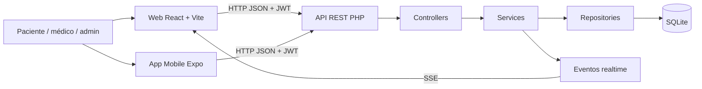
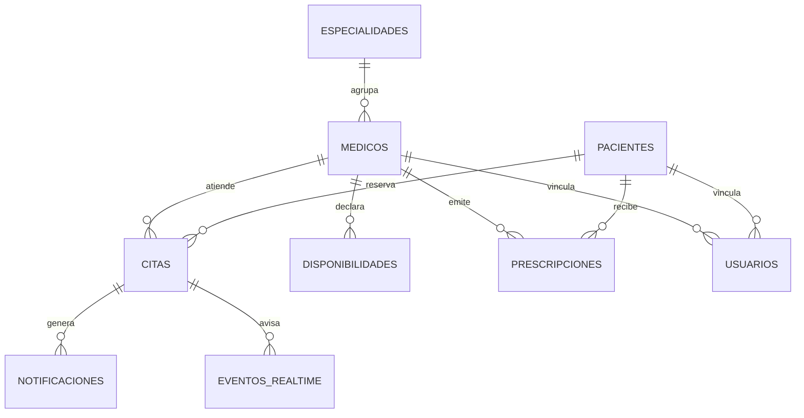
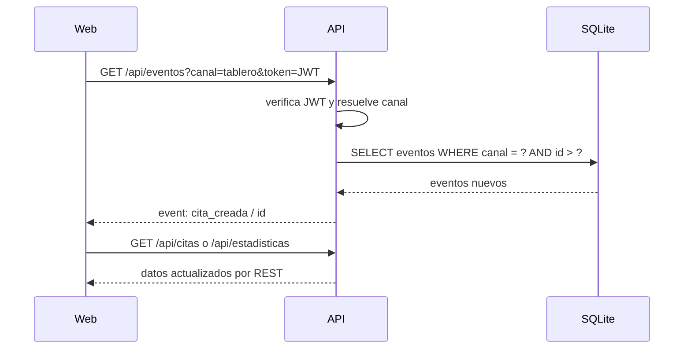

# Cómo defender un proyecto profesional aplicado a SaludWEB

**Guía de origen:** *Cómo Defender un Proyecto Profesional* 
**Proyecto:** SaludWEB (Backend PHP/SQLite, Web React y Mobile React Native/Expo) 
**Autora:** Ailen Adriana Quaglino Fail 
**Carrera:** Tecnicatura en Programación 
**Institución:** UTN Facultad Regional Paraná 
**Fecha de la aplicación:** 25/10/2026

---

## Índice

0. [Introducción: qué significa defender](#0-introducción-qué-significa-defender)
1. [Qué evalúa realmente una defensa](#1-qué-evalúa-realmente-una-defensa)
2. [El problema antes del código](#2-el-problema-antes-del-código)
3. [Arquitectura cliente-servidor](#3-arquitectura-cliente-servidor)
4. [Justificar las tecnologías con criterio](#4-justificar-las-tecnologías-con-criterio)
5. [Seguridad y autenticación](#5-seguridad-y-autenticación)
6. [Base de datos, integridad y tiempo real](#6-base-de-datos-integridad-y-tiempo-real)
7. [Mostrar decisiones, no pantallas](#7-mostrar-decisiones-no-pantallas)
8. [Guion de defensa](#8-guion-de-defensa)
9. [Preguntas difíciles y respuestas](#9-preguntas-difíciles-y-respuestas)
10. [Checklist y ensayo](#10-checklist-y-ensayo)
11. [Límites, deuda técnica y mejoras](#11-límites-deuda-técnica-y-mejoras)
12. [Trazabilidad y fuentes](#12-trazabilidad-y-fuentes)

---

## 0. Introducción: qué significa defender

Defender un proyecto no es recitar tecnologías ni mostrar que “todo funciona”. Es demostrar cuatro cosas a la vez:

1. **Que entendés el problema** que el sistema resuelve, para quién y por qué vale la pena.
2. **Que entendés cómo está construido**, incluso las partes que no escribiste en la última semana.
3. **Que tomaste decisiones con criterio**, no por moda, y que conocés sus costos.
4. **Que podés comunicar todo eso** con claridad, sin esconderte detrás de la jerga.

La defensa es una conversación técnica con evidencia. El evaluador no quiere que sepas todo de memoria: quiere comprobar si podés explicar, justificar, reconocer límites y razonar sobre alternativas. Un proyecto chico bien entendido se defiende mejor que un proyecto enorme que su autor no puede explicar.

Este documento aplica esa idea a **SaludWEB**. No reemplaza el código, los README, la guía de producción y defensa ni los documentos de cada materia. Los complementa con una preparación específica para la instancia oral.

> **Regla de oro:** si no podés explicar una decisión en dos minutos, con un problema, una alternativa y un costo, todavía no la tenés incorporada.

### 0.1. Las tres clases de afirmaciones

En este documento se distinguen tres niveles. Conviene usarlos también en la defensa:

| Nivel | Qué significa | Cómo se reconoce |
|---|---|---|
| **Hecho verificado** | Surge del repositorio o de una prueba ejecutada | Se cita como `archivo:línea` o con el resultado de un comando |
| **Decisión de diseño** | Es una elección tomada, con ventajas y costos | Se explica con “elegí esto porque…” y “el costo es…” |
| **Propuesta o deuda** | Es una mejora pendiente, no algo ya implementado | Se dice “hoy no está” o “la próxima iteración sería…” |

La defensa gana credibilidad cuando separa los tres. Mezclar una propuesta con un hecho es la forma más rápida de que una respuesta correcta se vuelva sospechosa.

### 0.2. Qué se defiende y qué no

**Se defiende:** el problema, el alcance, la arquitectura, las reglas de negocio, la seguridad, los datos, las decisiones de interfaz, las pruebas y los límites.

**No se defiende:** que el sistema sea perfecto, que tenga todas las funciones imaginables o que la tecnología elegida sea la mejor del mundo. Ninguna de esas cosas es cierta en ningún proyecto real.

**Tampoco se defiende con capturas de pantalla.** Las pantallas muestran resultados. La defensa tiene que mostrar por qué esos resultados existen y qué decisiones los hicieron posibles.

---

## 1. Qué evalúa realmente una defensa

Una defensa profesional se parece más a una revisión de ingeniería que a un examen oral de definiciones. El evaluador suele mirar cinco dimensiones.

| Dimensión | Qué busca | Cómo se evidencia en SaludWEB |
|---|---|---|
| **Comprensión del problema** | Que expliques el dolor real antes de la solución | Problema del `PROJECT_BRIEF.md:20-31`, usuarios y alcance en `PROJECT_BRIEF.md:54-82` |
| **Dominio técnico** | Que sepas cómo viaja una petición y dónde vive cada regla | Flujo `index.php` → `routes.php` → controller → service → repository → SQLite |
| **Criterio de ingeniería** | Que justifiques decisiones y reconozcas costos | Elección de SQLite, JWT, SSE, React y Expo, con alternativas y límites |
| **Calidad y evidencia** | Que no digas “funciona” sin poder demostrarlo | Suites `php tests/run.php`, `probar_turnera.php`, `probar_seguridad.php`, builds de Web/Mobile |
| **Comunicación** | Que puedas explicar lo complejo sin humo | Discurso de problema, demo guiada, respuestas honestas y cierre claro |

### 1.1. La diferencia entre “sé usar” y “sé defender”

| “Sé usar” | “Sé defender” |
|---|---|
| “Usé React y PHP.” | “Elegí React para una SPA que consume una API común, y PHP nativo para mantener explícita la arquitectura de capas.” |
| “Tiene JWT.” | “El token va firmado con HS256, dura una hora por defecto y el middleware diferencia autenticación (401) de autorización (403).” |
| “Anda la turnera.” | “La turnera valida disponibilidad, solapamiento y una cita viva por paciente; además, un índice UNIQUE resuelve la carrera entre dos reservas simultáneas.” |
| “La base es SQLite.” | “SQLite elimina la administración de un motor, pero serializa escrituras; es adecuada para este volumen y tiene un camino de migración a PostgreSQL.” |

### 1.2. La defensa no es una demo larga

La demo sirve para anclar la explicación, no para reemplazarla. Una defensa con veinte minutos de clics y dos minutos de arquitectura transmite lo contrario de lo que se busca: muestra que el sistema anda, pero no que su autor lo entiende.

La estructura recomendada es:

- **20 % problema y alcance.**
- **30 % demo con decisiones.**
- **35 % arquitectura, seguridad y datos.**
- **15 % límites, aprendizaje y cierre.**

La demo de tres minutos que ya está en `README.md:544-551` sirve para una feria o una charla breve. Para una defensa académica conviene una versión de 8 a 10 minutos, con pausas para explicar decisiones.

---

## 2. El problema antes del código

### 2.1. La historia que hay que contar

Imaginá un consultorio que agenda por teléfono, anota en papel y guarda las recetas en una carpeta. El paciente llama en horario de atención, espera, y muchas veces no sabe si el turno quedó reservado. El médico tiene su agenda en una planilla que alguien actualiza a mano. El administrador no puede responder rápido cuántos turnos hay, cuánta gente falta o cuánto se usa la reserva online. Y una receta puede terminar escrita por alguien que no es médico, lo que no es un detalle administrativo: es un problema de seguridad clínica.

Ese es el punto de partida de SaludWEB. No es “una app de turnos”; es una forma de ordenar información sensible, evitar duplicaciones y hacer cumplir reglas que en papel dependen de la memoria o de la buena voluntad.

El `PROJECT_BRIEF.md:20-31` lo resume en cinco dolores:

- duplicación de datos y errores de tipeo;
- dificultad para encontrar el historial de prescripciones;
- riesgo de que personas sin rol médico generen recetas;
- imposibilidad de consultar el sistema desde el celular;
- datos desactualizados en pantalla.

### 2.2. Los usuarios y lo que gana cada uno

| Usuario | Situación anterior | Qué gana con SaludWEB |
|---|---|---|
| **Paciente** | Llama en horario limitado, no sabe si quedó anotado | Reserva 24 h desde la web o el celular, consulta y cancela sus turnos |
| **Médico** | Agenda en papel o planilla, llamadas para confirmar | Ve su agenda actualizada y registra el estado del turno |
| **Administrador** | Datos dispersos, poca visibilidad | Gestiona usuarios, profesionales, turnos y ve indicadores de gestión |
| **Consultorio** | Reglas dependientes de personas | Reglas de negocio aplicadas en el backend, con trazabilidad |

La tabla de beneficios que ya está en `README.md:526-532` es buena para una conversación no técnica. Para la defensa técnica hay que agregar una frase: **esos beneficios no son adornos de interfaz; son consecuencias de reglas implementadas en el servidor**.

### 2.3. Objetivo, alcance y exclusiones

El objetivo general está en `PROJECT_BRIEF.md:33-52`: administrar pacientes, médicos y prescripciones con control de acceso por roles, desde una SPA y una app móvil.

El alcance incluye:

- CRUD de pacientes, médicos y prescripciones;
- prescripciones digitales con la regla “solo un médico receta”;
- cambio de estado de prescripciones;
- búsqueda y paginado resueltos en el backend;
- autenticación JWT con roles `admin`, `medico` y `paciente`;
- interfaces responsivas;
- turnera con agenda, reserva, cancelación y estados;
- panel en vivo con SSE;
- app móvil que consume la misma API;
- PWA, biometría y SSO como módulos del ciclo final.

El alcance **no** incluye, y conviene decirlo antes de que lo pregunten:

- historia clínica completa;
- facturación u obras sociales integradas;
- módulo de farmacia con rol farmacéutico;
- envío real de correos o SMS;
- hosting productivo con dominio propio y soporte 24/7.

Reconocer el alcance no debilita la defensa: la vuelve creíble. Un sistema que promete todo suele no cumplir nada.

### 2.4. El discurso de apertura en 60 segundos

> “SaludWEB es un sistema de gestión de salud que centraliza pacientes, médicos, turnos y prescripciones. El problema no era solo ‘digitalizar formularios’: había datos duplicados, agendas difíciles de coordinar y recetas que podían generarse sin rol médico. La solución es una API REST en PHP con SQLite, una SPA en React y una app móvil en Expo que consumen el mismo backend. Lo importante es que las reglas viven en el servidor: el paciente solo puede reservar para sí mismo, un turno no se superpone con otro, y solo un médico puede crear una prescripción. La web y la app son dos ventanas distintas al mismo sistema, no dos sistemas distintos.”

Ese párrafo tiene problema, solución, arquitectura y una regla concreta. No menciona tecnologías porque sí: cada una aparece cumpliendo un papel.

---

## 3. Arquitectura cliente-servidor

### 3.1. Vista general

SaludWEB es una **API REST en capas** con dos clientes:

- **Web:** SPA React que consume JSON.
- **Mobile:** app Expo/React Native que consume la misma API.

No es un MVC clásico con vistas generadas en el servidor. El backend no devuelve HTML: devuelve JSON. La interfaz vive en los clientes.

### 3.2. El recorrido de una petición

Tomemos `POST /api/citas`, que reserva un turno:

1. **Entrada:** `index.php:7-11` carga la configuración y despacha la petición.
2. **Router:** `core/Router.php:13-27` resuelve el método y la ruta.
3. **Composición:** `core/bootstrap.php:232-312` construye PDO, repositorios, servicios y controladores.
4. **Middleware:** `routes.php:625-627` exige un JWT válido con `verificarToken()`.
5. **Controller:** `CitaController` traduce HTTP a una llamada de servicio.
6. **Service:** `CitaService::crear()` valida reglas de negocio (`services/CitaService.php:451-695`).
7. **Repository:** ejecuta SQL preparado contra SQLite.
8. **Response:** devuelve un envelope JSON con datos, mensaje y código HTTP.

Ese recorrido es la respuesta a “¿cómo funciona?”. Si el evaluador pregunta “¿dónde está la regla de que un paciente no puede reservar para otro?”, la respuesta no es “en el frontend”: está en `services/CitaService.php:456-473`.

### 3.3. Por qué esta arquitectura

| Decisión | Motivo | Costo |
|---|---|---|
| **API REST separada de los clientes** | Una sola fuente de verdad para Web y Mobile | Hay que mantener el contrato JSON y CORS |
| **Capas controller → service → repository** | Las reglas no dependen de HTTP ni del motor de base | Más archivos y composición manual |
| **Frontend SPA** | Interacción fluida, componentes reutilizables | Más complejidad de estado y autenticación |
| **App móvil con la misma API** | No se duplica la lógica de negocio | Las limitaciones nativas se resuelven en el cliente |
| **Monolito en capas** | Es suficiente para el tamaño y el equipo del proyecto | No separa despliegues por módulo |

**Lo que no es:** no es microservicios, no es serverless y no tiene una capa de mensajería externa. No hace falta. Un monolito bien separado es una decisión de ingeniería, no una versión pobre de otra cosa.

### 3.4. HTTP, JSON y códigos de estado

La API usa el envelope de `core/Response.php:12-13`. Los códigos que más se defienden son:

| Código | Cuándo se usa | Ejemplo |
|---|---|---|
| **200** | Operación exitosa con datos | Listar turnos |
| **201** | Recurso creado | Alta de paciente o prescripción |
| **204** | Sin contenido | Preflight CORS |
| **401** | No autenticado o token inválido/expirado | Falta `Authorization: Bearer` |
| **403** | Autenticado, pero sin permiso | Paciente intenta crear un médico |
| **404** | El recurso no existe o no se quiere revelar | Turno ajeno consultado por un paciente |
| **409** | Conflicto de negocio | Horario ya reservado |
| **422** | Datos inválidos | Fecha en el pasado o rol inexistente |
| **429** | Demasiados intentos | Login bloqueado por rate limiting |

La diferencia entre **401** y **403** es una pregunta clásica. La respuesta corta: **401 es “no sé quién sos”; 403 es “sé quién sos, pero no podés hacer esto”**. En el código, `AuthMiddleware::verificarToken()` produce 401 (`core/AuthMiddleware.php:29-75`) y `requireRol()` produce 403 (`core/AuthMiddleware.php:80-105`).

### 3.5. CORS y por qué no se usa `*`

`routes.php:21-59` define una whitelist de orígenes. Si el navegador manda un `Origin` que no está en la lista, no se devuelven las cabeceras CORS y el navegador bloquea la respuesta. No se usa `Access-Control-Allow-Origin: *` con credenciales porque esa combinación es inválida y, además, convertiría cualquier sitio en un cliente autorizado.

La Web en desarrollo usa el proxy de Vite con URL base vacía (`src/api/client.js:12-46`). En producción usa una URL absoluta configurada por `VITE_API_URL` y el backend debe tener ese origen en `CORS_ORIGINS`. Esa diferencia es una decisión de entorno, no un capricho: evita CORS en desarrollo y lo exige explícitamente en producción.

### 3.6. La arquitectura en una frase

> “El cliente pide, el servidor decide y la base guarda. La interfaz puede cambiar; las reglas no se mueven de capa.”

---

## 4. Justificar las tecnologías con criterio

Una defensa débil dice “usé React porque es el estándar” o “usé SQLite porque es más fácil”. Una defensa profesional compara alternativas y reconoce costos.

### 4.1. Criterios de elección

Antes de justificar una tecnología, conviene nombrar los criterios:

1. **Problema que resuelve.**
2. **Alternativas reales.**
3. **Costo de adopción y mantenimiento.**
4. **Encaje con el equipo y el despliegue.**
5. **Camino de salida si el proyecto crece.**

### 4.2. Tabla de decisiones

| Tecnología | Para qué se eligió | Alternativa | Por qué se eligió | Costo / cuándo cambiar |
|---|---|---|---|---|
| **PHP 8 nativo** | API REST y reglas de negocio | Laravel, Symfony | El proyecto es académico y se buscó entender el recorrido HTTP, el routing y la composición sin magia de framework | Más código manual de routing, validación y composición; un framework tendría sentido al crecer el equipo |
| **SQLite** | Persistencia local | MySQL, PostgreSQL | Un solo archivo, sin servidor, ideal para desarrollo y demo; WAL y `busy_timeout` para concurrencia moderada | Serializa escrituras; migrar a PostgreSQL si hay muchas escrituras concurrentes o varios servidores |
| **React + Vite** | SPA Web | Server-side rendering, Next.js | Componentes, estado de sesión, ruteo y build simple; no se necesita SEO | La autenticación y el estado del cliente agregan complejidad |
| **Expo / React Native** | App móvil | Android nativo, Flutter | Reutiliza el conocimiento de React y consume la misma API | Limitaciones de módulos nativos y de automatización de pruebas |
| **JWT (HS256)** | Autenticación entre clientes | Sesiones con cookies | Funciona bien con SPA y app móvil; el servidor no guarda sesión en el camino principal | No hay revocación inmediata ni refresh implementado; el token vive en el cliente |
| **SSE** | Avisos en vivo al panel | Polling, WebSocket | Es unidireccional, nativo del navegador y más simple que WebSocket para “avisá que algo cambió” | Una conexión abierta por cliente; en `php -S` bloquea el servidor |
| **PDO con SQL preparado** | Acceso a datos | ORM | Control explícito del SQL y defensa contra inyección | Más SQL manual y mapeo |

### 4.3. Las justificaciones que hay que evitar

| Justificación débil | Por qué falla | Versión defendible |
|---|---|---|
| “Es el más usado.” | Popularidad no es un requisito del problema | “Elegí React porque el equipo ya lo conocía y la SPA necesitaba estado de sesión y componentes reutilizables.” |
| “Es más fácil.” | “Fácil” para quién y para qué | “SQLite elimina la administración de un motor y alcanza para el volumen de una demo; el costo es la concurrencia de escritura.” |
| “Es más seguro.” | Seguridad no es una propiedad automática | “JWT firmado evita que el cliente invente el rol; además el backend valida permisos y propiedades del dato.” |
| “Porque lo pide la cátedra.” | Puede ser cierto, pero no explica nada | “La consigna pedía PHP y SQLite; dentro de esa restricción separé capas y mantuve el SQL parametrizado.” |

### 4.4. “¿Por qué no usaste un framework?”

Respuesta recomendada:

> “Porque el objetivo del proyecto era entender y poder defender el recorrido completo de una petición. Con Laravel o Symfony habría ganado velocidad, pero también habría delegado routing, validación y composición en código que no escribí. Para este alcance, PHP nativo con capas explícitas me obligó a tomar decisiones visibles. Si el equipo creciera o el proyecto pasara a producción con más funcionalidades, migrar a un framework o a un ORM sería una decisión razonable.”

### 4.5. “¿Por qué SQLite y no MySQL?”

Respuesta recomendada:

> “SQLite resuelve el problema de persistencia sin instalar ni administrar un servidor: la base es un archivo, se crea sola y el backup es copiar ese archivo. Para el volumen de una demo y para el despliegue académico, eso reduce la superficie de error. El costo es que las escrituras se serializan y no está pensada para alta concurrencia de escritura. Si el sistema tuviera muchos consultorios escribiendo a la vez, migraría a PostgreSQL; el esquema relacional y el SQL parametrizado ya están preparados para ese cambio.”

---

## 5. Seguridad y autenticación

### 5.1. Autenticación no es autorización

| Concepto | Pregunta | En SaludWEB |
|---|---|---|
| **Autenticación** | ¿Quién sos? | Login con email y contraseña, o SSO; el backend emite un JWT |
| **Autorización** | ¿Qué podés hacer? | `requireRol()` y reglas de propiedad en los servicios |

Confundirlas produce respuestas malas. “Tiene token” no significa “puede hacer cualquier cosa”. El token dice quién es; el backend decide qué puede.

### 5.2. Registro y contraseñas

- `AuthService::registro()` usa `password_hash($password, PASSWORD_BCRYPT)` (`services/AuthService.php:87-89`).
- El rol `admin` **no** se acepta en el alta pública (`services/AuthService.php:93-106`). Si se aceptara, cualquiera podría registrarse como administrador.
- El hash se guarda; la contraseña en texto plano no se persiste ni se devuelve.
- El login compara con `password_verify()` (`services/AuthService.php:201-215`).
- Si el email no existe o la contraseña no coincide, el mensaje es el mismo: “Email o contraseña inválidos” (`services/AuthService.php:197-215`). Eso evita enumerar cuentas.
- El rate limiter permite 5 intentos por IP en 900 segundos y responde 429 (`controllers/AuthController.php:63-103`).

### 5.3. Qué es y qué no es un JWT

El token se genera en `core/JwtService.php:48-72` con:

- `iss`: emisor `saludweb-api`;
- `iat`: momento de emisión;
- `exp`: expiración (3600 segundos por defecto, configurable por `JWT_TTL`);
- `sub`: id del usuario;
- `rol`: rol del usuario;
- `email` y `nombre`: datos de presentación.

No lleva contraseña ni datos clínicos. Está firmado con HS256 y un secreto que, en producción, debe venir de `JWT_SECRET`; en desarrollo se guarda en `storage/secret.key` (`core/Secret.php`). La verificación comprueba firma y expiración (`core/JwtService.php:81-86`).

**JWT no cifra el contenido.** Cualquiera que tenga el token puede leer los claims; lo que no puede es modificarlos sin invalidar la firma. Por eso no se ponen datos sensibles ahí y por eso el transporte debe ser HTTPS en producción.

### 5.4. El recorrido de una petición autenticada

1. El cliente guarda el token (Web: `localStorage`; Mobile: `AsyncStorage`).
2. Axios o el cliente móvil agrega `Authorization: Bearer <token>` (`src/api/client.js:89-104`; `SaludWEB_Mobile/src/api/client.js:47-66`).
3. `AuthMiddleware::verificarToken()` extrae el header (`core/AuthMiddleware.php:119-143`), verifica firma y expiración, y devuelve el payload.
4. Si el token falta, está vencido o fue manipulado: 401.
5. Si la ruta exige un rol, `requireRol()` compara el claim `rol` con la lista permitida: 403 si no coincide.

### 5.5. Autorización por rol y por dato

Hay dos niveles:

**Por rol:** `requireRol($payload, ['admin'])` protege rutas administrativas; `requireRol($payload, ['medico'])` protege la creación y edición de prescripciones (`routes.php:277-312`, `409-443`, `472`, `653`, `706`, `739-762`, `802-818`).

**Por dato:** no alcanza con “sos paciente”; hay que verificar “esta cita es tuya”. Eso está en `services/CitaService.php:1027-1052`:

- admin: puede operar sobre cualquier cita;
- paciente: solo si `id_paciente` coincide con el del token;
- médico: solo si `id_medico` coincide con el del token;
- cualquier otro: 403.

También se impide que un paciente reserve para otro: el `id_paciente` del body se descarta y se impone el del token (`services/CitaService.php:456-473`).

### 5.6. Matriz de amenazas y controles

| Amenaza | Control actual | Límite o deuda |
|---|---|---|
| **Fuerza bruta** | Rate limit 5/15 min por IP (`AuthController.php:63-103`) | Se puede eludir con IPs distribuidas; no hay CAPTCHA ni bloqueo por cuenta |
| **Enumeración de cuentas** | Mensaje genérico de login | El registro puede revelar si un email ya existe; es un compromiso de usabilidad |
| **Contraseñas débiles** | Mínimo de 6 caracteres (`AuthService.php:558`) | No hay política de complejidad ni verificación contra filtraciones |
| **Robo de token** | TTL de 1 hora, HTTPS en producción, `no-store` en SSE | Token en `localStorage` es vulnerable a XSS; no hay refresh ni revocación inmediata |
| **Escalada de privilegios** | `requireRol()`, alta pública sin admin, id de paciente desde el token | Pacientes y prescripciones tienen rutas que solo exigen token (ver 5.8) |
| **Inyección SQL** | PDO con consultas preparadas | Hay que mantener la disciplina: no concatenar SQL |
| **XSS** | React escapa por defecto; `Validador` sanea campos; headers `X-Content-Type-Options`, `X-Frame-Options`, `Referrer-Policy` | No hay CSP; el token en `localStorage` amplifica el impacto de un XSS |
| **CSRF** | El camino principal usa `Authorization: Bearer`, no cookies | El fallback de sesión PHP en `AuthController` merece revisión |
| **CORS** | Whitelist explícita (`routes.php:21-59`) | Si se configura mal `CORS_ORIGINS`, se rompe el cliente o se habilita un origen indebido |
| **Datos en logs** | Logger enmascara datos y redacta secretos (README:503-507) | Hay que revisar cada nuevo log; no es automático |
| **Fuerza bruta en SSO** | Rate limit por IP y validación de firma/aud/iss | Depende de la disponibilidad del proveedor |

### 5.7. La respuesta de 60 segundos a “¿cómo sabe el sistema quién sos?”

> “Cuando el usuario hace login, el backend verifica la contraseña contra un hash bcrypt y emite un JWT firmado con HS256. El token lleva el id, el rol y la expiración, pero no la contraseña ni datos clínicos. En cada petición protegida, el cliente manda `Authorization: Bearer <token>`; el middleware verifica firma y expiración. Si el token no es válido, responde 401. Si es válido pero el rol no alcanza, responde 403. Además, en la turnera no alcanza con el rol: el servicio verifica que la cita pertenezca al paciente o al médico del token. Eso evita que alguien opere sobre un id ajeno.”

### 5.8. Deuda de autorización que hay que reconocer

La seguridad no se defiende diciendo que no hay fallas. Se defiende mostrando que se conocen y se priorizan. En SaludWEB quedan tres brechas claras:

1. **Pacientes:** `GET/POST/PUT/PATCH /api/pacientes` solo exigen token (`routes.php:141-179`, `318-357`). Un paciente autenticado podría listar o modificar pacientes. La lectura se justificó para el selector de prescripciones del médico, pero la escritura debería ser admin.
2. **Prescripciones:** `GET /api/prescripciones` y `GET /api/prescripciones/{id}` solo exigen token (`routes.php:375-401`). Un paciente podría leer prescripciones ajenas. La creación/edición sí exige rol médico (`routes.php:403-443`), pero la lectura no está acotada por paciente.
3. **Cambio de estado de prescripción:** `PATCH /api/prescripciones/{id}/estado` solo exige token (`routes.php:453-456`). Debería restringirse a médico/admin según la regla de negocio.

La respuesta madura es:

> “Hoy la regla crítica de recetas está protegida en creación y edición, y la turnera tiene autorización por dato. Quedan brechas de lectura y de cambio de estado en prescripciones, y de escritura en pacientes. Están documentadas como deuda prioritaria; la corrección es acotada: agregar `requireRol()` y filtrar por `id_paciente`/`id_medico` del token.”

### 5.9. “¿Cómo invalida el logout un JWT?”

Respuesta honesta:

> “El logout actual limpia el token del cliente y destruye la sesión PHP (`controllers/AuthController.php:303-309`), pero no revoca el JWT en el servidor. Un token robado podría seguir siendo válido hasta su expiración. Para producción implementaría una lista de revocación o un `token_version` por usuario, y un refresh token con rotación. Hoy el TTL corto reduce la ventana, pero no elimina el problema.”

Esta respuesta vale más que decir “el logout lo invalida” cuando el código no lo hace.

### 5.10. “¿Qué harías primero si tuvieras una semana de seguridad?”

Orden recomendado:

1. Restringir escritura de pacientes a admin y lectura de prescripciones por paciente/médico.
2. Restringir cambio de estado de prescripción a médico/admin.
3. Agregar revocación de JWT y refresh token.
4. Migrar el token a una cookie `HttpOnly` o a un almacenamiento con protección frente a XSS.
5. Agregar CSP y HSTS en producción.
6. Agregar pruebas de autorización por recurso, no solo por rol.
7. Revisar el fallback de sesión PHP y unificar el modelo de autenticación.

---

## 6. Base de datos, integridad y tiempo real

### 6.1. Modelo de datos

Las tablas principales están en `db.php`:

- `pacientes`, `medicos`, `especialidades`, `disponibilidades`;
- `citas`, `prescripciones`, `medicamentos`;
- `usuarios`, `notificaciones`, `auditoria`;
- `eventos_realtime`.

### 6.2. Integridad antes que “arreglarlo en el código”

La base no es un depósito pasivo. Impone reglas:

| Regla | Dónde | Qué evita |
|---|---|---|
| `PRAGMA foreign_keys = ON` | `db.php:147` | Huérfanos y referencias inválidas |
| `UNIQUE` en DNI y email | `db.php:213`, `db.php:287` | Duplicados de identidad |
| `CHECK` de roles | `db.php:285-293` | Roles inventados |
| `UNIQUE (id_medico, fecha, hora, slot_reservado)` | `db.php:392-407` | Dos citas vivas en el mismo horario |
| Índices por paciente, médico, estado y fecha | `db.php:409-411` | Escaneos completos en listados |
| Trigger de `actualizado_at` | `db.php:426` | Fechas de modificación olvidadas |
| `UNIQUE (id_cita, tipo, canal)` en notificaciones | `db.php:458-471` | Recordatorios duplicados |

Una regla en la base no reemplaza la validación en el servicio: la complementa. El servicio da un mensaje entendible; la base garantiza que, incluso con dos procesos simultáneos, el dato inválido no entre.

### 6.3. Cómo se guarda una reserva, paso a paso

`CitaService::crear()` (`services/CitaService.php:451-695`) hace esto:

1. **Quién reserva:** si el rol es paciente, el `id_paciente` sale del token; el del body se descarta.
2. **Formato:** valida paciente, médico, fecha y hora.
3. **Pasado y futuro:** no permite fechas pasadas ni más de 60 días de anticipación (`services/CitaService.php:518-532`).
4. **Existencia y estado:** paciente y médico deben existir y estar activos.
5. **Agenda:** el médico debe tener un bloque de disponibilidad que contenga la hora (`services/CitaService.php:558-581`).
6. **Solapamiento:** recorre las citas del día y compara intervalos `[inicio, fin)` (`services/CitaService.php:587-612`).
7. **Doble turno del paciente:** verifica que el paciente no tenga otra cita viva en el mismo horario (`services/CitaService.php:618-635`).
8. **Guardado:** inserta con `slot_reservado = 'reservado'`.
9. **Carrera:** si el `INSERT` viola el índice único, PDO devuelve `23000` y el servicio traduce a 409 (`services/CitaService.php:669-681`).
10. **Aviso:** publica el evento después de guardar, nunca antes (`services/CitaService.php:683-694`).

### 6.4. La pregunta de la carrera: “¿y si dos reservan a la vez?”

Esta es una de las mejores preguntas para demostrar criterio.

Respuesta:

> “Las dos peticiones pueden pasar la validación en memoria al mismo tiempo. Por eso la garantía final no es el `if` del servicio, sino el índice `UNIQUE (id_medico, fecha, hora, slot_reservado)`. SQLite acepta el primer `INSERT` y rechaza el segundo con violación de unicidad. El servicio captura ese error y devuelve 409: ‘Ese horario acaba de ser reservado por otro paciente’. La validación en el servicio mejora el mensaje; la base garantiza la integridad.”

Ese es el tipo de respuesta que separa “hice un CRUD” de “entendí concurrencia”.

### 6.5. Por qué `slot_reservado` existe

El índice único incluye una cuarta columna que vale `'reservado'` mientras la cita ocupa el horario y `NULL` cuando se cancela o el paciente falta. En SQLite y MySQL, los `NULL` no se consideran duplicados entre sí en un índice único. Eso permite conservar el histórico de citas canceladas sin bloquear el mismo horario para una nueva reserva.

La explicación está en `db.php:300-327`. Es una solución simple y defendible: no se borra la cita, se libera el slot.

### 6.6. Transacciones: qué hay y qué falta

La operación crítica de la turnera se apoya en una escritura atómica y en el índice único. No se necesita una transacción larga para reservar. Para operaciones que tocan varias tablas a la vez —por ejemplo, crear una cita y una notificación— conviene envolver todo en `beginTransaction()`/`commit()` con `rollBack()` ante error.

**Respuesta honesta:** “La reserva crítica está protegida por el índice único. Las operaciones multi-tabla que agreguen notificaciones o auditoría deberían usar transacción explícita; hoy no todas lo hacen.”

### 6.7. Paginación, búsqueda e índices

Los listados se resuelven en el backend, no en el cliente. Eso evita descargar toda la tabla y permite que la UI sea predecible. Los índices de `db.php:409-411` acompañan las consultas por paciente, médico, estado y fecha.

La paginación no es un detalle estético: es una decisión de rendimiento y de memoria. Si el evaluador pregunta “¿qué pasa con 100.000 pacientes?”, la respuesta es: “el listado sigue paginado; el problema sería la concurrencia de escritura de SQLite, no el tamaño de la tabla”.

### 6.8. Backups y recuperación

La base es un archivo (`storage/saludweb.sqlite`). El backup mínimo es una copia consistente del archivo; con WAL conviene usar la API de backup de SQLite o hacer un checkpoint antes de copiar. Un backup no probado no es un backup: hay que restaurarlo en otra carpeta y verificar que la API arranca y que los datos están.

En producción, la política sería:

- copia diaria;
- retención mínima de 7 días;
- 3 copias, 2 soportes, 1 fuera del sitio;
- prueba de restauración periódica;
- backups cifrados, porque son datos de salud.

### 6.9. Tiempo real: polling, SSE o WebSocket

| Opción | Ventaja | Costo | Uso en SaludWEB |
|---|---|---|---|
| **Polling** | Simple, funciona en cualquier servidor | Latencia y peticiones repetidas | Fallback y modo desarrollo cada 5 s |
| **SSE** | Unidireccional, nativo, reconexión del navegador | Una conexión abierta por cliente; no sirve para enviar datos al servidor | Canal `/api/eventos` |
| **WebSocket** | Bidireccional, baja latencia | Más complejidad de infraestructura y estado | No se usa; no se necesita para avisar cambios |

La guía lo dice claro: no se elige WebSocket “porque es más moderno”. Se elige SSE porque el problema es “el servidor avisa que algo cambió”, no “el cliente y el servidor conversan en tiempo real”.

### 6.10. Cómo funciona el canal en vivo

El evento **no lleva el estado completo**. Lleva el tipo y los identificadores mínimos. El cliente recibe el aviso y vuelve a pedir los datos por REST. Eso evita tener dos copias de la misma verdad y evita que el canal SSE se convierta en una segunda base de datos.

La tabla `eventos_realtime` es un outbox: guarda la señal, no el dato clínico (`db.php:500-527`). El servicio decide los canales (`services/RealtimeService.php:138-163`), autoriza el canal a partir del token (`services/RealtimeService.php:188-264`) y purga eventos viejos cada 25 publicaciones (`services/RealtimeService.php:47-63`).

### 6.11. Canales y autorización

| Canal | Quién puede escucharlo | Qué recibe |
|---|---|---|
| `tablero` | Admin y médico | Cambios de turnos para indicadores |
| `mis-turnos` | Paciente con ficha vinculada | Cambios de sus propios turnos |
| `mi-agenda` | Médico con ficha vinculada | Cambios de su agenda |
| `agenda:<id>` | Solo admin | Agenda de un profesional puntual |

El cliente pide un canal declarativo; el backend traduce el id desde el token. Si el cliente pidiera `agenda:7` siendo médico, recibiría 403. Esa es la diferencia entre un canal y una dirección pública.

### 6.12. La limitación de desarrollo que hay que saber explicar

`php -S` atiende una petición por vez. Si se abre una conexión SSE, el servidor queda ocupado y la API deja de responder. Por eso el hook `useEventosRealtime.js:11-36` usa sondeo cada 5 segundos en desarrollo y SSE real en el build de producción, donde se espera Apache/nginx + PHP-FPM. `RealtimeController` cierra el canal a los 300 segundos y libera la sesión antes del bucle (`controllers/RealtimeController.php:85`, `250-364`).

**Respuesta recomendada:** “No es que SSE no funcione; es que el servidor de desarrollo de PHP es de un solo hilo. En producción, con PHP-FPM, el canal es real. En desarrollo se simula con sondeo para no bloquear la API.”

### 6.13. “¿Qué pasa si se cae el canal?”

- El cliente reconecta con espera creciente (`src/api/realtime.js:177-225`).
- Si el evento no llega, la pantalla puede recargar por REST.
- Si publicar el evento falla, la reserva no se revierte: el aviso es un extra, no parte de la transacción de negocio (`services/CitaService.php:827-846`).
- Los eventos viejos se purgan; no crecen para siempre.

### 6.14. “¿Cómo escalaría?”

1. Migrar SQLite a PostgreSQL si hay escrituras concurrentes o varios servidores.
2. Servir la API con PHP-FPM y varios workers.
3. Mantener SSE con un broker (Redis pub/sub) si hay más de un servidor.
4. Cachear catálogos y estadísticas si el volumen crece.
5. Separar jobs de notificaciones del request principal.
6. Agregar métricas, trazas y alertas; hoy hay logs y correlación, pero no observabilidad de producción.

---

## 7. Mostrar decisiones, no pantallas

### 7.1. La regla

Para cada pantalla que se muestre, hay que poder responder:

1. **¿Qué problema resuelve?**
2. **¿Qué decisión se tomó?**
3. **¿Dónde está implementada?**
4. **¿Qué resultado produce?**
5. **¿Qué límite tiene?**

Si solo se puede responder “se ve lindo” o “funciona”, no es una decisión: es una captura.

### 7.2. Turnera pública

| Aspecto | Detalle |
|---|---|
| **Problema** | El paciente no puede ver disponibilidad sin llamar |
| **Decisión** | La disponibilidad es pública; los datos personales no |
| **Implementación** | `GET /api/citas/disponibilidad` (`routes.php:551-558`); `CitaService::obtenerDisponibilidad()` |
| **Resultado** | El paciente elige médico, fecha y horario antes de registrarse |
| **Límite** | La reserva sí exige sesión y ficha de paciente vinculada |

**Qué decir:** “No oculté la disponibilidad detrás del login porque el primer paso del paciente es ver si hay turno. Lo que sí protegí es la reserva y los datos personales.”

### 7.3. Login y registro

| Aspecto | Detalle |
|---|---|
| **Problema** | Hay que identificar al usuario sin filtrar si una cuenta existe |
| **Decisión** | Error genérico, bcrypt, rate limit y alta pública sin admin |
| **Implementación** | `services/AuthService.php:87-215`; `controllers/AuthController.php:63-103` |
| **Resultado** | Credenciales inválidas no revelan el motivo; el admin no se auto-registra |
| **Límite** | No hay MFA; el registro puede revelar un email duplicado |

**Qué decir:** “La seguridad no está solo en el hash: está en el mensaje, en el límite de intentos y en no permitir que el rol más privilegiado se cree desde la calle.”

### 7.4. Dashboard

| Aspecto | Detalle |
|---|---|
| **Problema** | El administrador necesita ver demanda, ocupación, ausentismo y autogestión sin recargar |
| **Decisión** | KPIs por rol, datos por REST y aviso por SSE |
| **Implementación** | `GET /api/estadisticas` (`routes.php:722-728`); `EstadisticaController`; `Dashboard.jsx:38-55` |
| **Resultado** | El panel se actualiza cuando cambia un turno, sin polling permanente |
| **Límite** | Si SSE no está disponible en desarrollo, se usa sondeo cada 5 s |

**Qué decir:** “El panel no es una colección de números: es una lectura de la agenda. El admin ve el consultorio; el médico ve su agenda. El rol define el alcance, no la pantalla.”

### 7.5. Mis turnos y cancelación

| Aspecto | Detalle |
|---|---|
| **Problema** | El paciente necesita ver y cancelar solo sus turnos |
| **Decisión** | Autorización por dato, no solo por rol; 404 para no revelar turnos ajenos |
| **Implementación** | `CitaService::verificarAccesoACita()` (`services/CitaService.php:1027-1052`); `CitaController` |
| **Resultado** | Un paciente no puede operar sobre un id ajeno |
| **Límite** | La lista de pacientes sigue teniendo deuda de autorización (ver 5.8) |

**Qué decir:** “Si un paciente cambia el id de la URL, no recibe los datos de otro: recibe 404. No confirmo que el turno existe si no es suyo.”

### 7.6. Agenda del médico

| Aspecto | Detalle |
|---|---|
| **Problema** | El médico necesita una agenda unificada y actualizada |
| **Decisión** | Solo ve su agenda; el admin puede ver agendas puntuales |
| **Implementación** | `GET /api/citas/agenda` (`routes.php:560-574`); `CitaController` |
| **Resultado** | No hay cruce de agendas ni edición de turnos ajenos |
| **Límite** | La disponibilidad recurrente se administra por bloques; no hay calendario de excepciones |

### 7.7. Prescripciones

| Aspecto | Detalle |
|---|---|
| **Problema** | Una receta solo puede generarla un médico |
| **Decisión** | `POST/PUT/PATCH` exigen rol médico; el admin puede eliminar |
| **Implementación** | `routes.php:403-472`; `PrescripcionService` |
| **Resultado** | La regla de negocio se aplica en el backend, no solo se oculta en la UI |
| **Límite** | La lectura y el cambio de estado tienen deuda de autorización (ver 5.8) |

**Qué decir:** “Ocultar el botón en la UI no es una regla. La regla está en la ruta: si un paciente intenta crear una prescripción, recibe 403 aunque sepa la URL.”

### 7.8. Usuarios y roles

| Aspecto | Detalle |
|---|---|
| **Problema** | Un admin no puede quedarse sin administradores |
| **Decisión** | No se degrada a sí mismo ni al último admin activo |
| **Implementación** | `services/UsuarioService.php:190-216`; `probar_roles.php` |
| **Resultado** | El sistema conserva al menos un admin |
| **Límite** | La regla se apoya en conteo y escritura; en alta concurrencia conviene transacción y bloqueo |

### 7.9. Mobile: misma API, otras restricciones

| Aspecto | Detalle |
|---|---|
| **Problema** | El paciente y el médico necesitan acceso desde el celular |
| **Decisión** | Reutilizar la API; guardar token en `AsyncStorage`; biometría local; SSO |
| **Implementación** | `SaludWEB_Mobile/src/context/AuthContext.jsx:17-165`; `utils/biometria.js:13-37`; `screens/Login.jsx:117-155` |
| **Resultado** | La app consume el mismo backend y las mismas reglas |
| **Límite** | La biometría desbloquea la sesión local, no reemplaza la autenticación del servidor; los tests de SSO/biometría son difíciles de automatizar |

**Qué decir:** “La biometría no es el login: es un desbloqueo local sobre un token ya emitido. El servidor sigue validando el JWT. No confundo autenticación con comodidad.”

### 7.10. Lo que no hay que mostrar

- Diez pantallas de CRUD una detrás de otra.
- Formularios vacíos sin explicar la regla que aplican.
- Un listado sin decir qué índice o paginación lo sostiene.
- Un “funciona” sin prueba ni caso borde.
- Un diagrama decorativo que no se usa en la explicación.

---

## 8. Guion de defensa

### 8.1. Guion de 10 minutos

| Tiempo | Objetivo | Qué decir / mostrar |
|---|---|---|
| **0:00–1:00** | Encuadrar el problema | Consultorio con agenda manual, datos duplicados y recetas sin control de rol. No empezar por tecnologías |
| **1:00–2:00** | Usuarios y alcance | Paciente, médico, admin; qué incluye y qué no |
| **2:00–4:30** | Demo con decisiones | Turnera pública → reserva → panel en vivo → mis turnos/cancelación. En cada paso, decir qué regla se está aplicando |
| **4:30–6:00** | Arquitectura | Diagrama de capas y recorrido de `POST /api/citas` |
| **6:00–7:30** | Seguridad | Hash, JWT, 401/403, autorización por dato. Mencionar la deuda de prescripciones/pacientes |
| **7:30–8:30** | Datos y tiempo real | Índice único, carrera de reservas, SSE y outbox |
| **8:30–9:30** | Decisiones y límites | SQLite, PHP sin framework, SSE; qué cambiaría en producción |
| **9:30–10:00** | Cierre | Qué aprendí, qué sigue, por qué el sistema es coherente |

### 8.2. Apertura textual

> “Voy a defender SaludWEB desde el problema, no desde las herramientas. El problema es que un consultorio coordina pacientes, médicos, turnos y recetas con información dispersa. Eso genera duplicados, turnos superpuestos y recetas que pueden generarse sin rol médico. La solución es una API REST que concentra las reglas, con una web y una app móvil como clientes. Voy a mostrar cómo se reserva un turno, cómo se evita un doble turno y cómo el panel se entera sin recargar.”

### 8.3. Demo recomendada

1. **Abrir la turnera sin sesión.** Mostrar que la disponibilidad es pública y que no se exponen datos personales.
2. **Reservar un turno como paciente.** Mostrar que el paciente solo puede reservar para sí mismo.
3. **Abrir el panel como admin en otra pestaña.** Mostrar el cambio en vivo. Explicar que el evento no trae el dato: dispara una recarga REST.
4. **Intentar reservar el mismo horario.** Mostrar el 409 y explicar el índice único.
5. **Cancelar el turno.** Mostrar que el horario se libera y que la cita no se borra: queda el histórico.
6. **Abrir `GET /api/health`.** Mostrar que la API está viva y que la demo no es una maqueta.
7. **Si el tiempo alcanza:** mostrar una respuesta 401 sin token y una 403 con rol incorrecto.

### 8.4. Si la demo falla

Nunca improvisar en vivo. Tener un plan B:

- Backend local con `composer run dev` y Web con `npm run dev`.
- `http://127.0.0.1:8000/api/health` para demostrar que la API responde.
- Capturas o video corto de la reserva y del panel.
- Ejecutar `php tests/run.php` y `php probar_turnera.php` si hay terminal disponible.
- Mostrar el código de la regla que se iba a demostrar.

**Frase:** “La demo puede fallar por red o por entorno; lo que no depende de la red es la regla y la prueba. Les muestro dónde está y cómo se verifica.”

### 8.5. Qué archivos mostrar y por qué

No mostrar veinte archivos. Mostrar cinco, en este orden:

1. `routes.php` — el contrato HTTP y los permisos por ruta.
2. `AuthMiddleware.php` y `JwtService.php` — autenticación y autorización.
3. `CitaService.php` — reglas de negocio y concurrencia.
4. `db.php` — esquema, índices y decisiones de integridad.
5. `useEventosRealtime.js` — cómo el cliente recibe el aviso y por qué no duplica estado.

Cada archivo se muestra con una frase: “esto existe para…”. No se lee código línea por línea salvo que lo pidan.

### 8.6. Cierre textual

> “SaludWEB no es un CRUD con pantallas lindas. Es un sistema donde el servidor decide, la base garantiza y los clientes solo muestran. La reserva no se superpone porque hay una regla y un índice; la receta no la crea cualquiera porque la ruta lo impide; el panel se actualiza porque hay un aviso, no porque esté preguntando todo el tiempo. Lo que falta también lo sé: autorización más fina en pacientes y prescripciones, revocación de tokens y un despliegue con HTTPS y backups probados. Eso es la próxima iteración, no una sorpresa.”

---

## 9. Preguntas difíciles y respuestas

### 9.1. Arquitectura y stack

**1. ¿Por qué PHP sin framework?**
Porque el objetivo era entender el recorrido completo: routing, middleware, composición, validación y respuesta. Un framework habría acelerado el desarrollo, pero habría ocultado decisiones que necesitaba poder defender. Para un equipo más grande o un producto en producción, migrar a un framework sería razonable.

**2. ¿Por qué no microservicios?**
Porque el problema y el equipo no lo justifican. Un monolito en capas con servicios y repositorios separados alcanza para turnos, pacientes, médicos y prescripciones. Microservicios agregarían red, despliegues y consistencia distribuida sin un beneficio proporcional.

**3. ¿Por qué React y Expo?**
React permite una SPA con componentes y estado de sesión; Expo permite reutilizar React y consumir la misma API en móvil. El costo es más complejidad de cliente y limitaciones nativas, pero evita duplicar la lógica de negocio.

**4. ¿Por qué SQLite?**
Porque no requiere servidor, se crea sola, el backup es un archivo y alcanza para el volumen de la demo. El costo es la concurrencia de escritura. Si el sistema crece, migraría a PostgreSQL.

**5. ¿Por qué JWT y no sesiones?**
Porque la API tiene dos clientes y el camino principal es stateless: el token viaja en el header y el servidor no guarda sesión. El costo es que la revocación es más difícil. De hecho, el proyecto conserva un fallback de sesión PHP en `AuthController`; unificarlo sería una mejora.

**6. ¿Por qué SSE y no WebSocket?**
Porque el problema es unidireccional: el servidor avisa que algo cambió. SSE es nativo, más simple y suficiente. WebSocket sería útil si hubiera colaboración en tiempo real o envío continuo desde el cliente.

**7. ¿Qué pasa si se cae la API?**
La Web muestra error de red y conserva la sesión si el 401 no es de credenciales; el cliente móvil expulsa solo ante 401. La demo tiene fallback local. En producción haría falta monitoreo, reintentos y una pantalla de estado.

**8. ¿Cómo escalaría el sistema?**
PostgreSQL para escrituras concurrentes, PHP-FPM con varios workers, un broker para SSE si hay varios servidores, cache de catálogos y jobs para notificaciones. Primero mediría; no escalaría por intuición.

### 9.2. Seguridad

**9. ¿Cómo sabe el sistema quién soy?**
Con el JWT firmado que emite el login. El middleware verifica firma y expiración; el rol y el id salen del token, no de lo que manda el cliente.

**10. ¿Dónde se guarda la contraseña?**
Como hash bcrypt con `password_hash()`. Nunca se guarda ni se devuelve en texto plano. El login compara con `password_verify()`.

**11. ¿Qué pasa si me roban el token?**
El atacante puede usarlo hasta que expire. El TTL por defecto es una hora; en producción usaría HTTPS, cookies `HttpOnly` o almacenamiento protegido, refresh con rotación y revocación. Hoy el logout no invalida el JWT en el servidor; esa es una deuda conocida.

**12. ¿Cómo funciona el logout?**
Limpia el token del cliente y destruye la sesión PHP. No revoca el JWT. Es una limitación real, no un detalle: un token robado sigue vivo hasta su `exp`.

**13. ¿Diferencia entre 401 y 403?**
401: no hay identidad válida (falta token, expiró o está manipulado). 403: hay identidad, pero el rol o el dueño del dato no permite la acción. El 404 se usa a veces para no revelar la existencia de un recurso ajeno.

**14. ¿Puede un paciente ver prescripciones de otro?**
Hoy `GET /api/prescripciones` solo exige token, no filtra por paciente. Es una brecha de autorización documentada. La corrección es filtrar por `id_paciente` del token y restringir el listado global a médico/admin.

**15. ¿Cómo evitan inyección SQL?**
Con PDO y consultas preparadas. Los valores viajan como parámetros, no concatenados. La disciplina es parte de la revisión de código.

**16. ¿Y XSS?**
React escapa por defecto; el backend sanea campos con `Validador`; hay headers de seguridad. Falta una CSP. El token en `localStorage` hace que un XSS sea más grave, por eso la migración a cookie `HttpOnly` está en la lista.

**17. ¿CORS está bien configurado?**
Sí: whitelist explícita, sin `*` con credenciales, y `Vary: Origin`. En producción hay que configurar `CORS_ORIGINS` con el dominio real y no dejar los orígenes de desarrollo.

**18. ¿Cuál es la deuda de seguridad más importante?**
La autorización fina en pacientes y prescripciones, y la revocación de tokens. La regla crítica de recetas está protegida en creación/edición, pero la lectura y el cambio de estado todavía no están acotados por rol/propietario.

### 9.3. Datos y concurrencia

**19. ¿Cómo evitan dos turnos en el mismo horario?**
Con validación en el servicio y, sobre todo, con el índice `UNIQUE (id_medico, fecha, hora, slot_reservado)`. Si dos requests pasan la validación, la base acepta solo una.

**20. ¿Qué pasa si dos pacientes reservan a la vez?**
El primero inserta; el segundo recibe una violación de unicidad, que el servicio traduce a 409. No se guarda un turno duplicado.

**21. ¿Cómo se libera un horario cancelado?**
`slot_reservado` pasa a `NULL`; como los `NULL` no colisionan en el índice único, el horario puede volver a reservarse sin borrar la cita histórica.

**22. ¿Por qué no borran la cita cancelada?**
Porque el histórico permite medir demanda, cancelaciones y ausentismo. Borrar destruye el dato; cancelar lo conserva.

**23. ¿Cómo hacen backup?**
La base es un archivo. Se copia de forma consistente (con checkpoint/WAL) y se prueba la restauración. En producción: copia diaria, retención, cifrado y prueba periódica.

**24. ¿Qué pasa con 100.000 pacientes?**
El listado sigue paginado; el problema sería la concurrencia de escritura de SQLite, no el tamaño de la tabla. Migraría a PostgreSQL y agregaría índices según consultas reales.

**25. ¿Usan transacciones?**
La reserva crítica se apoya en una escritura atómica y el índice único. Las operaciones multi-tabla (cita + notificación + auditoría) deberían usar transacción explícita; no todas lo hacen hoy.

### 9.4. Tiempo real

**26. ¿Por qué el evento no trae los datos?**
Porque si trajera el estado completo habría dos copias del mismo dato y podrían desincronizarse. El evento avisa; el cliente recarga por REST, que ya respeta permisos.

**27. ¿Qué pasa si se pierde un evento?**
El cliente puede recargar por REST; el sondeo de desarrollo también cubre el caso. En producción, el `id` del evento permite reanudar desde el último visto y la purga evita crecimiento infinito.

**28. ¿Por qué en desarrollo usan polling?**
Porque `php -S` es de un solo hilo: una conexión SSE abierta bloquea la API. En producción, con PHP-FPM, se usa SSE real. La limitación es del servidor de desarrollo, no del diseño.

**29. ¿SSE o WebSocket?**
SSE para avisos unidireccionales; WebSocket si hubiera necesidad de comunicación bidireccional. No se elige por moda.

**30. ¿Cómo autorizan un canal?**
El cliente pide un canal declarativo (`tablero`, `mis-turnos`, `mi-agenda`). El backend toma el id del token y decide el canal real; si pide el canal de otro, 403.

### 9.5. Producto, proceso y aprendizaje

**31. ¿Cuál es el mayor logro del proyecto?**
Haber convertido reglas de negocio en decisiones verificables: la receta solo la crea un médico, el turno no se superpone y el paciente solo opera sobre lo suyo. No es solo CRUD.

**32. ¿Qué harías distinto?**
Unificaría antes el modelo de autenticación (JWT vs fallback de sesión), agregaría autorización por recurso desde el inicio y automatizaría CI. También haría pruebas de integración desde el primer módulo.

**33. ¿Qué queda afuera?**
Historia clínica completa, facturación, farmacia, envío real de notificaciones y hosting productivo con dominio propio. Está en el alcance excluido del brief.

**34. ¿Por qué debería confiar en que funciona?**
Porque hay pruebas y evidencia: 50 unitarias PHP, suites de integración para turnera, roles y seguridad, builds de Web/Mobile y una demo reproducible. No pido confianza: muestro comandos y resultados.

**35. ¿Qué aprendiste?**
Que la seguridad no es una capa al final: es una decisión de arquitectura. Y que la concurrencia no se resuelve con un `if`, sino con una garantía de la base.

**36. ¿Cuál es el valor para un consultorio?**
Menos llamadas y errores de agenda, recetas con control de rol, historial consultable y visibilidad de la demanda. El valor no es “tener una web”: es ordenar el proceso.

**37. ¿Qué sigue?**
Cerrar las brechas de autorización, agregar revocación/refresh de tokens, migrar a PostgreSQL si hace falta, sumar CI/CD y un plan de backups con restauración probada.

**38. Si no sabés algo**
No inventar. La respuesta profesional es: “No lo medí / no lo implementé. Lo que sí sé es X, y para responderlo necesitaría Y.” La honestidad técnica también se evalúa.

---

## 10. Checklist y ensayo

### 10.1. Una semana antes

- [ ] Leer el `PROJECT_BRIEF.md` y el `README.md` completos.
- [ ] Repetir la demo de punta a punta en una máquina limpia.
- [ ] Verificar que la base de demo se regenera con `php sembrar_datos_demo.php`.
- [ ] Correr `php tests/run.php` y las suites de integración.
- [ ] Correr `npm test` y `npm run build` en Web.
- [ ] Correr `npm test` y `npm run export` en Mobile.
- [ ] Revisar `README.md:544-551` y la guía de producción.
- [ ] Preparar capturas de respaldo.
- [ ] Escribir el guion en papel y cronometrarlo.

### 10.2. Un día antes

- [ ] Probar la demo en el equipo que se va a usar.
- [ ] Verificar `http://127.0.0.1:8000/api/health`.
- [ ] Verificar login de admin, médico y paciente.
- [ ] Verificar reserva, cancelación y panel en vivo.
- [ ] Verificar que el token vence y que el 401 se muestra bien.
- [ ] Verificar que un paciente no puede abrir una ruta de admin.
- [ ] Tener una segunda terminal para tests.
- [ ] Tener el diagrama de arquitectura y el ER a mano.
- [ ] Ensayar la respuesta a “¿cuál es la deuda?” sin ponerse defensivo.

### 10.3. Diez minutos antes

- [ ] Backend levantado.
- [ ] Web levantada.
- [ ] Pestañas ordenadas: turnera, login, dashboard, mis turnos.
- [ ] Notificaciones del sistema silenciadas.
- [ ] Token de demo listo, sin datos reales de pacientes.
- [ ] Backup de la base de demo.
- [ ] Plan B abierto: capturas y comandos de prueba.

### 10.4. Durante la defensa

- [ ] Empezar por el problema, no por el stack.
- [ ] Mostrar una regla por pantalla, no todas.
- [ ] Decir “no sé” cuando corresponda.
- [ ] No improvisar cambios de código en vivo.
- [ ] No discutir con el evaluador: reformular y responder.
- [ ] Cerrar con límites y próxima iteración.

### 10.5. Evidencia mínima

| Afirmación | Evidencia |
|---|---|
| La API responde | `GET /api/health` |
| El login emite JWT | `POST /api/auth/login` y respuesta con `token` |
| Sin token hay 401 | `php probar_seguridad.php` |
| Un rol incorrecto hay 403 | `php probar_roles_http.php` |
| La turnera no se superpone | `php probar_turnera.php` |
| La seguridad no retrocedió | `php probar_seguridad.php` |
| El panel recibe eventos | `php probar_tiempo_real.php` y `GET /api/eventos/estado` |
| La Web compila | `npm run build` |
| La Mobile exporta | `npm run export` |

### 10.6. Rúbrica de ensayo

Puntuar de 1 a 5:

| Criterio | 1 | 5 |
|---|---|---|
| Claridad del problema | Empieza por tecnologías | Explica dolor, usuarios y alcance en 2 minutos |
| Dominio técnico | No puede explicar una petición | Recorre entrada, router, middleware, service, repository y base |
| Justificación | “Porque sí” | Compara alternativas y reconoce costos |
| Seguridad | “Tiene JWT” | Distingue autenticación, autorización, 401/403 y deuda |
| Datos | “Usa SQLite” | Explica índice único, carrera, backup y migración |
| Comunicación | Lee diapositivas | Conversa, ejemplifica y admite límites |

Si alguna fila queda por debajo de 4, ese es el tema del próximo ensayo.

---

## 11. Límites, deuda técnica y mejoras

### 11.1. Lo que el sistema no es

- No es una historia clínica electrónica completa.
- No es un sistema de facturación.
- No es una farmacia.
- No es una plataforma de alta disponibilidad.
- No tiene CI/CD ni observabilidad de producción.
- No tiene revocación de JWT ni refresh token.
- No tiene autorización por recurso en todos los endpoints.

### 11.2. Deuda priorizada

| Prioridad | Deuda | Impacto | Corrección |
|---|---|---|---|
| **Alta** | Lectura de prescripciones solo por token | Privacidad de datos clínicos | Filtrar por paciente/médico y restringir listado global |
| **Alta** | Escritura de pacientes solo por token | Integridad y privacidad | `requireRol(['admin'])` en POST/PUT/PATCH |
| **Alta** | Cambio de estado de prescripción solo por token | Regla de negocio | Restringir a médico/admin |
| **Alta** | Logout no revoca JWT | Token robado sigue válido | Lista de revocación o `token_version` |
| **Media** | Sin refresh token | Sesión de 1 h y re-login | Refresh con rotación |
| **Media** | Token en `localStorage` | XSS amplificado | Cookie `HttpOnly` o almacenamiento protegido |
| **Media** | Sin CSP/HSTS | Defensa en profundidad | Headers en producción |
| **Media** | Sin CI/CD | Regresiones no detectadas | Pipeline con tests y build |
| **Media** | SQLite para escrituras concurrentes | Cuello de botella | PostgreSQL si el volumen crece |
| **Baja** | SSE bloquea `php -S` | Solo desarrollo | PHP-FPM en producción |
| **Baja** | Tests de UI móvil limitados | Cobertura desigual | Detox/Appium o pruebas manuales guiadas |

### 11.3. Lo que no se debe decir

- “Está terminado.” Ningún sistema real lo está.
- “No tiene fallas.” Es falso y resta credibilidad.
- “La seguridad está en el frontend.” Es conceptualmente incorrecto.
- “SQLite es para producción de alto tráfico.” No lo es.
- “El logout invalida el token.” Hoy no lo hace.
- “Los tests cubren todo.” Cubren lo que cubren; hay que decir qué.

### 11.4. La respuesta madura sobre límites

> “El sistema resuelve el núcleo del problema y lo resuelve con reglas verificables. Tiene deuda conocida en autorización fina, revocación de tokens y despliegue. No la escondo: la tengo priorizada. Un proyecto profesional no es el que no tiene deuda, sino el que sabe cuál tiene y por qué.”

---

## 12. Trazabilidad y fuentes

### 12.1. Documentos internos

| Documento | Uso |
|---|---|
| `README.md` | Presentación, demo de 3 minutos, comandos y estado del proyecto |
| `PROJECT_BRIEF.md` | Problema, objetivos, alcance, usuarios y riesgos |
| `PREPARAR_SISTEMA_PARA_PRODUCCION_Y_DEFENSA.md` | Ambientes, deploy, backups y checklist de producción |
| `ARQUITECTURA_Y_SISTEMAS_OPERATIVOS_APLICADO.md` | Arquitectura y conceptos de sistemas operativos |
| `METODOLOGIA_DE_SISTEMAS_II_APLICADA.md` | Calidad, SOLID, capas, pruebas y deuda de autorización |
| `ANALISIS_DE_DATOS_APLICADO.md` | Datos, calidad, indicadores y límites |
| `GESTION_DE_DESARROLLO_DE_SOFTWARE_APLICADA.md` | Planificación, riesgos y auditoría del tablero |
| `DERECHO_APLICADO_A_LA_INFORMATICA_APLICADO.md` | Datos de salud, consentimiento, firma y responsabilidad |
| `GUIA_DE_CODIGO.md` | Convenciones y recorrido del código |
| `GUIA_TIEMPO_REAL.md` | Diseño del canal SSE y del outbox |
| `REVISAR_Y_PROBAR_EL_PROYECTO.md` | Checklist de verificación y evidencia |

### 12.2. Código citado

| Tema | Archivo:línea |
|---|---|
| Entrada y despacho | `index.php:7-11`, `core/Router.php:13-27` |
| Composición de dependencias | `core/bootstrap.php:232-312` |
| CORS y headers | `routes.php:21-72` |
| Rutas de pacientes | `routes.php:141-179`, `318-357` |
| Rutas de prescripciones | `routes.php:375-472` |
| Turnera | `routes.php:484-654` |
| Estadísticas | `routes.php:722-728` |
| Usuarios y roles | `routes.php:799-819` |
| Registro y login | `services/AuthService.php:87-215` |
| JWT | `core/JwtService.php:48-86` |
| Middleware | `core/AuthMiddleware.php:29-105` |
| Rate limiting | `controllers/AuthController.php:63-103` |
| Logout | `controllers/AuthController.php:303-309` |
| Reserva y concurrencia | `services/CitaService.php:451-695` |
| Autorización por dato | `services/CitaService.php:1027-1052` |
| Transiciones de estado | `services/CitaService.php:1077-1136` |
| Esquema y PRAGMA | `db.php:147-167` |
| Índice único de citas | `db.php:300-411` |
| Outbox de eventos | `db.php:500-527` |
| Canales y purga | `services/RealtimeService.php:37-63`, `138-264` |
| SSE | `controllers/RealtimeController.php:85`, `112-364` |
| Polling de desarrollo | `SaludWEB_Web/src/hooks/useEventosRealtime.js:11-36` |
| Cliente Web | `SaludWEB_Web/src/api/client.js:12-46`, `89-104` |
| Sesión Web | `SaludWEB_Web/src/context/AuthContext.jsx:13-172` |
| Rutas protegidas Web | `SaludWEB_Web/src/App.jsx:48-139` |
| Sesión Mobile | `SaludWEB_Mobile/src/context/AuthContext.jsx:17-165` |
| Biometría Mobile | `SaludWEB_Mobile/src/utils/biometria.js:13-37` |
| SSO Mobile | `SaludWEB_Mobile/src/screens/Login.jsx:117-155` |

### 12.3. Verificaciones

| Verificación | Comando | Resultado esperado |
|---|---|---|
| Unitarias backend | `php tests/run.php` | 50/50 |
| Turnera | `php probar_turnera.php` | Flujo completo sin errores |
| Seguridad | `php probar_seguridad.php` | 401 sin token, 422 al registrar admin |
| Roles | `php probar_roles.php` / `php probar_roles_http.php` | Matriz de permisos consistente |
| Tiempo real | `php probar_tiempo_real.php` | Tabla, autorización y purga |
| Web | `npm test`, `npm run build` | Tests y build OK |
| Mobile | `npm test`, `npm run export` | Tests y export OK |
| Salud API | `GET /api/health` | 200 con estado |

### 12.4. Nota final

Este documento no modifica el código de la aplicación. Es una guía de preparación y comunicación. Las afirmaciones sobre implementación se apoyan en el repositorio; las propuestas están marcadas como deuda o mejora. Si el código cambia, las referencias `archivo:línea` deben revisarse.

La defensa profesional no consiste en saberlo todo. Consiste en poder explicar lo que se hizo, por qué se hizo, qué costo tiene y qué harías distinto. Eso es lo que convierte un proyecto que funciona en un proyecto que se puede sostener.
