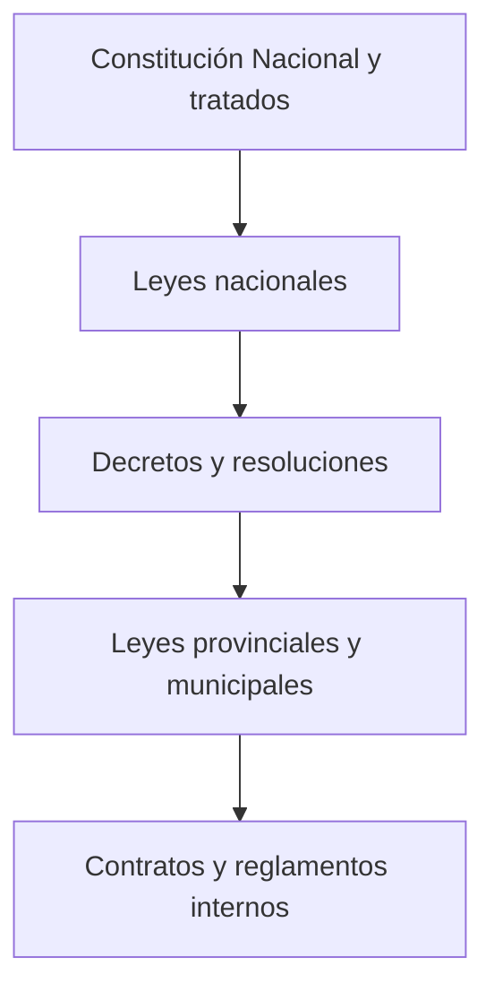

# Derecho Aplicado a la Informática aplicado a SaludWEB

**Materia:** Derecho Aplicado a la Informática 
**Carrera:** Tecnicatura en Programación 
**Institución:** UTN Facultad Regional Paraná 
**Autora:** Ailen Adriana Quaglino Fail 
**Proyecto:** SaludWEB (Backend PHP/SQLite, Web React y Mobile React Native/Expo) 
**Fecha de la aplicación:** 25/10/2026

> **Advertencia:** este documento es un trabajo académico de aplicación. No constituye asesoramiento jurídico ni reemplaza la consulta a un abogado. La normativa y la jurisprudencia cambian; antes de operar un sistema real con datos de salud hay que validar el encuadre con un profesional y con la autoridad de aplicación.

---

## Índice

0. [Introducción y alcance](#0-introducción-y-alcance)
1. [Derecho, ordenamiento y jerarquía normativa](#1-derecho-ordenamiento-y-jerarquía-normativa)
2. [SaludWEB como caso de derecho informático](#2-saludweb-como-caso-de-derecho-informático)
3. [Datos personales y datos sensibles de salud](#3-datos-personales-y-datos-sensibles-de-salud)
4. [Derechos constitucionales digitales](#4-derechos-constitucionales-digitales)
5. [Personas, actos y contratos electrónicos](#5-personas-actos-y-contratos-electrónicos)
6. [Firma electrónica y firma digital](#6-firma-electrónica-y-firma-digital)
7. [Responsabilidad civil y contractual](#7-responsabilidad-civil-y-contractual)
8. [Prueba digital y cadena de custodia](#8-prueba-digital-y-cadena-de-custodia)
9. [Derecho laboral y trabajo informático](#9-derecho-laboral-y-trabajo-informático)
10. [Propiedad intelectual, software y licencias](#10-propiedad-intelectual-software-y-licencias)
11. [Consumidor, comercio electrónico e intermediarios](#11-consumidor-comercio-electrónico-e-intermediarios)
12. [Ciberdelitos y seguridad](#12-ciberdelitos-y-seguridad)
13. [Inteligencia artificial y decisiones automatizadas](#13-inteligencia-artificial-y-decisiones-automatizadas)
14. [Casos de análisis](#14-casos-de-análisis)
15. [Matriz legal de SaludWEB](#15-matriz-legal-de-saludweb)
16. [Plan de cumplimiento priorizado](#16-plan-de-cumplimiento-priorizado)
17. [Autoevaluación](#17-autoevaluación)
18. [Conclusión](#18-conclusión)
19. [Trazabilidad, límites y bibliografía](#19-trazabilidad-límites-y-bibliografía)

---

## 0. Introducción y alcance

Este documento aplica al proyecto **SaludWEB** los temas de Derecho Aplicado a la Informática: derecho público y privado, jerarquía normativa, derechos digitales, protección de datos personales, datos sensibles de salud, actos y contratos electrónicos, firma electrónica y digital, responsabilidad civil, prueba digital, derecho laboral, propiedad intelectual, licencias, consumidor, ciberdelitos, inteligencia artificial y casos de análisis.

El objetivo no es memorizar leyes: es entender **qué obligaciones aparecen cuando un sistema registra datos de pacientes, emite recetas y permite acceder desde una web y un celular**.

### 0.1 Tres niveles de afirmación

1. **Hecho verificado:** surge del repositorio y se cita como `archivo:línea`.
2. **Encuadre jurídico:** es una lectura razonada de la normativa aplicable al caso.
3. **Recomendación:** es una medida propuesta; no debe leerse como algo ya implementado.

### 0.2 Aclaración importante

SaludWEB es un proyecto académico. No es una clínica, no factura, no envía recetas a farmacias y no está desplegado como servicio de salud real. Muchas obligaciones se activan **solo si el sistema se pone en producción con datos reales**. Otras, en cambio, ya son relevantes desde el diseño: privacidad, control de acceso, integridad, trazabilidad y licencias.

---

## 1. Derecho, ordenamiento y jerarquía normativa

### 1.1 Derecho público y derecho privado

| Rama | Qué regula | Ejemplo aplicado a SaludWEB |
|---|---|---|
| Derecho constitucional | Derechos fundamentales y organización del Estado | Intimidad, datos personales, salud |
| Derecho administrativo | Actividad del Estado y habilitaciones | Registro de bases, inspecciones, sanciones |
| Derecho penal | Delitos y penas | Acceso no autorizado, daño informático |
| Derecho civil | Personas, contratos, daños | Vínculo paciente–institución, responsabilidad |
| Derecho comercial | Empresas, obligaciones, contratos | Prestación de servicios informáticos |
| Derecho laboral | Trabajo dependiente | Equipo de desarrollo, teletrabajo |
| Derecho del consumidor | Relación de consumo | Turnos, información, revocación |
| Propiedad intelectual | Autoría, marcas, licencias | Código, UI, nombre “SaludWEB” |

La distinción es analítica: un mismo hecho puede caer en varias ramas. Una filtración de datos puede generar responsabilidad civil, sanciones administrativas y, si hay dolo, consecuencias penales.

### 1.2 Pirámide normativa

Reglas prácticas:

- Una ley no puede contradecir la Constitución.
- Un decreto no puede contradecir una ley.
- Un contrato no puede violar normas imperativas.
- La costumbre y la jurisprudencia interpretan, pero no siempre reemplazan la ley.

### 1.3 Federalismo

La Argentina es un país federal. La Nación legisla sobre comercio interjurisdiccional, telecomunicaciones, datos personales y delitos informáticos, pero las provincias conservan competencias sobre salud, seguridad y justicia ordinaria. En ciberdelitos, la competencia puede ser federal o provincial según el bien jurídico, el medio y la conexión territorial. Esto importa para la investigación de incidentes: no siempre interviene la misma autoridad.

### 1.4 Fuentes del derecho

| Fuente | Función |
|---|---|
| Constitución y tratados | Derechos y límites |
| Ley | Regla general obligatoria |
| Decreto reglamentario | Detalle de aplicación |
| Jurisprudencia | Interpretación de casos |
| Doctrina | Análisis técnico |
| Costumbre | Práctica reiterada |
| Contrato | Regla entre partes |

---

## 2. SaludWEB como caso de derecho informático

El derecho informático tiene dos vertientes. La **informática jurídica** usa la tecnología como herramienta del derecho: gestión documental, bases de datos, firma y prueba. El **derecho de la informática** regula las conductas y relaciones que aparecen con la tecnología. SaludWEB usa la primera vertiente porque es un sistema de gestión, y queda alcanzado por la segunda por los datos que trata, la firma de recetas, la responsabilidad y los posibles delitos.

### 2.1 Qué datos maneja

| Dato | Tabla | Naturaleza |
|---|---|---|
| Nombre y DNI | `pacientes` | Identificatorio |
| Obra social | `pacientes` | Personal, puede revelar condición |
| Nivel de triage y observaciones | `triages` | Dato de salud |
| Medicamentos e indicaciones | `prescripciones` | Dato de salud |
| Médico tratante | `prescripciones` | Dato de salud y profesional |
| Email, rol y contraseña | `usuarios` | Credencial y dato personal |
| Fecha y hora de atención | `citas` | Dato personal y de salud |
| Logs y eventos | `logs`, `eventos_realtime` | Metadata técnica |

Los datos de salud son **datos sensibles** en el sentido de la Ley 25.326. No es necesario que el sistema se llame “historia clínica” para que lo sean: una receta, un triage o una observación médica ya lo son.

### 2.2 Riesgos jurídicos principales

| Riesgo | Consecuencia posible |
|---|---|
| Acceso indebido a pacientes o recetas | Responsabilidad civil, sanción administrativa, delito |
| Filtración de datos | Daño a la intimidad, acción de habeas data, indemnización |
| Receta sin firma válida | Discusión sobre autoría y validez |
| Pérdida de datos | Incumplimiento contractual y daño |
| Uso de software sin licencia | Contrafacción, reclamo del titular |
| Trabajo sin contrato | Reclamo laboral y propiedad del código |
| Términos y condiciones ausentes | Falta de prueba del consentimiento |
| Auditoría insuficiente | Imposibilidad de reconstruir un incidente |

### 2.3 Diferencia entre “seguro” y “cumplidor”

Un sistema puede ser técnicamente seguro y, aun así, incumplir obligaciones legales. Ejemplos:

- Tener JWT y bcrypt, pero no informar al titular cómo ejercer sus derechos.
- Cifrar el tránsito, pero no tener política de retención.
- Tener logs, pero sin identificar al usuario que hizo la operación.
- Tener un botón “Acepto”, pero sin versión de los términos ni evidencia de aceptación.

**Cumplimiento = seguridad técnica + deberes de información + control + evidencia + contrato.**

---

## 3. Datos personales y datos sensibles de salud

### 3.1 Marco normativo

- **Ley 25.326** de Protección de los Datos Personales y su Decreto 1558/2001.
- **Artículo 43 de la Constitución Nacional**: acción de habeas data.
- **Ley 26.529** de Derechos del Paciente en su Relación con los Profesionales e Instituciones de la Salud.
- **Ley 27.553** de Receta Electrónica.
- Normativa de la **Agencia de Acceso a la Información Pública (AAIP)**, autoridad de aplicación.
- Si el sistema se usa en una jurisdicción específica, normativa provincial de salud y de historia clínica.

### 3.2 Principios de protección de datos

| Principio | Qué exige | Aplicación a SaludWEB |
|---|---|---|
| Legalidad | Base legal para tratar | Consentimiento o excepción legal |
| Finalidad | Fin determinado y explícito | Asistencia sanitaria, no marketing |
| Proporcionalidad | Datos adecuados y no excesivos | No pedir datos innecesarios |
| Calidad | Datos exactos y actualizados | DNI, nombre y receta correctos |
| Seguridad | Medidas técnicas y organizativas | Control de acceso, cifrado, respaldo |
| Confidencialidad | Deber de reserva | Solo el personal autorizado accede |
| Transparencia | Informar al titular | Política de privacidad clara |
| Conservación limitada | No guardar para siempre | Plazo y borrado/anonimización |
| Responsabilidad | Poder demostrar cumplimiento | Registro y auditoría |

### 3.3 Datos sensibles

El artículo 2 de la Ley 25.326 considera sensibles a los datos que revelan origen racial o étnico, opiniones políticas, convicciones religiosas, filosóficas o morales, afiliación sindical, información sobre salud o vida sexual.

Consecuencias:

- La regla general es el **consentimiento expreso**.
- Deben extremarse las medidas de seguridad.
- El acceso debe ser restrictivo y registrado.
- La cesión a terceros requiere base legal y control.
- La finalidad debe ser compatible con la atención sanitaria.

### 3.4 Consentimiento

El consentimiento debe ser:

- **Libre:** sin presión.
- **Informado:** con finalidad, responsable, derechos y consecuencias.
- **Expreso:** para datos sensibles.
- **Específico:** no un “acepto todo” genérico.
- **Revocable:** cuando corresponda.
- **Demostrable:** con fecha, versión y evidencia.

En SaludWEB **no se encontró** una pantalla de consentimiento informado, una política de privacidad ni términos y condiciones en el repositorio. El registro pide email, nombre y contraseña (`services/AuthService.php:60-110`), pero no muestra una aceptación versionada de condiciones.

### 3.5 Derechos del titular

| Derecho | Contenido | Situación en SaludWEB |
|---|---|---|
| Acceso | Saber qué datos se tienen | No hay endpoint específico de acceso del titular |
| Rectificación | Corregir datos inexactos | El admin puede editar; el paciente no tiene flujo propio |
| Supresión | Pedir borrado cuando corresponda | No hay procedimiento; el CASCADE puede borrar de más |
| Confidencialidad | Limitar el acceso | Hay autenticación, pero faltan controles por pertenencia |
| Oposición | Oponerse a ciertos tratamientos | No hay mecanismo |
| Portabilidad | No está reconocida de forma general en la ley argentina | No aplica como derecho autónomo |
| Habeas data | Acción judicial | Vía constitucional disponible |

### 3.6 Registro y responsable de la base

Si SaludWEB se operara con datos reales, habría que definir:

- **Responsable de la base:** quién decide finalidad y medios.
- **Encargado:** quién trata datos por cuenta del responsable.
- **Registro de la base:** inscripción ante la AAIP cuando corresponda.
- **Registro de actividades de tratamiento:** inventario de datos, fines, destinatarios y plazos.
- **Delegado de protección de datos:** según estructura y normativa aplicable.

En el proyecto académico no hay responsable designado ni registro. Es una brecha de gobernanza, no solo técnica.

### 3.7 Retención y borrado

El esquema usa `ON DELETE CASCADE` desde pacientes hacia triages y prescripciones (`db.php:228`, `db.php:263`). Eso significa que borrar un paciente elimina su historial clínico asociado.

Problemas:

- La historia clínica puede tener un plazo legal de conservación.
- La trazabilidad de una receta puede necesitarse después del alta.
- El borrado sin control puede destruir prueba.
- La supresión del dato personal no siempre es absoluta: puede ceder ante obligaciones legales.

**Recomendación:** separar baja lógica, anonimización y borrado físico; definir plazos por tipo de dato; impedir el borrado clínico sin autorización y registro.

### 3.8 Seguridad de los datos

| Medida | Estado en SaludWEB | Comentario |
|---|---|---|
| Hash de contraseñas | Sí, bcrypt (`AuthService.php:89`) | Correcto |
| JWT con expiración | Sí, 1 hora (`JwtService.php:33`) | Correcto, pero almacenado en localStorage |
| Rate limiting | Sí (`RateLimiter.php`) | Reduce fuerza bruta |
| CORS con whitelist | Sí (`routes.php:34-62`) | Correcto |
| Cabeceras de seguridad | Parcial (`routes.php:64-72`) | Falta CSP y HSTS |
| Cifrado en reposo | No identificado | SQLite sin cifrado |
| Cifrado en tránsito | Depende del despliegue | En local es HTTP |
| Control por rol | Parcial | Deuda en pacientes y prescripciones |
| Auditoría | Insuficiente | Tabla sin usuario, IP ni entidad |
| Respaldo | No implementado | Solo recomendación documental |
| Token en URL SSE | Sí (`RealtimeController.php:464-481`) | Riesgo de registro en logs |

### 3.9 Transferencias internacionales

El login con Google y Microsoft envía datos de autenticación a proveedores externos (`services/AuthService.php:252-342`). Aunque el flujo sea SSO, hay que analizar:

- Qué datos se comparten.
- Dónde se alojan.
- Qué términos acepta el usuario.
- Qué nivel de protección ofrece el proveedor.
- Si corresponde informarlo en la política de privacidad.

No toda transferencia internacional está prohibida, pero debe tener base legal y transparencia.

### 3.10 Menores de edad

La tabla `pacientes` no tiene fecha de nacimiento (`db.php:211-218`). Por lo tanto, el sistema no puede saber si el paciente es menor ni verificar quién ejerce la representación legal.

Si se usara con menores, haría falta:

- Edad o fecha de nacimiento.
- Vínculo con el adulto responsable.
- Consentimiento del representante.
- Reglas de acceso y confidencialidad adaptadas.

---

## 4. Derechos constitucionales digitales

### 4.1 Intimidad y autodeterminación informativa

El artículo 19 de la Constitución protege las acciones privadas que no ofenden al orden público ni perjudican a terceros. El artículo 43 incorpora el habeas data para tomar conocimiento de los datos personales y exigir su rectificación, supresión o confidencialidad.

La **autodeterminación informativa** es la facultad de la persona de controlar el tratamiento de sus datos. En salud, esto es especialmente sensible: el paciente debe saber quién accede a su historia, para qué y con qué límites.

### 4.2 Derecho a la salud y consentimiento informado

La Ley 26.529 regula los derechos del paciente, la historia clínica y el consentimiento informado. El consentimiento informado es un proceso de información y decisión sobre un acto médico; no se reemplaza con un checkbox de términos y condiciones.

En SaludWEB:

- La receta es un documento clínico.
- El paciente debería poder acceder a su información.
- El profesional debe quedar identificado.
- La institución debe custodiar la historia.
- El software debe respetar la confidencialidad.

### 4.3 Libertad de expresión, imagen y honor

La libertad de expresión protege la difusión de ideas, pero no ampara el hostigamiento, la difamación ni la divulgación indebida de datos de salud. La imagen y el honor también son derechos personalísimos.

En una app de salud, el riesgo aparece en:

- Comentarios o reseñas de profesionales.
- Fotos de estudios o recetas.
- Mensajes entre paciente y médico.
- Publicación de casos clínicos.

La regla es: **no publicar datos identificables sin consentimiento** y aplicar minimización incluso en imágenes.

### 4.4 Acceso a la información pública y transparencia algorítmica

La Ley 27.275 regula el acceso a la información pública. No se aplica directamente a un privado, pero sí a organismos públicos que usen SaludWEB o sistemas similares.

La transparencia algorítmica exige explicar:

- Qué datos entran.
- Qué reglas o modelos se aplican.
- Qué decisión se toma.
- Quién revisa.
- Cómo se corrige un error.

SaludWEB no usa IA para decidir tratamientos. Si en el futuro se agregara un triage automático o un scoring de riesgo, habría que documentar el modelo, validarlo y mantener revisión humana.

---

## 5. Personas, actos y contratos electrónicos

### 5.1 Personas físicas y jurídicas

| Concepto | Aplicación |
|---|---|
| Persona física | Paciente, médico, desarrolladora |
| Persona jurídica | Clínica, empresa proveedora, hosting |
| Capacidad | Mayores de edad; menores con representación |
| Atributos | Nombre, domicilio, documento, estado civil |
| Representación | Quien firma por la clínica o empresa |

Un sistema informático no es persona: es una herramienta. Las obligaciones recaen en el responsable de la base, el prestador de salud y, según el contrato, el proveedor de software.

En SaludWEB se aplican las reglas de la persona, las obligaciones, los contratos y la responsabilidad civil. No se aplican familia, sucesiones ni derechos reales: el sistema no crea vínculos familiares, no transmite bienes por herencia ni constituye propiedad sobre cosas. Esa delimitación evita trasladar al proyecto instituciones que no tienen relación con su funcionamiento.

### 5.2 Acto jurídico y documento electrónico

Un acto jurídico es una manifestación de voluntad destinada a producir efectos jurídicos. Puede instrumentarse en papel o en soporte electrónico.

El documento electrónico puede ser:

- Un archivo PDF.
- Un registro en base de datos.
- Un mensaje.
- Una firma insertada en un sistema.

Para tener valor probatorio necesita:

- Autoría atribuible.
- Integridad.
- Fecha.
- Conservación.
- Acceso reproducible.

### 5.3 Contratos electrónicos

| Tipo | Cómo se manifiesta | Fuerza probatoria |
|---|---|---|
| Clickwrap | El usuario hace clic en “Acepto” con términos disponibles | Alta, si hay registro versionado |
| Browsewrap | Términos enlazados sin aceptación expresa | Baja o discutible |
| Contrato por conducta | Uso reiterado del servicio | Media, según contexto |
| Firma digital | Certificado y firma criptográfica | Muy alta, con presunción legal |

En SaludWEB no se encontró ninguno de los tres primeros en el flujo de registro. Si se agregaran términos, el estándar mínimo sería:

1. Mostrar el texto completo antes de aceptar.
2. Registrar usuario, fecha, hora, IP y versión.
3. Guardar un hash del documento aceptado.
4. Permitir consultar la versión aceptada.
5. Separar aceptación de términos de consentimiento de datos sensibles.

### 5.4 Formación del consentimiento

El consentimiento contractual requiere capacidad, voluntad y objeto lícito. En entornos digitales, el “clic” es una manifestación de voluntad, pero debe poder probarse.

Un botón “Crear cuenta” no equivale a “acepto los términos y el tratamiento de mis datos de salud”. Son consentimientos distintos y deben tratarse por separado.

---

## 6. Firma electrónica y firma digital

### 6.1 Diferencia central

| Concepto | Definición | Efecto |
|---|---|---|
| Firma electrónica | Cualquier método electrónico de identificación | Puede ser válida, pero hay que probarla |
| Firma digital | Firma electrónica avanzada con certificado emitido por certificador licenciado | Presunción de autoría e integridad si se usa correctamente |

La **Ley 25.506** regula ambas. La firma digital no es “una imagen de la firma”: es un mecanismo criptográfico asimétrico con certificado y validación.

### 6.2 Qué es y qué no es un JWT

En SaludWEB:

- El JWT se firma con HS256 y un secreto del servidor (`core/JwtService.php:67`).
- Sirve para autenticar la sesión y verificar que el token no fue alterado.
- No es una firma digital de la receta.
- No tiene certificado de firma.
- No garantiza no repudio a largo plazo.
- El servidor que conoce el secreto podría emitir un token válido.

Por lo tanto, **JWT ≠ firma digital de una receta**.

### 6.3 La receta en SaludWEB

El esquema tiene:

- `firma_digital TEXT NULL` (`db.php:271`).
- `qr_code TEXT NULL` (`db.php:270`).

Pero en el código relevado **no se encontró** un lugar que complete esos campos. La receta se atribuye al médico por `id_medico`, que es una clave foránea, no una firma criptográfica.

Consecuencias:

- Hay atribución funcional, no firma digital.
- No hay prueba criptográfica de que el médico emitió exactamente ese contenido.
- No hay sello de tiempo confiable.
- No hay validación de integridad posterior.
- El QR, si se generara, sería un identificador, no una firma.

### 6.4 Qué haría falta para una receta electrónica robusta

1. Identidad verificada del médico.
2. Firma electrónica o digital del contenido.
3. Sello de tiempo.
4. Hash del documento.
5. Registro de emisión y de cualquier cambio.
6. Verificación de vigencia y estado.
7. Conservación y auditoría.
8. Marco normativo de receta electrónica aplicable.

La Ley 27.553 promueve la receta electrónica, pero su implementación es progresiva y requiere adhesión y regulación provincial. No alcanza con agregar un campo `firma_digital`: hay que definir el esquema, el certificado, el formato y la validación.

---

## 7. Responsabilidad civil y contractual

### 7.1 Tipos de responsabilidad

| Tipo | Origen | Ejemplo |
|---|---|---|
| Contractual | Incumplimiento de un contrato | El sistema no está disponible según lo pactado |
| Extracontractual | Daño a quien no es parte | Filtración que afecta a un paciente |
| Administrativa | Incumplimiento regulatorio | Falta de registro o de medidas de seguridad |
| Penal | Delito | Acceso no autorizado o daño informático |
| Profesional | Acto médico o técnico | Error en una receta o en un diagnóstico |

Una misma situación puede generar varias. La responsabilidad no se borra con un aviso legal genérico.

### 7.2 Elementos de la responsabilidad civil

1. **Antijuridicidad:** conducta contraria a derecho.
2. **Daño:** lesión a un interés jurídicamente protegido.
3. **Relación causal:** el daño deriva del hecho.
4. **Factor de atribución:** dolo, culpa, riesgo, garantía.

En software de salud, los daños posibles incluyen:

- Daño físico por una receta errónea.
- Daño moral por exposición de datos.
- Daño económico por pérdida de turnos o datos.
- Daño a la imagen del profesional o de la institución.

### 7.3 Obligaciones de medios y de resultado

La obligación médica suele ser de medios: el profesional no garantiza curar, pero debe actuar con diligencia. La obligación del proveedor de software puede ser de medios (desarrollar y mantener) o de resultado (disponibilidad, recuperación, integridad), según el contrato.

Un SLA (Acuerdo de Nivel de Servicio) debería definir:

- Disponibilidad.
- Tiempo de respuesta.
- Ventana de mantenimiento.
- Recuperación ante desastre.
- Soporte.
- Penalidades.
- Exclusión de responsabilidad.
- Propiedad de los datos.

SaludWEB no tiene SLA ni contrato de prestación. Es un proyecto académico; si se comercializara, sería imprescindible.

### 7.4 Responsabilidad por el hecho del software

Si un error del software causa un daño, hay que analizar:

- Si el defecto era evitable con diligencia.
- Si hubo prueba suficiente.
- Si el usuario siguió las instrucciones.
- Si el daño derivó de un acto médico o de una falla técnica.
- Si existía un deber de advertir y actualizar.

Un descargo del tipo “el software no reemplaza el criterio médico” puede ayudar, pero no elimina la responsabilidad por defectos graves ni por incumplimientos de seguridad.

### 7.5 Responsabilidad por datos

El responsable de la base debe adoptar medidas para evitar:

- Acceso no autorizado.
- Pérdida.
- Alteración.
- Comunicación indebida.

La responsabilidad puede alcanzar al responsable, al encargado y a quienes tratan datos sin autorización. La subcontratación no borra el deber de control.

### 7.6 Responsabilidad de los profesionales

El médico responde por el acto médico. El administrador responde por la gestión de accesos. El desarrollador responde por el producto y por los deberes asumidos en el contrato. La institución responde por la organización del servicio y por la custodia de la historia clínica.

La delimitación debe estar en contratos, manuales de uso y políticas, no solo en la cabeza de los involucrados.

### 7.7 Casos aplicados

| Situación | Análisis |
|---|---|
| Se filtra una lista de pacientes | Responsabilidad por seguridad y confidencialidad; daño moral y económico |
| Una receta se emite con el paciente equivocado | Revisar control de identidad, atribución y validación humana |
| Se pierde la base por falta de backup | Incumplimiento de diligencia y continuidad |
| Un admin ve recetas de todos | Falla de autorización; riesgo de acceso indebido |
| Un paciente modifica una receta | Falla de integridad y control de acceso |
| El sistema muestra una dosis incorrecta por un error de UI | Analizar causalidad, diseño, advertencia y responsabilidad profesional |

---

## 8. Prueba digital y cadena de custodia

### 8.1 Qué es la prueba digital

Es toda evidencia almacenada o transmitida en formato digital: logs, correos, mensajes, archivos, bases de datos, capturas, metadatos, hashes.

Para que sea útil debe demostrar:

- **Autenticidad:** quién la produjo.
- **Integridad:** no fue alterada.
- **Fecha:** cuándo se produjo.
- **Contexto:** de dónde salió.
- **Custodia:** quién la tuvo y cómo la preservó.

### 8.2 Cadena de custodia

Es el registro documentado de cada paso sobre la evidencia:

1. Identificación.
2. Recolección.
3. Empaquetado o copia forense.
4. Hash.
5. Almacenamiento.
6. Transferencia.
7. Análisis.
8. Conservación.

Un archivo sin hash ni registro de custodia es fácilmente cuestionable.

### 8.3 Situación de SaludWEB

| Elemento | Estado | Problema |
|---|---|---|
| Logs JSON | Sí | Pueden rotar o perderse |
| `correlation_id` | Sí | Bueno para trazabilidad técnica |
| Tabla `auditoria` | Sí, pero incompleta | Solo `accion` y `fecha` (`db.php:275-279`) |
| Usuario en auditoría | No | No se sabe quién hizo la acción |
| IP y dispositivo | No | Difícil reconstruir el acceso |
| Entidad afectada | No | No se sabe qué paciente o receta |
| Antes/después | No | No se puede reconstruir el cambio |
| Hash de evidencia | No | No hay prueba de integridad |
| Firma de logs | No | No hay sello de tiempo |
| Retención | No definida | Se puede perder o conservar de más |

**Conclusión:** hay trazabilidad operativa, no auditoría legal. Para un incidente real, los logs actuales pueden ayudar, pero no alcanzan como prueba robusta.

### 8.4 Recomendaciones

- Registrar `usuario_id`, rol, IP, user-agent, entidad, acción y resultado.
- Guardar antes y después en operaciones críticas.
- Usar hash encadenado o almacenamiento append-only.
- Sincronizar reloj (NTP).
- Definir retención y protección de logs.
- Separar logs técnicos de auditoría clínica.
- Documentar el procedimiento de respuesta a incidentes.

---

## 9. Derecho laboral y trabajo informático

### 9.1 Relación de dependencia

La Ley de Contrato de Trabajo (20.744) protege al trabajador dependiente. Hay relación de dependencia cuando existen:

- Subordinación.
- Continuidad.
- Retribución.
- Trabajo personal.

Un “contrato de locación de servicios” no convierte automáticamente a un empleado en autónomo si en la práctica hay subordinación. La realidad de los hechos prevalece sobre el nombre del contrato.

En un equipo de software la subordinación se manifiesta en tres planos: **jurídica** (dirección, organización y potestad disciplinaria), **económica** (el salario como medio principal de vida) y **técnica** (arquitectura, metodología, repositorios y herramientas definidas por la empresa). El principio protectorio y la irrenunciabilidad de los derechos mínimos impiden que un contrato formal disfrace una relación de dependencia.

### 9.2 Teletrabajo

La Ley 27.555 regula el teletrabajo. Puntos relevantes:

- Voluntariedad.
- Igualdad de derechos.
- Herramientas y compensación de gastos.
- Derecho a la desconexión.
- Prevención de riesgos.
- Registro de jornada.
- Tareas de cuidado: pautas horarias compatibles o pausas pactadas para trabajadores con menores de 13 años o personas dependientes a cargo.
- Privacidad: el monitoreo debe limitarse a la seguridad de los datos corporativos y no puede invadir correos, archivos personales ni la intimidad del trabajador.

Si SaludWEB se desarrollara con un equipo remoto, habría que definir estos puntos.

### 9.3 Contractor y monotributo

Un trabajador independiente puede facturar, pero no debe ser tratado como empleado encubierto. Señales de riesgo:

- Horario impuesto.
- Exclusividad.
- Control diario.
- Herramientas provistas.
- Integración en la organización.
- Retribución fija mensual.

Para un equipo real, conviene un contrato de servicios con:

- Alcance.
- Entregables.
- Plazos.
- Propiedad intelectual.
- Confidencialidad.
- Facturación.
- Terminación.

La Ley 27.742 introdujo cambios que inciden en un equipo de software: período de prueba de seis meses, ampliable según el tamaño de la empresa; fondo de cese laboral como alternativa indemnizatoria; regularización de multas por empleo no registrado; y la posibilidad de que un trabajador independiente tenga hasta tres colaboradores sin relación de dependencia. En el sector informático también conviven el CCT 130/75 de Comercio y convenios específicos impulsados por cámaras como CESSI. El encuadre concreto debe verificarse con un profesional antes de contratar.

### 9.4 Pasantías

La Ley 26.427 regula pasantías. No son relación de empleo, pero tienen límites de duración, carga horaria y condiciones. No deben usarse para cubrir trabajo permanente sin derechos.

### 9.5 Propiedad del código

| Situación | Regla práctica |
|---|---|
| Empleado que programa en horario laboral | El empleador suele tener los derechos patrimoniales sobre la obra creada en cumplimiento del contrato |
| Freelance | Hay que ceder expresamente los derechos patrimoniales |
| Estudiante en proyecto académico | Conserva autoría; la institución puede tener reglas propias |
| Colaborador sin contrato | Zona de conflicto: conviene documentar aportes y licencia |

En SaludWEB, la autora es la desarrolladora y titular del proyecto académico. Si se sumaran colaboradores, haría falta un acuerdo de contribución y una licencia clara.

### 9.6 Aplicación al proyecto

Hoy no hay relación laboral con usuarios ni con una empresa. El riesgo aparece si:

- Se contrata a alguien sin contrato.
- Se usa un “colaborador” gratuito para trabajo permanente.
- Se vende el sistema sin definir propiedad intelectual.
- Se usan pasantes para tareas críticas.

---

## 10. Propiedad intelectual, software y licencias

### 10.1 Protección del software

En Argentina, el software se protege por el derecho de autor. La Ley 11.723, modificada por la Ley 25.036, asimila el software a las obras literarias. La protección alcanza:

- Código fuente.
- Código objeto.
- Documentación.
- Manuales.
- Estructura y organización.
- Interfaz gráfica, según el caso.

No protege ideas, algoritmos abstractos ni funcionalidades en sí mismas. Para eso pueden aplicarse patentes si se cumplen los requisitos, lo que es excepcional en software.

### 10.2 Titularidad

La titularidad puede ser:

- De la autora.
- Del empleador, por contrato o relación laboral.
- De la institución, según reglamento.
- Compartida, por acuerdo.

En el repositorio **no hay archivo `LICENSE`**. Eso significa que, por defecto, no se concede permiso para copiar, modificar ni distribuir. El README dice que el software “no tiene licencias” en el sentido de que usa tecnología libre, pero eso **no es una licencia de uso**.

### 10.3 Licencias de terceros

| Componente | Licencia probable | Obligación |
|---|---|---|
| PHP | PHP License | Conservar avisos |
| SQLite | Dominio público | Sin obligación fuerte |
| React | MIT | Conservar copyright y permiso |
| Vite | MIT | Conservar aviso |
| Axios | MIT | Conservar aviso |
| React Native / Expo | MIT | Conservar aviso |
| `firebase/php-jwt` | BSD-3-Clause | Conservar aviso |
| Google / Microsoft SSO | Términos del proveedor | Aceptar y documentar |

Las licencias permisivas (MIT, BSD) exigen conservar el aviso de copyright y la licencia. No obligan a abrir el código propio, pero sí a reconocer el de terceros.

### 10.4 Compatibilidad

Si se incorporara una librería GPL o AGPL, habría que analizar si el proyecto se considera obra derivada y si se activa el deber de distribuir el código. Para un producto cerrado, conviene revisar cada licencia antes de incorporarla.

### 10.5 Marcas

“SaludWEB” puede funcionar como marca de hecho, pero no está registrada. Si el proyecto se comercializara, conviene:

- Buscar antecedentes en INPI.
- Registrar la marca en la clase correspondiente.
- Revisar el dominio y las redes.
- Evitar un nombre que confunda con otro servicio.

### 10.6 Bases de datos

La base de datos puede estar protegida como compilación si hay originalidad en la selección u organización. En Argentina no hay un derecho sui generis equivalente al europeo, pero el contrato y el secreto comercial pueden proteger el conjunto.

### 10.7 Recomendaciones

1. Agregar un archivo `LICENSE` al repositorio.
2. Agregar `THIRD_PARTY_NOTICES.md`.
3. Documentar la titularidad en el README.
4. Definir licencia para colaboradores.
5. Revisar licencias antes de agregar dependencias.
6. Registrar la marca si se comercializa.
7. Separar el código propietario de las dependencias.

---

## 11. Consumidor, comercio electrónico e intermediarios

### 11.1 Ley de Defensa del Consumidor

La Ley 24.240 protege al consumidor en relaciones de consumo. Si SaludWEB cobrara turnos o servicios, habría que analizar:

- Información clara y veraz.
- Precio y condiciones.
- Derecho de revocación.
- Garantía legal.
- Trato digno.
- Publicidad.
- Responsabilidad por daños.

### 11.2 Derecho de revocación

En contratos celebrados fuera del establecimiento comercial, el consumidor tiene un plazo de **10 días** para revocarlos, con devolución de lo pagado, según el artículo 34 de la Ley 24.240.

Matices:

- No todos los servicios de salud admiten la misma lógica.
- Una urgencia no se puede tratar como una compra online.
- Si se cobra una consulta programada, hay que definir política de cancelación.
- La revocación no debe usarse para dejar sin atención una urgencia.

SaludWEB no tiene pagos implementados. Si se agregaran, habría que redactar términos de compra, cancelación y reembolso.

### 11.3 Contratos clickwrap y browsewrap

- **Clickwrap:** el usuario acepta con un clic. Es más fácil de probar.
- **Browsewrap:** el usuario navega con un enlace a los términos. Es más débil.
- **Sign-in wrap:** se informa que al crear la cuenta se aceptan los términos. Es intermedio.

Para datos de salud, el consentimiento debe ser expreso y separado. Un browsewrap no alcanza.

### 11.4 Intermediarios

SaludWEB no es un buscador ni una red social: es un prestador directo del servicio. Por eso, su responsabilidad es directa, no de intermediario.

Los proveedores de SSO (Google, Microsoft) son terceros con sus propios términos. InfinityFree aloja el tablero, no la API clínica. Si se usara un hosting para la API, habría que analizar el contrato, la ubicación de los datos y las medidas de seguridad.

### 11.5 Comercio electrónico

Si se agregara pago de turnos:

- Pasarela de pago.
- Facturación.
- Datos de tarjeta (nunca almacenar sin PCI DSS).
- Política de reembolso.
- Confirmación de compra.
- Comprobante.
- Protección del consumidor.

No se debe inventar un cumplimiento que el sistema no tiene.

---

## 12. Ciberdelitos y seguridad

### 12.1 Marco normativo

- **Ley 26.388** incorporó delitos informáticos al Código Penal.
- **Ley 27.411** aprobó la Convención de Budapest sobre ciberdelincuencia.
- Código Penal: arts. 153 bis, 155, 157, 183, 184, 255, 277, entre otros.

Figuras relevantes:

| Conducta | Figura posible |
|---|---|
| Acceso no autorizado a un sistema | Art. 153 bis |
| Interceptación de comunicaciones | Art. 155 |
| Alteración, destrucción o inutilización de datos | Art. 157 |
| Daño informático | Arts. 183/184 |
| Fraude informático | Arts. 172/173 |
| Falsificación de documento electrónico | Art. 292, según el caso |
| Encubrimiento o lavado | Arts. 277 y siguientes |

### 12.2 Aplicación a SaludWEB

Riesgos:

- Un atacante accede con credenciales robadas.
- Un usuario con token válido consulta datos de otro paciente.
- Se altera una receta.
- Se borra la base.
- Se intercepta el token en la URL de SSE.
- Se hace phishing a un médico.

La deuda de autorización en `routes.php:148-150`, `319-321`, `375-378` y `453-456` no es solo un bug: es una puerta a acceso indebido.

### 12.3 Denuncia y respuesta

Ante un incidente:

1. Contener.
2. Preservar evidencia.
3. Registrar fecha, hora y acciones.
4. Notificar internamente.
5. Evaluar notificación a titulares y autoridad.
6. Analizar causa.
7. Corregir.
8. Documentar lecciones.

No se debe “arreglar” borrando logs. Eso destruye prueba y agrava la situación.

### 12.4 Competencia

La investigación puede involucrar:

- Justicia federal, por delitos interjurisdiccionales o de alcance nacional.
- Justicia provincial, por delitos comunes.
- Unidades fiscales especializadas en ciberdelito.
- Autoridad de protección de datos, por la vía administrativa.

La competencia depende del caso. La respuesta técnica debe preservar evidencia para cualquier fuero.

---

## 13. Inteligencia artificial y decisiones automatizadas

### 13.1 Estado del proyecto

SaludWEB no usa IA para diagnosticar ni para decidir tratamientos. El triage es un registro manual; el dashboard calcula métricas; las recetas las emite un médico.

### 13.2 Si se agregara IA

Habría que evaluar:

- Finalidad lícita.
- Base legal.
- Datos de entrenamiento.
- Sesgos y equidad.
- Explicabilidad.
- Validación clínica.
- Supervisión humana.
- Responsabilidad por errores.
- Transparencia.
- Derecho a revisión.

Un sistema que prioriza pacientes o sugiere dosis no puede ser una caja negra. La decisión clínica final debe quedar en un profesional.

### 13.3 Transparencia algorítmica

Como mínimo:

- Informar que se usa un sistema automatizado.
- Explicar qué datos usa.
- Permitir revisión humana.
- Registrar la recomendación y la decisión final.
- Evaluar impacto discriminatorio.
- Documentar limitaciones.

### 13.4 Caso de IA en empleo público

El material plantea un caso de IA aplicada a selección de personal público. La enseñanza es:

- Un algoritmo puede reproducir sesgos.
- La opacidad dificulta el control.
- La decisión administrativa debe tener motivación.
- La revisión humana es obligatoria.
- La persona afectada debe poder impugnar.

Aplicado a salud: si un modelo prioriza turnos, el paciente debe poder entender y cuestionar la prioridad.

---

## 14. Casos de análisis

### 14.1 CloudNet

**Situación planteada:** un servicio en la nube almacena datos de usuarios y se produce un incidente de seguridad.

**Cuestiones:**

- ¿Quién es responsable de la base?
- ¿Quién es encargado?
- ¿Qué contrato regula el servicio?
- ¿Dónde están los datos?
- ¿Hubo cifrado?
- ¿Se notificó el incidente?
- ¿Qué evidencia se preservó?

**Aplicación a SaludWEB:** si la API se alojara en un proveedor cloud, la clínica seguiría siendo responsable de los datos y el proveedor sería encargado. El contrato debe exigir seguridad, confidencialidad, respaldo, notificación de brechas y devolución de datos.

### 14.2 IA en empleo público

**Situación planteada:** un sistema automatizado filtra candidatos para un empleo público.

**Cuestiones:**

- ¿Qué datos usa?
- ¿El modelo fue auditado?
- ¿Hay sesgo?
- ¿Quién revisa?
- ¿Cómo se impugna?

**Aplicación a SaludWEB:** si se usara IA para priorizar pacientes, habría que validar el modelo, explicar el criterio y mantener revisión profesional. La eficiencia no justifica una decisión sanitario opaca.

### 14.3 Competencia en ciberdelitos

**Situación planteada:** un incidente informático ocurre entre jurisdicciones.

**Cuestiones:**

- ¿Qué autoridad interviene?
- ¿Qué evidencia se preserva?
- ¿Cómo se coordina?
- ¿Qué plazos corren?

**Aplicación a SaludWEB:** un incidente con pacientes de varias provincias puede requerir coordinación federal y provincial. La preservación de logs y la cadena de custodia son clave.

### 14.4 Libertad de expresión y medidas cautelares

**Situación planteada:** se pide bloquear o eliminar contenido por una medida cautelar.

**Cuestiones:**

- ¿Hay orden judicial?
- ¿Es proporcionada?
- ¿Afecta libertad de expresión?
- ¿Quién responde?

**Aplicación a SaludWEB:** no es una red social, pero podría alojar reseñas o mensajes. Cualquier moderación debe tener reglas claras, motivación y posibilidad de reclamo.

### 14.5 Intermediarios y filiales

**Situación planteada:** una plataforma y una filial reciben una orden de remover contenido.

**Cuestiones:**

- ¿Quién es intermediario?
- ¿Hay conocimiento efectivo?
- ¿Qué obligación de remoción existe?
- ¿Qué pasa con los datos?

**Aplicación a SaludWEB:** al ser prestador directo, no puede escudarse en la inmunidad de intermediario. Debe cumplir las órdenes judiciales y proteger los datos.

### 14.6 Anonimato y habeas data

**Situación planteada:** una persona pide acceder a sus datos o reclama por un tratamiento anónimo.

**Cuestiones:**

- ¿Los datos son personales?
- ¿Se pueden anonimizar?
- ¿Cómo se ejerce el acceso?
- ¿Qué límites hay?

**Aplicación a SaludWEB:** la historia clínica necesita identificar al paciente, pero los tableros y la investigación deben usar datos agregados o seudónimos. El derecho de acceso no se satisface con un “no tenemos nada”.

---

## 15. Matriz legal de SaludWEB

| Requisito | Estado | Evidencia | Brecha | Prioridad |
|---|---|---|---|---|
| Política de privacidad | No encontrada | Repositorio | El titular no sabe cómo se tratan sus datos | Alta |
| Términos y condiciones | No encontrados | Registro sin aceptación | No hay prueba de consentimiento contractual | Alta |
| Consentimiento para datos de salud | No encontrado | `AuthService.php:60-110` | Falta base legal demostrable | Alta |
| Registro de actividades de tratamiento | No | Repositorio | No hay inventario de datos | Alta |
| Derechos de acceso/rectificación/supresión | Parcial | Admin edita; no hay flujo del titular | No hay procedimiento | Alta |
| Seguridad de contraseñas | Sí | bcrypt (`AuthService.php:89`) | Correcto | — |
| Control de acceso por rol | Parcial | Deuda RBAC | Acceso indebido a pacientes/recetas | Crítica |
| Auditoría con usuario y contexto | No | `db.php:275-279` | No se puede reconstruir un incidente | Alta |
| Retención y borrado | No definido | CASCADE clínico | Se puede destruir historia clínica | Alta |
| Respaldo y recuperación | No implementado | Solo documentado | Pérdida de datos | Alta |
| Cifrado en reposo | No identificado | SQLite | Exposición del archivo | Media |
| Cifrado en tránsito | Depende del deploy | Local HTTP | Token y datos expuestos | Alta en producción |
| Firma de receta | No | `firma_digital` sin uso | Falta no repudio | Alta |
| Receta electrónica | Parcial | Datos de receta, sin firma | No cumple estándar completo | Alta |
| Notificación de brechas | No | No hay procedimiento | Incumplimiento y daño | Alta |
| Registro de la base | No | Proyecto académico | Obligación si se operationaliza | Media |
| Transferencias internacionales | Parcial | SSO Google/Microsoft | Falta análisis y aviso | Media |
| Menores | No | Sin fecha de nacimiento | No se puede verificar representación | Media |
| Licencia del repositorio | No | Sin `LICENSE` | No hay permiso de uso claro | Media |
| Avisos de terceros | No | Sin `THIRD_PARTY_NOTICES` | Riesgo de incumplir licencias | Media |
| Marca | No registrada | README | Riesgo si se comercializa | Baja |
| Contratos con proveedores | No | Proyecto académico | Sin SLA ni responsabilidades | Media |
| Seguro de responsabilidad | No | Proyecto académico | Sin cobertura | Media |
| Capacitación y procedimientos | No | Repositorio | Riesgo humano | Media |

### 15.1 Prioridad crítica

La brecha más grave es el **control de acceso**. Un sistema que permite que un usuario autenticado consulte pacientes o prescripciones que no le corresponden no cumple el deber de confidencialidad, aunque tenga JWT y bcrypt.

### 15.2 Prioridad alta

1. Política de privacidad y términos.
2. Consentimiento para datos sensibles.
3. Auditoría con contexto.
4. Retención y borrado.
5. Respaldo y recuperación.
6. Firma de receta.
7. Procedimiento de incidentes.

---

## 16. Plan de cumplimiento priorizado

### 16.1 Primeros 30 días

| Acción | Resultado |
|---|---|
| Corregir autorización de pacientes y prescripciones | Cierra la brecha crítica |
| Redactar política de privacidad y términos | Deber de información |
| Implementar aceptación versionada | Prueba de consentimiento |
| Completar auditoría con usuario, IP, entidad y acción | Trazabilidad |
| Definir retención y borrado lógico | Protección de la historia clínica |
| Documentar respuesta a incidentes | Preparación |

### 16.2 Días 31 a 60

| Acción | Resultado |
|---|---|
| Implementar backup y probar restauración | Continuidad |
| Agregar endpoints de derechos del titular | Acceso y rectificación |
| Revisar cifrado en tránsito y reposo | Confidencialidad |
| Agregar `LICENSE` y avisos de terceros | Cumplimiento de propiedad intelectual |
| Documentar transferencias por SSO | Transparencia |
| Revisar contratos de hosting y proveedores | Responsabilidad |

### 16.3 Días 61 a 90

| Acción | Resultado |
|---|---|
| Diseñar firma de receta y sello de tiempo | No repudio |
| Evaluar registro de la base y responsable | Gobernanza |
| Hacer evaluación de impacto de privacidad | Riesgo sistémico |
| Capacitar al equipo | Cultura de cumplimiento |
| Auditar logs y cadena de custodia | Prueba |
| Revisar marca y dominio | Propiedad intelectual |

### 16.4 Criterio de cierre

Un requisito se considera cerrado solo si tiene:

1. Norma aplicable identificada.
2. Implementación técnica.
3. Evidencia de prueba.
4. Responsable asignado.
5. Fecha de revisión.

---

## 17. Autoevaluación

| Pregunta | Respuesta breve |
|---|---|
| ¿Qué diferencia hay entre firma electrónica y digital? | La digital usa certificado y presunción legal; la electrónica es cualquier método de identificación |
| ¿Un JWT es una firma digital de una receta? | No. Autentica sesión, no firma el documento clínico |
| ¿Qué dato es sensible? | Salud, origen étnico, opiniones políticas, religión, vida sexual, afiliación sindical |
| ¿Qué principio exige no pedir datos innecesarios? | Proporcionalidad y minimización |
| ¿Qué es un clickwrap? | Aceptación mediante clic con términos disponibles |
| ¿Qué es browsewrap? | Términos enlazados sin aceptación expresa |
| ¿Cuánto dura la revocación del consumidor en contratos fuera del local? | 10 días, art. 34 Ley 24.240 |
| ¿Qué es la cadena de custodia? | Registro de cada paso sobre la evidencia digital |
| ¿Qué riesgo tiene `ON DELETE CASCADE` en salud? | Puede destruir historia clínica que debía conservarse |
| ¿Quién responde por una filtración? | Responsable, encargado y quienes incumplieron deberes, según el caso |
| ¿Qué ley regula datos personales? | Ley 25.326 |
| ¿Qué ley regula receta electrónica? | Ley 27.553 |
| ¿Qué ley regula teletrabajo? | Ley 27.555 |
| ¿Qué ley regula software? | Ley 11.723, modificada por Ley 25.036 |
| ¿Qué falta en el repositorio sobre licencias? | Archivo `LICENSE` y avisos de terceros |

---

## 18. Conclusión

SaludWEB es un proyecto técnicamente valioso, pero su dimensión jurídica todavía está incompleta. La seguridad básica está bien encaminada: bcrypt, JWT, rate limiting, CORS y cabeceras. Sin embargo, un sistema de salud no se juzga solo por “funcionar”: se juzga por **quién puede ver qué, cómo se prueba, cuánto se conserva y qué pasa cuando algo falla**.

Los tres riesgos jurídicos más importantes son:

1. **Control de acceso insuficiente** en pacientes y prescripciones, que afecta la confidencialidad.
2. **Ausencia de consentimiento, términos y política de privacidad**, que afecta la base legal y la prueba.
3. **Receta sin firma digital ni auditoría robusta**, que afecta la autoría y la no repudiación.

La buena noticia es que el proyecto ya tiene la arquitectura para corregirlo: capas, roles, logs, pruebas y documentación. El desafío es convertir esa base técnica en **cumplimiento demostrable**.

La enseñanza central de Derecho Aplicado a la Informática es que **el software no es neutral**: cada decisión de diseño distribuye poder, responsabilidad y riesgo. Documentar esas decisiones es tan importante como programar la función.

---

## 19. Trazabilidad, límites y bibliografía

### 19.1 Evidencia del proyecto

| Afirmación | Evidencia |
|---|---|
| Datos de pacientes | `db.php:211-218` |
| Triages | `db.php:226-232` |
| Prescripciones y campos `qr_code`/`firma_digital` | `db.php:261-272` |
| Auditoría incompleta | `db.php:275-279` |
| Usuarios y roles | `db.php:285-296` |
| Hash bcrypt | `services/AuthService.php:86-89` |
| JWT HS256 y expiración | `core/JwtService.php:30-87` |
| SSO Google/Microsoft | `services/AuthService.php:252-342` |
| CORS y cabeceras | `routes.php:21-75` |
| Token SSE en URL | `controllers/RealtimeController.php:444-481` |
| Deuda de autorización | `routes.php:148-150`, `319-321`, `375-378`, `453-456` |
| Sin política de privacidad ni términos | Búsqueda en repositorio |
| Sin archivo de licencia | Repositorios |
| Datos de salud en recetas | `db.php:263-266` |

### 19.2 Límites

- Este documento no es asesoramiento jurídico.
- No se analizó normativa provincial específica de cada jurisdicción.
- No se revisaron contratos reales de hosting, SSO ni clínica.
- No se hizo una auditoría de seguridad ofensiva.
- No se verificó la implementación operativa de receta electrónica en la provincia.
- La normativa puede cambiar después de la fecha de este documento.
- El proyecto es académico y no opera con datos reales.

### 19.3 Normativa citada

1. Constitución Nacional Argentina, arts. 14, 14 bis, 18, 19, 31, 43 y 75 inc. 22.
2. Ley 25.326 de Protección de los Datos Personales.
3. Decreto 1558/2001, reglamentario de la Ley 25.326.
4. Ley 25.506 de Firma Digital, modificada por Ley 27.446.
5. Ley 26.388 de delitos informáticos.
6. Ley 27.411, aprobación de la Convención de Budapest.
7. Ley 26.529 de Derechos del Paciente.
8. Ley 27.553 de Receta Electrónica.
9. Ley 27.555 de Teletrabajo.
10. Ley 20.744 de Contrato de Trabajo.
11. Ley 26.427 de Pasantías.
12. Ley 11.723 de Propiedad Intelectual, modificada por Ley 25.036.
13. Ley 22.362 de Marcas.
14. Ley 24.240 de Defensa del Consumidor.
15. Ley 27.275 de Acceso a la Información Pública.
16. Código Civil y Comercial de la Nación: personas, actos, contratos y responsabilidad.
17. Código Penal de la Nación: arts. 153 bis, 155, 157, 172, 173, 183, 184, 255, 277, 292.

### 19.4 Bibliografía

1. Lorenzetti, R. L. (2014). *Código Civil y Comercial de la Nación comentado*. Rubinzal-Culzoni.
2. Alterini, A. A. (2013). *Contratos civiles, comerciales, de consumo: teoría general*. Abeledo-Perrot.
3. Goldenberg, I. (2016). *Responsabilidad civil por daños informáticos*. La Ley.
4. Picasso, S. (2015). *Derecho de la salud*. Abeledo-Perrot.
5. Basterra, M. I. (2018). *Protección de datos personales*. Astrea.
6. Nissen, R. (2019). *Derecho informático*. Thomson Reuters.
7. Organización de los Estados Americanos. (2004). *Ley Modelo Interamericana sobre Protección de Datos Personales*.
8. Agencia de Acceso a la Información Pública. (2020). *Guías y resoluciones sobre protección de datos personales*.

### 19.5 Material de cátedra aplicado

Este documento se redactó a partir de los archivos de la carpeta `LEGISLACIÓN`. La aplicación no consiste en copiar el material: cada archivo se usó para fundamentar una parte del análisis de SaludWEB. Los archivos fuente no se duplican en el repositorio; la aplicación queda trazada en las secciones de este documento.

| Archivo de cátedra | Aporte principal | Dónde se aplica |
|---|---|---|
| `modulo 1 Alumnos` | Concepto de derecho, derecho público y privado, jerarquía normativa, estructura del Estado | Secciones 1, 3, 4 y 12 |
| `MODULO 2 Alumnos(1)` | Derecho civil y comercial aplicado a la informática | Secciones 5, 7, 10 y 11 |
| `UNIDAD 2` | Personas, capacidad, atributos, patrimonio y contratos | Secciones 5.1 a 5.3 y 7 |
| `UNIDAD 3 ALEN` | Derecho del trabajo, subordinación, principios protectores, teletrabajo, pasantías y propiedad del código | Secciones 9.1 a 9.6 |
| `UNIDAD N 4 AILEN` y `UNIDAD TEMÁTICA N 5 AILEN` | Derecho informático, aspectos constitucionales, civiles y penales; firma, prueba digital y ciberdelitos; propiedad intelectual, licencias, marcas, comercio electrónico e intermediarios | Secciones 2, 4, 6, 8, 10, 11, 12 y 13 |

**Parciales, trabajos prácticos y material de repaso:**

| Archivo | Aporte principal | Dónde se aplica |
|---|---|---|
| `EXAMEN CONCEPTUAL UNIDAD 4` | Autoevaluación de conceptos de derecho informático | Sección 17 |
| `TRABAJO AULICO UNIDAD 4` | Casos de libertad de expresión, medidas cautelares, intermediarios y habeas data | Secciones 14.4 a 14.6 |
| `PREGUNTAS Y RESPUESTAS, CASO 3` | Inteligencia artificial en el empleo público y constitucionalización del derecho privado | Sección 14.2 |
| `PREGUNTAS Y RESPUESTAS, CASO 4` | Competencias nacionales y provinciales en ciberdelitos | Sección 14.3 |
| `Clase 25 de septiembre Ailen` | Teletrabajo: equipamiento, gastos, desconexión digital, tareas de cuidado, privacidad y reforma laboral de la Ley 27.742 | Secciones 9.2 y 9.3 |
| `Actividad Práctica Grupo 1 Clase 28 de agosto` | Caso CloudNet: nube, clickwrap, firma electrónica, responsabilidad y ciberseguridad | Sección 14.1 |
| `Repaso_Ailen_QuaglinoFail` | Repaso integrador del Módulo 1 y de la jerarquía normativa | Secciones 1, 3, 4, 17 y 19.3 |

`ASISTENCIA Y CRITERIOS DE EVALUACIÓN` es material administrativo y no aporta contenido jurídico. `modulo 1 Alumnos (1).pdf` es el duplicado en PDF del Módulo 1 y no se cita por separado. El documento `DERECHO_APLICADO_A_LA_INFORMATICA_APLICADO.md` es la síntesis aplicada; no reemplaza la lectura de los archivos originales.

De la Unidad 2 se aplicaron personas, obligaciones, contratos y responsabilidad civil. Familia, sucesiones y derechos reales no se desarrollan porque SaludWEB no regula vínculos familiares, no transmite bienes por herencia ni constituye derechos sobre cosas. No es un archivo faltante: es un tema que no tiene incidencia en el proyecto.
