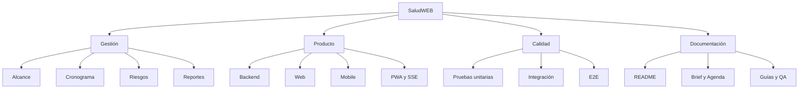

# Gestión de Desarrollo de Software aplicada a SaludWEB

**Materia:** Gestión de Desarrollo de Software 
**Trabajo práctico:** Reportes e Indicadores en Proyectos de Software 
**Docente:** Oscar Londero 
**Carrera:** Tecnicatura en Programación 
**Institución:** UTN Facultad Regional Paraná 
**Autora:** Ailen Adriana Quaglino Fail 
**Proyecto:** SaludWEB (Backend PHP/SQLite, Web React y Mobile React Native/Expo) 
**Fecha de la aplicación:** 25/10/2026 
**Entrega del TP:** jueves 5/11/2026

---

## Índice

0. [Introducción y alcance](#0-introducción-y-alcance)
1. [El proyecto como sistema de gestión](#1-el-proyecto-como-sistema-de-gestión)
2. [Alcance, entregables y triple restricción](#2-alcance-entregables-y-triple-restricción)
3. [Estructura de trabajo y fases](#3-estructura-de-trabajo-y-fases)
4. [Equipo, roles e interesados](#4-equipo-roles-e-interesados)
5. [Planificación y cronograma](#5-planificación-y-cronograma)
6. [Gestión de riesgos](#6-gestión-de-riesgos)
7. [Gestión de la calidad](#7-gestión-de-la-calidad)
8. [Configuración, cambios y trazabilidad](#8-configuración-cambios-y-trazabilidad)
9. [Reportes e indicadores: el TP](#9-reportes-e-indicadores-el-tp)
10. [Auditoría del tablero declarado](#10-auditoría-del-tablero-declarado)
11. [Propuesta de tablero confiable](#11-propuesta-de-tablero-confiable)
12. [Lecciones aprendidas](#12-lecciones-aprendidas)
13. [Conclusión](#13-conclusión)
14. [Trazabilidad, límites y bibliografía](#14-trazabilidad-límites-y-bibliografía)

---

## 0. Introducción y alcance

Este documento aplica al proyecto **SaludWEB** los conceptos de Gestión de Desarrollo de Software y resuelve el trabajo práctico **“Reportes e Indicadores en Proyectos de Software”**. El eje no es solo “mostrar un tablero”, sino entender qué mide cada indicador, de dónde sale, qué decisión habilita y cuándo un número deja de ser confiable.

Se usan tres tipos de afirmación:

1. **Hecho verificado:** está en el repositorio, en la agenda, en el QA o en el historial de Git.
2. **Dato declarado:** aparece en el tablero o en el TP, pero no se pudo reproducir desde el repositorio.
3. **Recomendación:** es una mejora de gestión, no una función ya implementada.

### 0.1 Aclaración importante

SaludWEB es un proyecto académico, no una empresa. El “equipo” es una sola persona que cumple varios roles. Por eso, la gestión se documenta como **simulación profesional**: sirve para aprender a planificar, medir, comunicar y corregir, no para afirmar que existió una estructura corporativa.

**No se modificó el código de la aplicación.** Este documento ordena la gestión y audita el tablero existente.

### 0.2 Fuentes usadas

| Fuente | Uso |
|---|---|
| `PROJECT_BRIEF.md` | Alcance, objetivos, entregables y riesgos |
| `AGENDA_DE_TRABAJO.md` | Fases, hitos, responsables y fechas |
| `QA/04_registro_de_resultados.md` | Evidencia de pruebas, ambiente e incidentes |
| `README.md` de los tres repos | Estado, comandos y funcionalidades |
| `REGISTRO_DE_CAMBIOS.md` | Historial de cambios documentales |
| Git/GitHub | Ramas, PR y merges |
| Tablero del TP | Indicadores declarados |
| `https://saludwebpro.infinityfreeapp.com/` | Dashboard publicado |

---

## 1. El proyecto como sistema de gestión

### 1.1 Qué produce el proyecto

SaludWEB es un sistema de gestión de salud con tres clientes:

- **Backend:** API REST en PHP 8 con SQLite, JWT y capas Controller/Service/Repository.
- **Web:** SPA en React + Vite, con roles, CRUD, turnera, PWA y tiempo real.
- **Mobile:** app React Native/Expo que consume la misma API, con biometría y SSO.

El producto no es “una pantalla”: es un conjunto de repositorios, datos, pruebas, documentación y decisiones. La gestión tiene que cubrir ese conjunto.

### 1.2 Procesos de gestión aplicados

| Proceso | Aplicación en SaludWEB | Evidencia |
|---|---|---|
| Inicio | Relevamiento de la consigna y alcance | `PROJECT_BRIEF.md:14-54` |
| Planificación | Fases A–I, hitos y fechas | `AGENDA_DE_TRABAJO.md:30-146` |
| Ejecución | Desarrollo por iteraciones e issues | Historial de commits y PR |
| Control | Pruebas, QA, revisión de reglas | `QA/04_registro_de_resultados.md` |
| Cierre | Documentación final y defensa | READMEs y registro de cambios |
| Calidad | Suites, build, PWA, contraste | QA y verificación Web |
| Riesgos | Matriz del Brief y riesgos del proyecto | `PROJECT_BRIEF.md:109-121` |
| Comunicación | README, agenda, PR, documentación | Repositorios |

### 1.3 Enfoque

El enfoque es **iterativo e incremental por hitos verificables**. Cada fase termina con algo que se puede mostrar: un repo, una prueba en vivo, un documento o una demo. No se sigue un cascada puro porque el alcance cambió con módulos nuevos (turnera, roles, PWA, SSE, biometría, SSO).

---

## 2. Alcance, entregables y triple restricción

### 2.1 Alcance incluido

- CRUD de pacientes, médicos y prescripciones.
- Autenticación JWT con roles admin, médico y paciente.
- Búsqueda, filtros y paginado server-side.
- Turnera: disponibilidades, reserva, mis turnos y estados.
- Panel con indicadores y tiempo real por SSE.
- PWA instalable con arranque offline del caparazón.
- App mobile con CRUD, biometría y SSO.
- Documentación: Brief, Agenda, README, guías y QA.

### 2.2 Alcance excluido

- Facturación y liquidación con obras sociales.
- Módulo de farmacia con rol farmacéutico.
- Envío real de correos o SMS.
- Historia clínica completa.
- Hosting de producción con dominio propio para la API.
- Aplicación nativa publicada en stores.

La exclusión es importante: un tablero que marca “historial clínico 50 %” cuando el módulo no está en el alcance no mide avance; mide una expectativa.

### 2.3 Triple restricción

| Restricción | Situación | Efecto |
|---|---|---|
| Alcance | Amplio para una sola persona | Se priorizó funcionalidad demostrable |
| Tiempo | Entrega académica y fechas ajustables | Cambios de alcance sin renegociar fechas |
| Costo | Trabajo personal, herramientas gratuitas | No hay presupuesto formal ni costo horario |
| Calidad | 136 pruebas verdes, 0 incidentes abiertos | Buena evidencia funcional; falta E2E de tiempo real |

En un proyecto real, la triple restricción se negocia. En este proyecto, el alcance creció y el costo se absorbió con horas personales. Eso explica por qué la calidad funcional es alta y la gestión formal es más débil.

### 2.4 Entregables

| Entregable | Estado | Evidencia |
|---|---|---|
| Backend API | Completo | `README.md`; 80 archivos PHP sin errores |
| Web SPA | Completo | Build de 134 módulos; 32/32 pruebas |
| Mobile | Funcional | 27/27 pruebas; export OK |
| PWA | Completo | 12/12 Playwright |
| Turnera | Completo | 21/21 smoke |
| Roles | Completo | Pruebas de roles y HTTP |
| SSE | Completo con límite | 15/15 piezas; E2E de dos navegadores no ejecutado |
| Documentación | Completa y en ampliación | READMEs, agenda, QA, documentos de materias |

---

## 3. Estructura de trabajo y fases

### 3.1 EDT simplificada

### 3.2 Fases reales

| Fase | Contenido | Estado |
|---|---|---|
| A | Inicio y aprobación | Completa |
| B | Corrección de los 5 issues | Completa |
| C | CRUD, paginado y regla “solo médicos recetan” | Completa |
| D | Project Brief y Agenda | Completa |
| E | Mobile, biometría y SSO | Completa con credenciales SSO pendientes |
| F | Integración y entrega | Preparada; E2E de dispositivo pendiente |
| G | Roles desde la Web | Completa |
| H | PWA y offline | Completa |
| I | Tiempo real SSE | Completa con límite de entorno |

La fase F tiene un problema de fechas: varias actividades terminan el 29/09/2026 pero empiezan el 07/10, 12/10 o 14/10. Es una inconsistencia de la línea base, no del código. Debe corregirse antes de usar el cronograma para calcular atrasos.

---

## 4. Equipo, roles e interesados

### 4.1 Equipo real

| Rol | Persona | Responsabilidad |
|---|---|---|
| Desarrollo backend | Ailen Quaglino | API, base, seguridad, pruebas |
| Desarrollo web | Ailen Quaglino | SPA, UI, PWA, SSE |
| Desarrollo mobile | Ailen Quaglino | App Expo, biometría, SSO |
| QA | Ailen Quaglino | Suites, regresión, evidencia |
| Documentación | Ailen Quaglino | README, Brief, Agenda, guías |
| Gestión | Ailen Quaglino | Planificación, riesgos, reportes |

**Riesgo de equipo:** concentración total en una persona. Si se ausenta, no hay reemplazo. Es el riesgo de mayor impacto y no se mitiga con un tablero: se mitiga con documentación, repositorios reproducibles y transferencia de conocimiento.

### 4.2 Interesados

| Interesado | Interés | Poder | Estrategia |
|---|---|---|---|
| Docente | Cumplir consigna y defender | Alto | Demos, documentación, evidencia |
| Autora | Aprobar y aprender | Alto | Planificación y registro |
| Paciente | Reservar y ver sus datos | Medio | Usabilidad y privacidad |
| Médico | Recetar y ver agenda | Medio | Reglas claras y rapidez |
| Admin | Gestionar usuarios y datos | Medio | Control y trazabilidad |
| QA | Verificar calidad | Medio | Suites y criterios de aceptación |
| Google/Microsoft | Proveer SSO | Bajo | Configuración y limitación de alcance |
| InfinityFree | Publicar el tablero | Bajo | No auditable por consola |

### 4.3 Matriz de comunicación

| Audiencia | Mensaje | Canal | Frecuencia |
|---|---|---|---|
| Docente | Avance, decisiones, deuda | README, demo, PR | Por hito |
| Usuarios | Qué pueden hacer y qué no | UI, mensajes, ayuda | Permanente |
| QA | Qué se probó y qué falta | `QA/04_registro_de_resultados.md` | Por corrida |
| Autora | Estado real | Agenda y tablero | Semanal |
| Futuro lector | Cómo reproducir | README y documentos | Al cerrar |

---

## 5. Planificación y cronograma

### 5.1 Hitos principales

| Hito | Fecha | Estado |
|---|---|---|
| Aprobación del proyecto | 01/09/2026 | Cumplido |
| Issues 1–5 corregidos | 11/09/2026 | Cumplido |
| CRUD + paginado + regla de receta | 22/09/2026 | Cumplido |
| Brief y Agenda | 22/09/2026 | Cumplido |
| Mobile, biometría y SSO | 24/09/2026 | Cumplido |
| Roles desde la Web | 29/09/2026 | Cumplido |
| PWA y offline | 29/09/2026 | Cumplido |
| SSE | 30/09/2026–01/10/2026 | Cumplido |
| Aplicación mobile funcional | 06/10/2026 | Declarado |
| Pruebas integrales finales | 09/10/2026 | Parcial: falta E2E de dispositivo |
| Docs finales + merge | 15/10/2026 | Cumplido |
| Entrega y defensa | 16/10/2026 | Pendiente |

### 5.2 Problema de la línea base

En `AGENDA_DE_TRABAJO.md:81-84`:

- F1: inicio 07/10/2026, fin 29/09/2026.
- F2: inicio 12/10/2026, fin 29/09/2026.
- F3: inicio 14/10/2026, fin 29/09/2026.

Una actividad no puede terminar antes de empezar. Esto impide calcular un desvío de cronograma confiable. Antes de reportar “2 días de atraso” hay que corregir la línea base o explicar que se usó otra.

### 5.3 Estimación

No hay estimación formal por puntos de historia ni por horas. La “velocidad 8/10/9” del tablero no tiene un registro de sprints con fechas, planificado vs. completado y criterios de aceptación. Por lo tanto:

- Se puede usar como **relato de gestión**.
- No se puede usar como **métrica de productividad**.
- No se puede comparar con otros equipos.

### 5.4 Capacidad

Al ser una sola persona, la capacidad semanal es limitada y variable. El proyecto compite con otras materias y con el trabajo. Un tablero serio debería mostrar **horas disponibles**, **horas reales** y **trabajo en curso**, no solo porcentajes.

---

## 6. Gestión de riesgos

### 6.1 Matriz de riesgos

| Riesgo | Prob. | Impacto | Exposición | Mitigación | Estado |
|---|---|---|---|---|---|
| Concentración en una persona | Alta | Alto | Crítica | Documentar, automatizar, dejar reproducible | Abierto |
| Autorización incompleta en pacientes/prescripciones | Media | Alto | Alta | Corregir RBAC y pruebas por rol | Abierto |
| Filtración de datos de salud | Baja-media | Muy alto | Alta | Cifrado, minimización, auditoría, accesos | Abierto |
| SSE bloquea el servidor mono-hilo | Alta en dev | Medio | Media | Documentar; usar PHP-FPM en producción | Mitigado parcial |
| E2E de dos navegadores no ejecutado | Alta | Medio | Media | Ejecutar con servidor multiproceso | Abierto |
| SSO mobile sin credenciales reales | Alta | Bajo | Baja | Configurar `SSO_*` o declarar limitación | Abierto |
| Fechas inconsistentes en la agenda | Alta | Medio | Media | Corregir línea base | Abierto |
| Alcance creciente | Alta | Medio | Media | Change control y priorización | Parcial |
| Pérdida de la base SQLite | Baja | Alto | Media | Backup y restauración probada | No implementado |
| Dependencia de hosting gratuito | Media | Bajo | Baja | Documentar y migrar si crece | Abierto |

### 6.2 Riesgo principal

El riesgo principal no es técnico: es **creer que el tablero es la realidad**. Un 85 % declarado puede convivir con una deuda de autorización, una E2E no ejecutada y una base con una sola cita. La gestión debe tratar el indicador como una hipótesis a verificar, no como una verdad.

---

## 7. Gestión de la calidad

### 7.1 Evidencia disponible

| Verificación | Resultado | Fuente |
|---|---|---|
| Archivos PHP sin errores de sintaxis | 80 | README / QA |
| Unitarias backend | 50/50 | `php tests/run.php` |
| Vinculación de fichas | 15/15 | `probar_vinculacion.php` |
| Roles por HTTP | OK | `probar_roles_http.php` |
| Turnera | 21/21 | `probar_turnera.php` |
| Tiempo real (piezas) | 15/15 | `probar_tiempo_real.php` |
| Unitarias Web | 32/32 | `npm test` |
| Build Web | OK, 134 módulos | `npm run build` |
| PWA | 12/12 | Playwright |
| Contraste | 12/12 | `ver_contraste.php` |
| Unitarias Mobile | 27/27 | `npm test` |
| Export Mobile | OK | `expo export` |
| E2E tiempo real 2 navegadores | No ejecutado | Limitación de entorno |

Total de pruebas verdes informadas: **136** (50 + 15 + 32 + 12 + 27). A ellas se suman las 21 de turnera, las 15 de roles HTTP y las 9 de seguridad, según el registro de QA.

### 7.2 Incidentes

| Incidente | Estado | Evidencia |
|---|---|---|
| INC-001 | Corregido | Pacientes exige token |
| INC-002 | Corregido | Falso negativo de turnera |
| INC-003 | Corregido | — |
| INC-004 | Corregido | — |
| Abiertos | 0 | QA, 14/10/2026 |

**Pero:** “0 incidentes abiertos” no significa “0 deuda”. La autorización incompleta de pacientes y prescripciones es una deuda conocida que no está registrada como incidente formal. Esa distinción debe aparecer en el tablero.

### 7.3 Criterios de aceptación

Un entregable se acepta si:

1. Cumple la regla de negocio.
2. Tiene evidencia reproducible.
3. No rompe pruebas previas.
4. Está documentado.
5. Declara sus límites.

### 7.4 Cobertura

No hay medición formal de cobertura de código. Las 136 pruebas verdes no equivalen a “cobertura alta”. Miden casos definidos, no todas las ramas. El tablero no debe convertir “pruebas verdes” en “calidad garantizada”.

---

## 8. Configuración, cambios y trazabilidad

### 8.1 Configuración

| Elemento | Control |
|---|---|
| Código | Git, rama `dev`, PR a `main` protegida |
| Documentación | Versionada en los repos |
| Base | SQLite local; MySQL legacy apagado |
| Secretos | Variables de entorno; `JWT_SECRET` fuera del repo |
| Dependencias | `composer.json`, `package.json` |
| Evidencia | QA, README, informes |

### 8.2 Cambios

El cambio se gestiona con issues y PR. No hay un comité formal de cambios (CCB), porque el equipo es una persona. Para el alcance académico, el registro en Git y en `REGISTRO_DE_CAMBIOS.md` es suficiente; para un equipo real, faltaría:

- Solicitud de cambio.
- Análisis de impacto.
- Aprobación.
- Actualización de línea base.
- Comunicación.

### 8.3 Trazabilidad

| Requisito | Implementación | Prueba |
|---|---|---|
| Solo médicos recetan | `routes.php` + UI | Roles HTTP |
| Turnos sin superposición | `UNIQUE` de cita | Turnera 21/21 |
| Panel en vivo | SSE + REST | 15/15 piezas |
| PWA offline | Service Worker | 12/12 |
| Roles | Backend + UI | Roles y HTTP |
| Privacidad de pacientes | Parcial | Deuda RBAC |

---

## 9. Reportes e indicadores: el TP

### 9.1 Consigna

El TP pide analizar **reportes e indicadores en proyectos de software**. Para SaludWEB se construyó un tablero publicado en:

**https://saludwebpro.infinityfreeapp.com/**

El tablero comunica el estado del proyecto a un lector no técnico. El análisis debe responder:

1. ¿Qué mide cada indicador?
2. ¿De dónde sale el dato?
3. ¿Se puede reproducir?
4. ¿Qué decisión habilita?
5. ¿Qué riesgo genera si es incorrecto?

### 9.2 Indicadores declarados

| Indicador | Valor declarado |
|---|---|
| Avance global | 85 % |
| Retraso | 2 días |
| Bugs | 1 bug menor |
| Historias del sprint 3 | 9 |
| Autenticación | 100 % |
| Turnos | 75 % |
| Administración de pacientes | 90 % |
| Reportes / historial clínico | 50 % |
| Velocidad | 8 / 10 / 9 |
| Infraestructura | “XAMPP/MySQL estable” |
| Integración API | Advertencia |

### 9.3 Lectura inicial

El tablero es claro y visual. Comunica avance, módulos, velocidad y riesgos. Como **herramienta de comunicación**, cumple. Como **instrumento de control**, tiene tres problemas:

1. No muestra la fuente ni la fecha de cada dato.
2. Mezcla estado funcional con estado técnico.
3. Presenta como porcentaje cosas que no tienen denominador verificable.

### 9.4 Verificación del dashboard publicado

La URL responde **HTTP 200**, pero InfinityFree devuelve un desafío JavaScript antes de servir el contenido. Por eso no se pudo auditar el HTML por consola. La verificación se basa en el contenido del TP y en las capturas declaradas. Esta limitación debe figurar en el informe: no es lo mismo “verificado en vivo” que “declarado en el TP”.

---

## 10. Auditoría del tablero declarado

### 10.1 Comparación con el repositorio

| Afirmación del tablero | Evidencia real | Veredicto | Corrección |
|---|---|---|---|
| “XAMPP/MySQL estable” | PHP nativo + SQLite; MySQL apagado a propósito (`QA/04:13-14`) | **Desactualizado** | “PHP 8 + SQLite; MySQL legado apagado” |
| “85 % de avance global” | No surge de un cálculo reproducible | **No auditable** | Mostrar fórmula, pesos y fecha |
| “2 días de retraso” | Agenda con fines anteriores a los inicios (`AGENDA:81-84`) | **No calculable** | Corregir línea base antes de reportar |
| “1 bug menor” | QA: 0 incidentes abiertos; deuda RBAC no registrada | **Inconsistente** | Separar incidentes de deuda conocida |
| “9 historias en sprint 3” | No hay registro de sprint con planificado/completado | **No auditable** | Crear registro de sprint |
| “Velocidad 8/10/9” | No hay serie de sprints ni criterios | **No auditable** | Medir con historias aceptadas |
| “Auth 100 %” | JWT, bcrypt, roles y rate limit; SSO mobile sin credenciales | **Alta, no total** | 95 % y aclarar SSO |
| “Turnos 75 %” | Turnera implementada y 21/21 pruebas; falta E2E de dispositivo | **Subestimado** | 90 % funcional, con E2E pendiente |
| “Pacientes 90 %” | CRUD y paginado; autorización de lectura incompleta | **Funcional 90 %, seguridad 60 %** | Separar funcionalidad de seguridad |
| “Reportes / historial clínico 50 %” | Dashboard y `/api/estadisticas` existen; historial clínico completo no | **Mezcla dos cosas** | Reportes 100 %; historial 0 % o “fuera de alcance” |
| “Integración API con advertencia” | E2E SSE no ejecutado por servidor mono-hilo | **Correcto, mal nombrado** | “E2E de tiempo real pendiente por entorno” |

### 10.2 El 85 % no se reproduce

Con los cuatro módulos declarados:

`(100 + 75 + 90 + 50) / 4 = 78,75 %`

No da 85 %. Para llegar a 85 % hay que ponderar distinto, incluir infraestructura, documentación o pruebas, o usar otro universo. Ninguna de esas decisiones está explicada en el tablero.

**Conclusión:** el 85 % puede ser una estimación válida, pero no es un indicador reproducible. Debe rotularse como “estimación de gestión” y acompañarse con la fórmula.

### 10.3 Reconstrucción ponderada

Una forma defendible de estimar avance funcional:

| Componente | Peso | Nota | Aporte |
|---|---:|---:|---:|
| Autenticación y roles | 15 % | 95/100 | 14,25 |
| Pacientes | 20 % | 75/100 (funcional 90, seguridad 60) | 15,00 |
| Médicos | 15 % | 90/100 | 13,50 |
| Prescripciones | 20 % | 85/100 | 17,00 |
| Turnos | 20 % | 90/100 | 18,00 |
| Reportes e historial | 10 % | 60/100 (reportes 100, historial 20) | 6,00 |
| **Total** | **100 %** | — | **83,75 %** |

Con pesos explícitos, el resultado es **83,75 %**, cercano al 85 % declarado. La diferencia no es el problema; el problema es que el tablero no muestra los pesos. Un número sin fórmula no se puede defender.

### 10.4 El “bug menor”

El QA del 14/10/2026 informa **0 incidentes abiertos** y **4 corregidos**. Si el tablero dice “1 bug menor”, hay tres posibilidades:

1. El tablero es anterior al cierre del bug.
2. El bug no está registrado en QA.
3. Se llama “bug” a una deuda que no es un incidente.

En los tres casos, el tablero debe mostrar **fecha de corte**. Un tablero sin fecha es una foto sin fecha: no se sabe si es actual.

### 10.5 El “retraso de 2 días”

No se puede calcular porque:

- La línea base tiene fechas imposibles.
- No hay registro de avance diario.
- No hay dependencias con fechas reales.
- El proyecto es una sola persona y el esfuerzo real no está medido.

Un retraso se calcula como `fecha real - fecha planificada` sobre una actividad concreta. Sin línea base corregida, “2 días” es una percepción, no una métrica.

### 10.6 “Reportes / historial clínico 50 %”

Es la mezcla más riesgosa:

- **Reportes:** el dashboard y `/api/estadisticas` existen. Eso es 100 % del módulo de reportes definido.
- **Historial clínico:** no hay una pantalla o módulo de historia clínica completa. Hay prescripciones y triages, pero no una historia longitudinal con diagnósticos, evoluciones y adjuntos.

Si se promedia 100 % y 0 %, da 50 %. Pero un lector puede interpretar que “el historial está a mitad de camino”, cuando en realidad **no está en el alcance**. Hay que separar los indicadores.

### 10.7 Infraestructura

El tablero dice “XAMPP/MySQL estable”. El QA dice:

- PHP 8.2.12 con servidor embebido.
- SQLite con 13 tablas.
- MySQL apagado a propósito (LEGACY).

Entonces la afirmación está desactualizada. No es un detalle menor: un lector técnico puede concluir que el sistema usa MySQL y que XAMPP es la arquitectura actual, cuando la decisión fue migrar a SQLite.

---

## 11. Propuesta de tablero confiable

### 11.1 Estructura

| Sección | Indicador | Fórmula | Fuente | Fecha |
|---|---|---|---|---|
| Producto | Módulos funcionales | Aceptados / planificados | Issues + QA | Semanal |
| Calidad | Pruebas verdes | Verdes / ejecutadas | QA | Por corrida |
| Calidad | Incidentes abiertos | Conteo | QA | Diaria |
| Calidad | Deuda conocida | Conteo | Registro de deuda | Semanal |
| Cronograma | Desvío | Real − plan | Agenda corregida | Semanal |
| Alcance | Cambios aprobados | Conteo | Issues/PR | Mensual |
| Riesgo | Exposición | Prob. × impacto | Matriz | Mensual |
| Operación | Cobertura de agenda | Médicos con agenda / activos | Base | Mensual |
| Datos | Citas analizables | Citas del período | Base | Mensual |

### 11.2 Reglas

1. Todo indicador tiene dueño, fórmula, fuente y fecha.
2. Todo porcentaje muestra el denominador.
3. “Sin datos” no es “0 %”.
4. Un bug corregido no se mezcla con deuda conocida.
5. Un módulo fuera de alcance no se promedia con uno implementado.
6. El tablero no reemplaza el repositorio: enlaza a la evidencia.
7. La estimación se rotula como estimación.
8. La fecha de corte es visible.

### 11.3 Semáforo propuesto

| Estado | Criterio | Acción |
|---|---|---|
| Verde | Indicador dentro de tolerancia y evidencia al día | Mantener |
| Amarillo | Dato faltante o evidencia parcial | Recolectar |
| Rojo | Desvío crítico o riesgo alto sin mitigar | Escalar |

No usar rojo/verde como única señal: agregar texto y código.

### 11.4 Tablero mínimo viable

| Tarjeta | Valor actual | Comentario |
|---|---|---|
| Avance funcional ponderado | 83,75 % | Fórmula explícita |
| Pruebas verdes | 136 | Más suites de integración |
| Incidentes abiertos | 0 | QA 14/10/2026 |
| Deuda conocida | 1 alta (RBAC) | No es incidente |
| E2E pendiente | 1 | Tiempo real 2 navegadores |
| Cobertura de agenda | 5/8 = 62,5 % | Médicos con agenda |
| Datos para ausentismo | Insuficientes | 1 cita |

---

## 12. Lecciones aprendidas

1. **Documentar no es burocrático:** permitió reconstruir decisiones y detectar inconsistencias.
2. **Un tablero sin fuente es decoración:** el 85 % no se puede defender sin fórmula.
3. **La calidad funcional no equivale a calidad de gestión:** 136 pruebas verdes conviven con una línea base rota.
4. **El alcance creciente se paga con horas:** turnera, PWA, SSE, biometría y SSO no estaban en el alcance inicial.
5. **La seguridad es un requisito, no un módulo:** la deuda RBAC no aparece en el tablero y es más importante que un bug visual.
6. **Una sola persona es un riesgo crítico:** la documentación y la reproducibilidad son la única mitigación real.
7. **El entorno importa:** el servidor PHP mono-hilo impide una E2E de SSE; hay que declararlo, no ocultarlo.
8. **Los indicadores deben ser honestos:** mostrar “sin datos” es mejor que mostrar un cero engañoso.

---

## 13. Conclusión

SaludWEB demuestra un producto funcional y una buena cultura de pruebas y documentación. La gestión, en cambio, todavía está en etapa de madurez: hay planificación, evidencia y tablero, pero falta **trazabilidad entre el número y la fuente**.

El TP de Reportes e Indicadores deja una enseñanza central: un tablero no se evalúa por lo lindo, sino por la calidad de las decisiones que permite tomar. El 85 % puede ser una estimación razonable; el problema es que no se puede reproducir. El “1 bug menor” puede ser un dato viejo; el problema es que no tiene fecha. “Reportes/historial 50 %” puede ser un promedio matemático; el problema es que mezcla un módulo implementado con uno fuera de alcance.

La propuesta es simple: **fórmula, fuente, fecha, dueño y límite** para cada indicador. Con esas cinco piezas, el tablero deja de ser un adorno y se convierte en una herramienta de gestión.

---

## 14. Trazabilidad, límites y bibliografía

### 14.1 Evidencia

| Afirmación | Evidencia |
|---|---|
| Alcance y objetivos | `PROJECT_BRIEF.md:14-54` |
| Fases e hitos | `AGENDA_DE_TRABAJO.md:30-146` |
| Fechas inconsistentes | `AGENDA_DE_TRABAJO.md:81-84` |
| Pruebas y ambiente | `QA/04_registro_de_resultados.md:6-80` |
| 136 pruebas verdes | `QA/04_registro_de_resultados.md:78` |
| 0 incidentes abiertos | `QA/04_registro_de_resultados.md:79` |
| MySQL legacy apagado | `QA/04_registro_de_resultados.md:13-14` |
| Stack PHP/SQLite | `PROJECT_BRIEF.md:87-91` |
| Tablero publicado | `https://saludwebpro.infinityfreeapp.com/` |
| Módulos y reglas | `README.md`; `routes.php` |
| Documentación | `REGISTRO_DE_CAMBIOS.md` |

### 14.2 Límites

- El tablero no se pudo auditar por consola por el desafío JavaScript de InfinityFree.
- No hay registro formal de sprints ni de horas.
- No hay presupuesto ni costo real.
- La línea base del cronograma tiene fechas inconsistentes.
- No hay medición de cobertura de código.
- La E2E de tiempo real con dos navegadores no se ejecutó.
- El equipo es una sola persona; los roles son una simulación profesional.

### 14.3 Bibliografía

1. Project Management Institute. (2021). *A Guide to the Project Management Body of Knowledge (PMBOK Guide)* (7.ª ed.). PMI.
2. Schwaber, K., & Sutherland, J. (2020). *The Scrum Guide*. Scrum.org.
3. Anderson, D. J. (2010). *Kanban: Successful Evolutionary Change for Your Technology Business*. Blue Hole Press.
4. Kerzner, H. (2017). *Project Management: A Systems Approach to Planning, Scheduling, and Controlling* (12.ª ed.). Wiley.
5. Sommerville, I. (2015). *Software Engineering* (10.ª ed.). Pearson.
6. Pressman, R. S. (2014). *Software Engineering: A Practitioner's Approach* (8.ª ed.). McGraw-Hill.
7. ISO/IEC. (2011). *ISO/IEC 25010:2011 — Systems and software Quality Requirements and Evaluation (SQuaRE): Quality model*.
8. ISO. (2021). *ISO 21502:2020 — Project, programme and portfolio management: Guidance on project management*.
