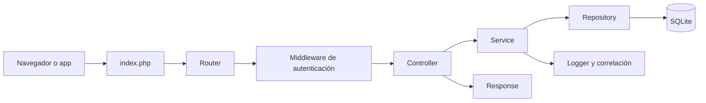
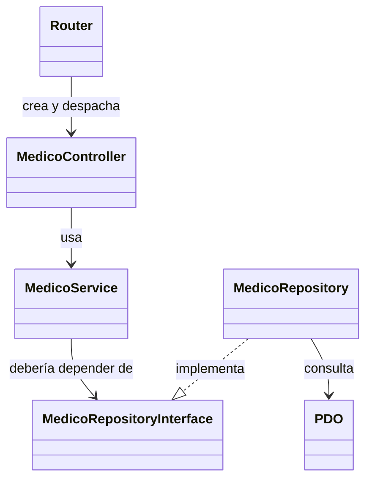
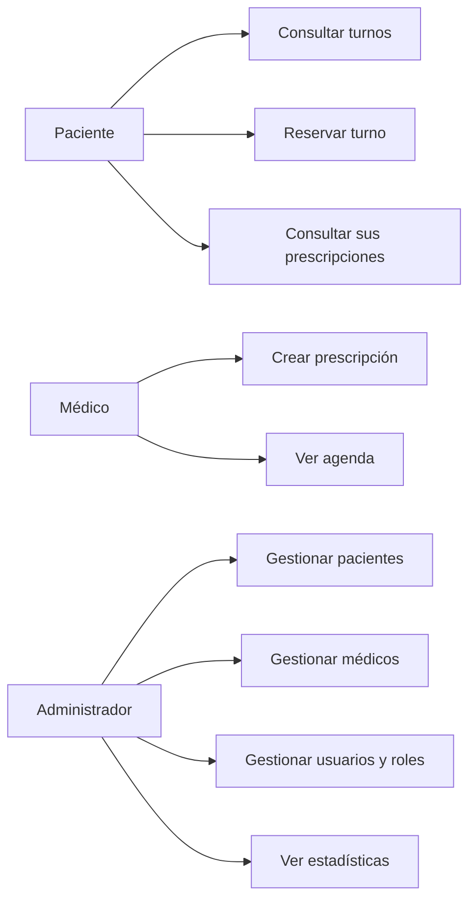
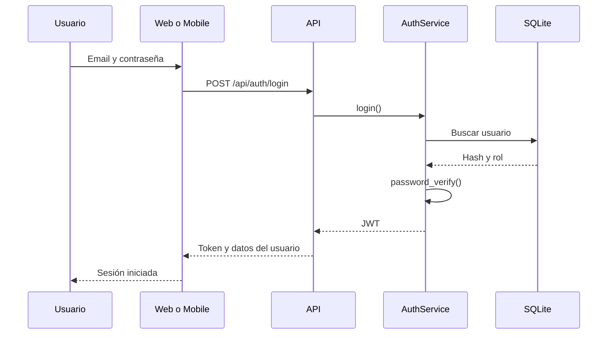
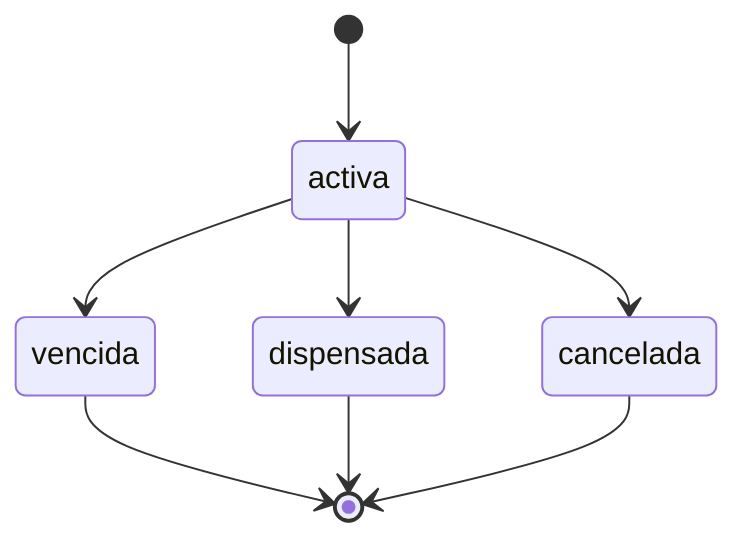

# Metodología de Sistemas II aplicada a SaludWEB

**Materia:** Metodología de Sistemas II 
**Carrera:** Tecnicatura en Programación 
**Institución:** UTN Facultad Regional Paraná 
**Autora:** Ailen Adriana Quaglino Fail 
**Proyecto:** SaludWEB (Backend PHP/SQLite, Web React y Mobile React Native/Expo) 
**Fecha de la aplicación:** 25/10/2026

---

## Índice

0. [Introducción y alcance](#0-introducción-y-alcance)
1. [Calidad de diseño y SOLID](#1-calidad-de-diseño-y-solid)
2. [Arquitectura, lógica del negocio y acceso a datos](#2-arquitectura-lógica-del-negocio-y-acceso-a-datos)
3. [Patrones de diseño](#3-patrones-de-diseño)
4. [UML, CASE, representación lógica y documentación](#4-uml-case-representación-lógica-y-documentación)
5. [UI/UX y evaluación de usabilidad](#5-uiux-y-evaluación-de-usabilidad)
6. [Pruebas y aseguramiento de la calidad](#6-pruebas-y-aseguramiento-de-la-calidad)
7. [Resolución del TP N.º 1](#7-resolución-del-tp-nº-1)
8. [Resolución del TP N.º 2](#8-resolución-del-tp-nº-2)
9. [TP N.º 3 e integración final](#9-tp-nº-3-e-integración-final)
10. [Hallazgos y mejoras priorizadas](#10-hallazgos-y-mejoras-priorizadas)
11. [Conclusión](#11-conclusión)
12. [Trazabilidad, límites y bibliografía](#12-trazabilidad-límites-y-bibliografía)

---

## 0. Introducción y alcance

Este documento aplica al proyecto **SaludWEB** el material de la cátedra de Metodología de Sistemas II: calidad de diseño, principios SOLID, arquitectura, lógica del negocio, acceso a datos, UML, documentación técnica, representación lógica, pruebas, UI/UX y patrones de diseño. También ordena la resolución de los tres trabajos prácticos de la materia.

No reemplaza las consignas originales ni el código de la aplicación. Es un documento de aplicación: cada concepto se explica y después se vincula con una decisión concreta del sistema. **No se modificó el código de la aplicación.**

### Cómo leerlo

Hay tres niveles de afirmación:

1. **Hecho verificado:** surge del repositorio y se cita como `archivo:línea`.
2. **Propuesta de mejora:** es una decisión sugerida; se marca como “propuesta” y no debe leerse como algo ya implementado.
3. **Ejemplo didáctico:** sirve para explicar un concepto, aunque el proyecto no lo use todavía.

### Fuentes usadas

| Fuente | Uso en este documento |
|---|---|
| Material de cátedra sobre calidad de diseño y principios | Criterios de evaluación de la arquitectura |
| Material sobre SOLID | Análisis de clases, interfaces y dependencias |
| Material sobre UI/UX | Evaluación heurística y prueba de usabilidad |
| Material sobre lógica del negocio y acceso a datos | Capas, reglas y persistencia |
| Material sobre UML y herramientas CASE | Diagramas y representación lógica |
| Material sobre documentación técnica | README, guías, QA y trazabilidad |
| Material sobre pruebas | Estrategia, niveles y evidencia |
| Material sobre patrones de diseño | Repository, Service, Adapter y propuestas |
| TP N.º 1, TP N.º 2 y TP N.º 3 | Actividades aplicadas |

### Aclaración importante

SaludWEB es un proyecto académico funcional, no una empresa constituida. Cuando se habla de “la organización” o de “los usuarios”, se describe el sistema y sus actores reales. Las mejoras de arquitectura y las propuestas de patrones son recomendaciones para una próxima iteración.

---

## 1. Calidad de diseño y SOLID

### 1.1 Los diez principios aplicados

| Principio | Qué exige | Evidencia en SaludWEB | Deuda o límite |
|---|---|---|---|
| Cohesión | Una clase debe tener un motivo claro para cambiar | `Validador` concentra validación y saneamiento (`core/Validador.php:7-27`); `Peticion` concentra trazabilidad (`core/Peticion.php:7-14`) | `routes.php` mezcla composición, CORS, adaptación HTTP y manejo de errores |
| Acoplamiento | Cambiar una parte no debe arrastrar a todas las demás | Servicios y repositorios están separados por constructor (`controllers/MedicoController.php:17-24`) | Varios servicios dependen de repositorios concretos, no de interfaces (`services/MedicoService.php:19-26`) |
| Abstracción | Mostrar el contrato y ocultar el detalle | Interfaces por agregado (`persistence/MedicoRepositoryInterface.php:10-26`) | La interfaz existe, pero no siempre se usa en el punto de inyección |
| Encapsulamiento | El estado interno no debe quedar expuesto | Propiedades privadas y métodos públicos en servicios y controladores (`services/MedicoService.php:17-19`) | `routes.php` conoce demasiados detalles de construcción |
| Modularidad | Separar por responsabilidad y permitir reemplazo | Carpetas `controllers/`, `services/`, `persistence/`, `core/` | La composición manual está concentrada en un archivo de 933 líneas |
| Jerarquía | Organizar dependencias en niveles claros | HTTP → Controller → Service → Repository → PDO | No hay una capa explícita de casos de uso o DTO |
| Simplicidad | Resolver sin complejidad innecesaria | Envelope único de respuesta (`core/Response.php:12-13`) | Los `try/catch` repetidos en rutas agregan ruido |
| Robustez | Soportar errores y entradas inválidas | Validadores, control de errores y restricciones de base (`db.php:147`, `db.php:407`) | Faltan `CHECK` para estados y niveles de triage |
| Flexibilidad | Permitir cambios acotados | Proveedor de notificaciones detrás de una interfaz (`services/Notificacion/ProveedorNotificacionesInterface.php:7-26`) | El frontend y el backend tienen reglas de autorización duplicadas y desiguales |
| Reutilización | Evitar repetir lógica | `Validador`, `Response`, `Logger`, `Peticion`, componentes de UI y tokens CSS | Hay documentos y estilos con copias manuales entre repositorios |

La lectura global es positiva: el proyecto separa responsabilidades y tiene una arquitectura reconocible. El problema no es “falta de capas”, sino que la composición y algunas reglas de acceso quedaron concentradas o incompletas.

### 1.2 SOLID, principio por principio

#### S — Responsabilidad única

Cada capa tiene una responsabilidad principal:

- `core/Router.php` resuelve el despacho de rutas (`core/Router.php:13-27`).
- `controllers/MedicoController.php` traduce HTTP a llamadas del servicio (`controllers/MedicoController.php:17-24`).
- `services/MedicoService.php` aplica reglas y prepara datos (`services/MedicoService.php:7-12`).
- `persistence/MedicoRepository.php` implementa el acceso a datos (`persistence/MedicoRepository.php:15`).

**Lo que falta:** `routes.php` no solo registra rutas; también crea dependencias, configura CORS y captura excepciones. Es una concentración de responsabilidades que conviene dividir en una capa de composición.

#### O — Abierto/cerrado

El sistema permite cambiar el proveedor de notificaciones sin tocar el servicio que lo usa:

- Contrato: `services/Notificacion/ProveedorNotificacionesInterface.php:7-26`.
- Implementación actual: `services/Notificacion/ProveedorNotificacionesStub.php:7-35`.
- Punto de elección: `core/bootstrap.php:310-312`.

La extensión está bien encapsulada. En cambio, agregar un nuevo recurso HTTP obliga a editar `routes.php`, porque no hay un registro automático de controladores.

#### L — Sustitución de Liskov

El stub de notificaciones respeta el contrato de la interfaz y puede sustituirse por un proveedor real sin cambiar al consumidor (`services/Notificacion/ProveedorNotificacionesStub.php:7-35`). No se encontraron jerarquías de herencia profundas que pongan en riesgo este principio.

#### I — Segregación de interfaces

Las interfaces están separadas por agregado: médicos, citas, disponibilidad, notificaciones (por ejemplo, `persistence/MedicoRepositoryInterface.php:10-26`). Esto evita obligar a un repositorio a implementar métodos que no le corresponden.

#### D — Inversión de dependencias

Hay una aplicación parcial:

- `RealtimeService` recibe una interfaz (`services/RealtimeService.php:71`).
- `UsuarioService` recibe una interfaz (`services/UsuarioService.php:69`).
- En cambio, `MedicoService` declara el repositorio concreto (`services/MedicoService.php:19`, `services/MedicoService.php:26`), aunque existe `MedicoRepositoryInterface`.

**Conclusión:** la arquitectura está preparada para DIP, pero no lo aplica en todos los servicios. La corrección es de bajo riesgo: cambiar el tipo del constructor y la propiedad por la interfaz, manteniendo la implementación concreta en bootstrap.

---

## 2. Arquitectura, lógica del negocio y acceso a datos

### 2.1 Capas y flujo de una petición

| Capa | Responsabilidad | Ejemplos |
|---|---|---|
| Entrada | Cargar configuración y despachar | `index.php:7-11` |
| Router | Registrar rutas y middlewares | `core/Router.php:13-27` |
| Composición | Crear PDO, repositorios, servicios y controladores | `core/bootstrap.php:232-312` |
| HTTP | Validar entrada, llamar al servicio y responder | `controllers/MedicoController.php:17-24` |
| Negocio | Aplicar reglas y coordinar repositorios | `services/CitaService.php:10-20` |
| Persistencia | Ejecutar SQL y mapear resultados | `persistence/MedicoRepository.php:15` |
| Infraestructura | Logs, errores, correlación, seguridad | `core/Peticion.php:7-14`, `core/Logger.php` |

El flujo es el de una API REST en capas, no el de un MVC clásico con vistas del lado del servidor. El frontend es una SPA que consume JSON.

### 2.2 Lógica del negocio

La lógica importante no está en el frontend ni en el SQL: está en los servicios.

- **Turnos:** se controla disponibilidad, superposición y una cita viva por paciente (`services/CitaService.php:10-20`).
- **Prescripciones:** solo un médico puede crear o editar; el administrador puede eliminar; el cambio de estado está disponible para usuarios autenticados (`routes.php:403-472`).
- **Usuarios:** se validan roles, no se permite autodegradarse y no se puede degradar al último administrador (`services/UsuarioService.php:25-33`).
- **Autenticación:** contraseñas con bcrypt, tokens JWT y verificación de firma (`services/AuthService.php:86-89`, `core/JwtService.php:67-84`).
- **SSO:** Google y Microsoft se validan contra claves públicas del proveedor (`services/AuthService.php:252-342`).

La lógica está bien ubicada, pero hay una deuda de autorización: algunos recursos de pacientes y prescripciones solo verifican que exista un token, sin comprobar el rol ni la pertenencia (`routes.php:148-150`, `routes.php:319-321`, `routes.php:375-378`, `routes.php:453-456`). Es el hallazgo más importante de este documento y se desarrolla en la sección 10.

### 2.3 Acceso a datos

El acceso a datos sigue estas decisiones:

- SQLite como base local, sin servidor externo (`PROJECT_BRIEF.md:87-91`).
- PDO con SQL preparado para evitar inyección (`PROJECT_BRIEF.md:91`).
- Claves foráneas activas (`db.php:147`).
- Restricciones de unicidad para evitar turnos duplicados (`db.php:407`).
- Índices para búsquedas y listados (`db.php:221`, `db.php:367`, `db.php:409-411`).

**Ventajas:** instalación simple, bajo costo, buen rendimiento para el volumen académico y una sola fuente de verdad local.

**Límites:** el esquema se crea desde `db.php`, no hay un sistema de migraciones versionadas; las fechas y horas se guardan como `TEXT`; dos campos clínicos usan JSON en texto (`db.php:265`, `db.php:514`). Para un sistema real habría que agregar migraciones, validaciones de esquema y una estrategia de respaldo.

### 2.4 Diagrama de clases simplificado

El diagrama muestra el diseño deseado. En el código actual, `MedicoService` apunta a `MedicoRepository` concreto; la flecha punteada indica la corrección de DIP pendiente.

---

## 3. Patrones de diseño

### 3.1 Patrones presentes

| Patrón | Problema que resuelve | Dónde está | Costo o límite |
|---|---|---|---|
| Repository | Aislar el SQL del negocio | `persistence/MedicoRepository.php:15` | No todos los servicios lo consumen por interfaz |
| Service Layer | Concentrar reglas y coordinar repositorios | `services/PacienteService.php:3-6` | Hay servicios con demasiadas responsabilidades |
| Front Controller | Una sola entrada para todas las rutas | `index.php:7-11` | `routes.php` crece demasiado |
| Dependency Injection | Recibir dependencias en vez de crearlas | `controllers/MedicoController.php:17-24` | La composición es manual y centralizada |
| Middleware | Separar autenticación y autorización | `core/AuthMiddleware.php:7-11` | Algunas rutas no aplican autorización por rol |
| Provider/Strategy incipiente | Cambiar el proveedor de notificaciones | `services/Notificacion/ProveedorNotificacionesInterface.php:7-26` | Solo hay una implementación real (stub) |
| Outbox | Guardar el aviso antes de enviarlo | `services/NotificacionService.php:17-30` | No reemplaza una cola de mensajes madura |
| Adapter de SSO | Uniformar Google y Microsoft detrás de una operación | `services/AuthService.php:332-342` | La lógica de cada proveedor está en métodos privados del servicio |

### 3.2 Patrones que no están implementados formalmente

No se encontraron clases propias llamadas `Factory`, `Observer`, `Decorator` o `Strategy` en el sentido estricto de los patrones de Gamma et al. Sí hay *equivalencias conceptuales*:

- El **Outbox + SSE** funciona como un observer distribuido: el backend publica un aviso y el frontend reacciona (`AGENDA_DE_TRABAJO.md:111-120`).
- El **proveedor de notificaciones** funciona como strategy, aunque todavía tenga una sola implementación.
- El **SSO** funciona como adapter, porque `loginSso()` delega en `validarGoogle()` o `validarMicrosoft()` (`services/AuthService.php:332-342`).

### 3.3 Propuestas para el TP N.º 2

| Patrón | Aplicación propuesta | Beneficio | Riesgo |
|---|---|---|---|
| Factory Method | Crear controladores desde una fábrica en lugar de 58 `new` manuales en `routes.php` | Menos duplicación y composición más legible | Agregar una capa innecesaria si no se documenta |
| Adapter | Encapsular Google y Microsoft en clases adaptadoras separadas | Aislar detalles de cada proveedor | Más archivos y pruebas |
| Observer | Formalizar el aviso SSE y la reacción del frontend | Desacoplar emisor y consumidor | No confundir evento con fuente de verdad |
| Strategy | Convertir el proveedor de notificaciones en estrategias intercambiables | Probar correo, SMS y stub sin tocar el servicio | Requiere configuración y pruebas de integración |

La recomendación es empezar por **Factory** y **Strategy**, porque atacan dos problemas concretos: el tamaño de `routes.php` y la evolución del módulo de notificaciones.

---

## 4. UML, CASE, representación lógica y documentación

### 4.1 Herramientas CASE y UML

El proyecto no depende de una herramienta CASE propietaria. La documentación usa Markdown y Mermaid, que son herramientas livianas, versionables y compatibles con GitHub. Para diagramas más formales se podría usar draw.io, PlantUML o Visual Paradigm, pero el principio es el mismo: el diagrama debe vivir cerca del código y actualizarse con él.

### 4.2 Diagramas que necesita el sistema

| Diagrama | Para qué sirve en SaludWEB | Estado |
|---|---|---|
| Casos de uso | Mostrar actores y acciones permitidas | Recomendado; no hay diagrama completo |
| Clases | Mostrar capas, contratos y dependencias | Hay guías de código y este documento agrega uno simplificado |
| Secuencia | Explicar login, reserva o prescripción | Recomendado; no hay diagrama completo |
| Estados | Mostrar el ciclo de una cita o prescripción | Recomendado; se puede derivar del código |
| Entidad-relación | Documentar tablas y claves | Presente en la documentación de Bases de Datos I |
| Arquitectura | Mostrar frontend, API, persistencia y tiempo real | Parcialmente documentado en README y guías |

### 4.3 Casos de uso principales

### 4.4 Secuencia de login

### 4.5 Estado de una prescripción

El código permite cambiar el estado, pero no hay una máquina de estados que impida transiciones inválidas. Es una mejora recomendable: validar que “dispensada” no vuelva a “activa” sin una regla explícita.

### 4.6 Documentación técnica y representación lógica

El proyecto tiene una base documental sólida:

- `GUIA_DE_CODIGO.md` y la carpeta `GUIA_CODIGO/` explican el código por archivo (`GUIA_DE_CODIGO.md:1-20`).
- `DOCUMENTAR_Y_PUBLICAR_EL_CAMINO_AL_EXITO.md` ordena la documentación y la publicación.
- Los cinco entregables de `QA/` registran checklist, matriz, incidentes, resultados y confirmación (`QA/01_checklist_de_calidad.md:9-20`).
- Los documentos aplicados de cada materia conectan la teoría con el sistema.

La representación lógica del sistema se apoya en tres piezas: casos de uso, modelo de datos y reglas de negocio. La documentación de Bases de Datos I aporta el DER y el diccionario de datos; este documento aporta la vista de arquitectura y de comportamiento.

**Lo que falta:** un diagrama de casos de uso formal, un diagrama de secuencia por cada flujo crítico y un registro de decisiones de arquitectura (ADR). Son mejoras de documentación, no fallas funcionales.

---

## 5. UI/UX y evaluación de usabilidad

### 5.1 Evaluación heurística de Nielsen aplicada

| Heurística | Evidencia | Resultado |
|---|---|---|
| Visibilidad del estado | Estados de carga, error y vacío en listados (`SaludWEB_Web/src/components/Medicos/ListaMedicos.jsx:189-199`) | Bien resuelto |
| Correspondencia con el mundo real | Etiquetas en español, roles y términos del dominio | Bien resuelto |
| Control y libertad del usuario | Modales de confirmación y acciones de cancelar | Bien resuelto; faltan deshacer en acciones destructivas |
| Consistencia y estándares | Tokens de color y espaciado (`SaludWEB_Web/src/tokens.css:1-27`) | Bien, con una inconsistencia de breakpoints |
| Prevención de errores | Validación de formularios, restricciones de turnos y confirmación de borrado | Bien; falta validación de estados en base |
| Reconocimiento antes que recuerdo | Navegación visible y estado activo (`SaludWEB_Web/src/App.css:732-750`) | Bien |
| Flexibilidad y eficiencia | Búsqueda, paginado y debounce (`SaludWEB_Mobile/src/screens/PagedList.jsx:43-58`) | Bien |
| Diseño estético y minimalista | Uso de tokens, tarjetas y jerarquía visual | Bien |
| Ayuda al usuario a recuperarse de errores | Mensajes de error, aviso offline (`SaludWEB_Web/src/components/common/AvisoOffline.jsx:84-86`) | Bien; algunos mensajes del backend son técnicos |
| Ayuda y documentación | README, guías y documentación de instalación | Bien; falta ayuda contextual dentro de la app |

### 5.2 Accesibilidad

El proyecto incorpora prácticas concretas:

- Etiquetas asociadas a campos (`SaludWEB_Web/src/components/Auth/Login.jsx:69-70`).
- Modal con `role="alertdialog"` y `aria-modal` (`SaludWEB_Web/src/components/common/ConfirmarModal.jsx:46-47`).
- Paginación con `aria-live` (`SaludWEB_Web/src/components/common/Paginacion.jsx:86-88`).
- Foco visible y respeto por `prefers-reduced-motion` (`SaludWEB_Web/src/App.css:249`, `SaludWEB_Web/src/App.css:475-489`, `SaludWEB_Web/src/App.css:599`).
- En mobile, tamaños táctiles y contraste documentados (`SaludWEB_Mobile/src/styles.js:61-80`).

**Pendiente:** revisar el contraste y los nombres accesibles de los controles de paginación móvil, y agregar pruebas automáticas de accesibilidad. La verificación existente de 12/12 contrastes es una buena señal, no una cobertura completa.

### 5.3 Diseño responsive

- Las tablas se transforman en tarjetas con `data-label` (`SaludWEB_Web/src/components/Medicos/Medicos.css:415-475`).
- El breakpoint principal es 768 px (`SaludWEB_Web/src/App.css:714`).
- La barra inferior web usa patrón mobile-first (`SaludWEB_Web/src/App.css:732-750`).
- La app móvil usa `SafeAreaView` y navegación inferior (`SaludWEB_Mobile/App.js:20-31`, `SaludWEB_Mobile/src/components/BottomNav.jsx:16-43`).

**Inconsistencia detectada:** la turnera mantiene un breakpoint de 640 px (`SaludWEB_Web/src/components/Turnera/Turnera.css:17`, `SaludWEB_Web/src/components/Turnera/Turnera.css:694`) mientras la documentación afirma un único corte de 768 px (`SaludWEB_Web/src/App.css:702-714`). Hay que unificar.

### 5.4 Plan de prueba de usabilidad (TP N.º 2)

**Objetivo:** verificar si un usuario nuevo puede completar las tareas críticas sin ayuda.

**Perfil:** 5 participantes adultos, con experiencia básica en navegación web; al menos uno con poca familiaridad con sistemas de salud.

**Tareas:**

1. Iniciar sesión como paciente.
2. Reservar un turno disponible.
3. Ver “Mis turnos” y cancelar una reserva.
4. Iniciar sesión como médico y crear una prescripción.
5. Iniciar sesión como administrador y revisar estadísticas.

**Métricas:**

| Métrica | Cómo se mide |
|---|---|
| Éxito | Tarea completada sin ayuda |
| Tiempo | Segundos desde el inicio hasta la confirmación |
| Errores | Cantidad y tipo de errores |
| Ayuda | Veces que el moderador interviene |
| Satisfacción | Escala simple de 1 a 5 al finalizar |

**Guion:** explicar que se prueba el sistema, no a la persona; pedir “pensar en voz alta”; no dar pistas; registrar observaciones; cerrar con preguntas abiertas.

**Límite:** con 5 participantes se detectan problemas de usabilidad, pero no se generalizan resultados estadísticos. Es una prueba cualitativa.

---

## 6. Pruebas y aseguramiento de la calidad

### 6.1 Estrategia por niveles

| Nivel | Qué verifica | Evidencia |
|---|---|---|
| Unitarias backend | Utilidades de seguridad, logging, validación y rate limiting | 50/50 en 5 clases (`QA/04_registro_de_resultados.md:21-31`) |
| Integración backend | Roles, vinculación, turnera, tiempo real y salud de la API | Suites `probar_*.php` (`QA/04_registro_de_resultados.md:22-28`) |
| Unitarias Web | Logger y correlación | 32/32 (`QA/04_registro_de_resultados.md:44`) |
| Unitarias Mobile | Logger y correlación | 27/27 (`QA/04_registro_de_resultados.md:60`) |
| E2E Web | PWA, instalación, offline y caché | 12/12 (`QA/04_registro_de_resultados.md:48`) |
| E2E tiempo real | Dos navegadores y actualización sin recarga | No ejecutado por limitación del servidor mono-hilo (`QA/04_registro_de_resultados.md:49-54`) |

### 6.2 Casos de prueba representativos

| ID | Dado | Cuando | Entonces | Evidencia |
|---|---|---|---|---|
| T01 | Un usuario sin token | Pide `/api/pacientes` | Responde 401 | `routes.php:148-150`, QA INC-001 |
| T02 | Un paciente autenticado | Intenta crear una prescripción | Responde 403 | `routes.php:406-410` |
| T03 | Un admin | Degrada al último administrador | Responde 409 | `services/UsuarioService.php:25-33` |
| T04 | Un paciente | Reserva un turno ya ocupado | La base rechaza el duplicado | `db.php:407` |
| T05 | Un médico | Consulta su agenda | Solo ve sus turnos | `routes.php:572-573`, `services/EstadisticaService.php:63-72` |
| T06 | Un usuario | Pierde la conexión | Ve el aviso offline | `SaludWEB_Web/src/components/common/AvisoOffline.jsx:84-86` |
| T07 | Un administrador | Abre el panel | Ve métricas por REST y avisos SSE | `SaludWEB_Web/src/components/Dashboard/Dashboard.jsx:416-481` |
| T08 | Un paciente | Pide un canal SSE ajeno | Responde 403 | `AGENDA_DE_TRABAJO.md:158` |

### 6.3 Lo que falta probar

- Servicios y controladores de backend con pruebas unitarias aisladas.
- Componentes, hooks y pantallas de Web y Mobile.
- Flujo completo de prescripción con reglas de transición de estado.
- Autorización de pacientes y prescripciones, que hoy no está cubierta por las pruebas de roles.
- Accesibilidad automática y manual con lector de pantalla.
- Migraciones y restauración de base de datos.

La evidencia es abundante para un proyecto académico, pero la pirámide está invertida: hay muchas pruebas de integración y pocas unitarias de lógica de negocio.

---

## 7. Resolución del TP N.º 1

El TP N.º 1 pide analizar la calidad del diseño y aplicar principios, patrones, UML, documentación, pruebas y UI/UX. La respuesta se organiza así:

| Consigna del TP | Dónde se responde |
|---|---|
| Principios de calidad | Sección 1.1 |
| SOLID | Sección 1.2 |
| Lógica del negocio | Sección 2.2 |
| Acceso a datos | Sección 2.3 |
| UML y CASE | Sección 4 |
| Documentación técnica | Sección 4.6 |
| Representación lógica | Secciones 4.3 a 4.5 |
| Pruebas | Sección 6 |
| Patrones | Sección 3 |
| UI/UX | Sección 5 |

### 7.1 Ejemplos de diseño que se pueden defender

1. **Separación de capas:** el controlador no ejecuta SQL y el repositorio no decide reglas de negocio.
2. **Contrato de respuesta:** todos los endpoints exitosos y de error usan el mismo envelope (`core/Response.php:12-13`).
3. **Seguridad:** JWT, bcrypt, rate limiting y validación de entrada (`core/JwtService.php:67-84`, `services/AuthService.php:86-89`).
4. **Manejo de errores:** `Peticion` centraliza excepciones y latencia (`core/Peticion.php:7-14`).
5. **Trazabilidad:** logs JSON con `correlation_id` y devolución del identificador al cliente (`README.md:452-496`).

### 7.2 Ejemplos de diseño que conviene mejorar

1. **Autorización incompleta:** hay autenticación, pero no siempre autorización por rol o pertenencia.
2. **Composición centralizada:** `routes.php` tiene 933 líneas y 58 instanciaciones manuales.
3. **DIP parcial:** las interfaces existen, pero no se usan en todos los servicios.
4. **Pruebas de lógica:** faltan unitarias de servicios y controladores.
5. **Diagramas:** faltan casos de uso y secuencias formales.

---

## 8. Resolución del TP N.º 2

El TP N.º 2 se concentra en patrones de diseño, evaluación heurística y prueba de usabilidad.

### 8.1 Patrones solicitados

| Patrón | Estado en SaludWEB | Aplicación o propuesta |
|---|---|---|
| Factory Method | No implementado | Fábrica de controladores para reducir el `new` repetido en `routes.php` |
| Adapter | Equivalente en SSO | `loginSso()` delega en validadores de Google y Microsoft (`services/AuthService.php:332-342`) |
| Observer | Equivalente en SSE/outbox | El evento avisa y el frontend reacciona (`AGENDA_DE_TRABAJO.md:111-120`) |
| Strategy | Parcial | El proveedor de notificaciones está detrás de una interfaz (`services/Notificacion/ProveedorNotificacionesInterface.php:7-26`) |

### 8.2 Comparación de patrones

- **Factory** reduce el acoplamiento entre el registro de rutas y la construcción de controladores. Es útil si el proyecto sigue creciendo.
- **Adapter** es el más claro de justificar: Google y Microsoft tienen protocolos y validaciones distintas, pero el resto del sistema solo necesita un `loginSso()`.
- **Observer** ya existe de hecho, pero conviene documentarlo como patrón de integración y no como una segunda fuente de datos.
- **Strategy** permite probar notificaciones sin enviar correos reales; el stub actual ya cumple ese papel.

### 8.3 Evaluación heurística

Se aplicaron las diez heurísticas de Nielsen. El resultado completo está en la sección 5.1. Las dos observaciones más importantes son:

1. La interfaz comunica bien los estados de carga, error y vacío.
2. La inconsistencia de breakpoints entre 640 y 768 px puede producir saltos visuales en pantallas intermedias.

### 8.4 Prueba de usabilidad

El plan está en la sección 5.4. La prueba debe ejecutarse con 5 participantes y registrar éxito, tiempo, errores, ayuda y satisfacción. No se ejecutó en el marco de este documento; se deja el instrumento listo para aplicar.

### 8.5 Entregable del TP N.º 2

- Análisis de los cuatro patrones.
- Evaluación heurística con evidencia.
- Plan de prueba de usabilidad.
- Propuestas de mejora priorizadas.
- Conclusión sobre qué patrones conviene implementar primero.

---

## 9. TP N.º 3 e integración final

El TP N.º 3 integra todo el recorrido. Para SaludWEB se propone cerrarlo con un caso integrador que demuestre que el sistema no es solo un CRUD.

### 9.1 Caso integrador

**Situación:** un consultorio pequeño necesita gestionar pacientes, médicos, turnos y prescripciones con roles diferenciados y acceso desde web y celular.

**Actores:** paciente, médico, administrador y equipo de desarrollo.

**Flujo principal:**

1. El paciente se registra o inicia sesión.
2. Consulta la turnera y reserva un turno.
3. El sistema valida disponibilidad, superposición y unicidad.
4. El médico ve su agenda y crea una prescripción.
5. El administrador gestiona usuarios, médicos y pacientes.
6. El panel muestra métricas y se actualiza con avisos SSE.
7. El paciente consulta el estado de su prescripción.

### 9.2 Historias de usuario y criterios de aceptación

| Historia | Criterio de aceptación | Estado |
|---|---|---|
| Como paciente quiero reservar un turno | El turno queda confirmado y no se superpone | Implementado |
| Como médico quiero recetar | Solo un médico puede crear la prescripción | Implementado en backend y UI |
| Como administrador quiero gestionar roles | No se puede degradar al último admin | Implementado |
| Como usuario quiero ver el panel actualizado | El panel recibe avisos sin recargar | Implementado; E2E de dos navegadores pendiente |
| Como paciente quiero ver mis prescripciones | Solo veo las mías | Parcial: falta restringir el listado general |
| Como usuario quiero usar la app sin conexión | La PWA muestra el caparazón y avisa | Implementado |
| Como administrador quiero ver estadísticas | Veo demanda, ocupación, ausentismo y autogestión | Implementado |

### 9.3 Matriz de trazabilidad

| Concepto | Evidencia | Sección |
|---|---|---|
| Arquitectura en capas | `core/bootstrap.php:232-312` | 2 |
| Regla de negocio de turnos | `services/CitaService.php:10-20` | 2.2 |
| Persistencia | `db.php:147`, `db.php:407` | 2.3 |
| Patrones | `services/Notificacion/ProveedorNotificacionesInterface.php:7-26` | 3 |
| UML | Diagramas de este documento | 4 |
| UI/UX | `SaludWEB_Web/src/tokens.css:1-27` | 5 |
| Pruebas | `QA/04_registro_de_resultados.md:21-60` | 6 |
| Deuda de autorización | `routes.php:148-150`, `routes.php:375-378` | 10 |

### 9.4 Lista de verificación para la defensa

- [ ] Explicar el flujo de una petición desde el navegador hasta SQLite.
- [ ] Mostrar una regla de negocio y su prueba.
- [ ] Mostrar un caso de 401 y otro de 403.
- [ ] Explicar por qué se eligió SSE y no WebSocket.
- [ ] Mostrar el panel con datos reales.
- [ ] Explicar la diferencia entre evento SSE y fuente de verdad.
- [ ] Mostrar la evidencia de pruebas y sus límites.
- [ ] Reconocer la deuda de autorización y el plan para corregirla.
- [ ] Explicar por qué MySQL quedó como legado y SQLite es la base actual.

---

## 10. Hallazgos y mejoras priorizadas

| Prioridad | Hallazgo | Evidencia | Mejora propuesta |
|---|---|---|---|
| Alta | Pacientes y prescripciones no tienen autorización por rol o pertenencia | `routes.php:148-150`, `routes.php:319-321`, `routes.php:375-378`, `routes.php:453-456` | Exigir admin para gestión de pacientes y limitar al paciente a sus propios datos |
| Alta | El listado general de prescripciones queda disponible para cualquier token | `routes.php:375-378` | Filtrar por paciente o médico según el rol |
| Media | `routes.php` concentra composición y manejo de errores | `routes.php:127`, `routes.php:326-328`, `routes.php:932` | Extraer una capa de composición y un manejador común |
| Media | DIP parcial | `services/MedicoService.php:19-26` | Inyectar interfaces en todos los servicios |
| Media | Faltan unitarias de servicios y controladores | `QA/04_registro_de_resultados.md:30-31` | Agregar pruebas de reglas de negocio |
| Media | Diagramas UML incompletos | `Preparar_el_Sistema_para_Produccion_y_Defensa.md:215-235` | Agregar casos de uso y secuencias |
| Baja | Breakpoints inconsistentes | `SaludWEB_Web/src/App.css:702-714`, `SaludWEB_Web/src/components/Turnera/Turnera.css:17` | Unificar en 768 px o justificar dos cortes |
| Baja | Paleta móvil duplicada | `SaludWEB_Mobile/src/styles.js:7-13` | Generar tokens compartidos o documentar la paridad |
| Baja | Falta máquina de estados de prescripción | `db.php:269`, `routes.php:453-456` | Validar transiciones permitidas |

La prioridad alta no es un detalle de estilo: afecta la privacidad y la seguridad clínica. Debe resolverse antes de presentar el sistema como “seguro por roles”.

---

## 11. Conclusión

SaludWEB demuestra que un proyecto académico puede tener una arquitectura seria: capas claras, contratos, inyección de dependencias, pruebas, documentación y una interfaz cuidada. Los principios de diseño y SOLID se aplican en la mayoría de las clases, y los patrones Repository, Service, Middleware y Provider tienen un lugar real en el código.

El aprendizaje principal de Metodología de Sistemas II es que **la calidad no termina en que el sistema funcione**. También importa que las responsabilidades estén bien asignadas, que las decisiones se puedan explicar, que las pruebas demuestren lo que se afirma y que la seguridad se aplique en todos los recursos, no solo en los que se probaron.

La deuda más importante es la autorización de pacientes y prescripciones. Después vienen la composición de rutas, la inversión de dependencias y la cobertura unitaria. Ninguna de estas observaciones invalida el proyecto: lo vuelve más defendible y muestra un camino concreto de mejora.

---

## 12. Trazabilidad, límites y bibliografía

### 12.1 Evidencia del proyecto

| Afirmación | Evidencia |
|---|---|
| Front Controller y router | `index.php:7-11`, `core/Router.php:13-27` |
| Composición manual | `core/bootstrap.php:232-312` |
| Capas Controller/Service/Repository | `controllers/MedicoController.php:17-24`, `services/MedicoService.php:19-26` |
| Respuesta uniforme | `core/Response.php:12-13` |
| Turnos | `services/CitaService.php:10-20`, `db.php:407` |
| Roles y usuarios | `services/UsuarioService.php:25-33` |
| SSO | `services/AuthService.php:252-342` |
| Pruebas | `QA/04_registro_de_resultados.md:21-80` |
| UI y accesibilidad | `SaludWEB_Web/src/tokens.css:1-27`, `SaludWEB_Web/src/App.css:249-599` |
| Mobile | `SaludWEB_Mobile/src/screens/PagedList.jsx:43-58`, `SaludWEB_Mobile/src/components/BottomNav.jsx:16-43` |

### 12.2 Límites

- No se modificó el código de la aplicación.
- No se ejecutó una prueba de usabilidad con personas.
- No hay medición formal de cobertura ni de deuda técnica.
- El E2E de tiempo real con dos navegadores no se ejecutó por la limitación del servidor PHP mono-hilo.
- Las propuestas de Factory, Strategy y máquina de estados son recomendaciones, no implementaciones.
- La evaluación de autorización se basa en lectura de rutas y servicios; no se hizo un pentest.

### 12.3 Bibliografía

1. Sommerville, I. (2015). *Software Engineering* (10.ª ed.). Pearson.
2. Pressman, R. S. (2014). *Software Engineering: A Practitioner's Approach* (8.ª ed.). McGraw-Hill.
3. Martin, R. C. (2017). *Clean Architecture: A Craftsman's Guide to Software Structure and Design*. Prentice Hall.
4. Martin, R. C. (2002). *Agile Software Development: Principles, Patterns, and Practices*. Prentice Hall.
5. Gamma, E., Helm, R., Johnson, R., & Vlissides, J. (1994). *Design Patterns: Elements of Reusable Object-Oriented Software*. Addison-Wesley.
6. Fowler, M. (2002). *Patterns of Enterprise Application Architecture*. Addison-Wesley.
7. Evans, E. (2003). *Domain-Driven Design: Tackling Complexity in the Heart of Software*. Addison-Wesley.
8. Cockburn, A. (2001). *Writing Effective Use Cases*. Addison-Wesley.
9. Booch, G., Rumbaugh, J., & Jacobson, I. (2005). *The Unified Modeling Language User Guide* (2.ª ed.). Addison-Wesley.
10. Nielsen, J. (1993). *Usability Engineering*. Academic Press.
11. W3C. (2023). *Web Content Accessibility Guidelines (WCAG) 2.2*.
12. ISO/IEC. (2011). *ISO/IEC 25010:2011 — Systems and software Quality Requirements and Evaluation (SQuaRE): Quality model*.
13. Beck, K. (2002). *Test-Driven Development: By Example*. Addison-Wesley.
14. OWASP. (2023). *OWASP API Security Top 10*.
