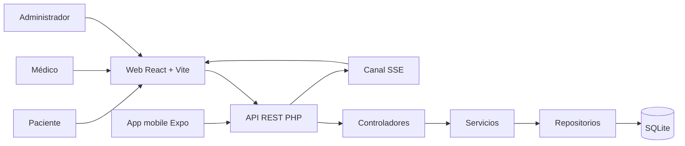

# Simulación de Defensa Final: SaludWEB

<!--
DOCUMENTO COMENTADO - SALUDWEB
==============================
Esta es la aplicación al proyecto SaludWEB de la guía "Simulación de Defensa
Final". El texto visible es el documento de trabajo; los comentarios van entre
marcadores HTML y no se ven cuando GitHub renderiza el Markdown.

Cómo leerlo:
- Cada sección tiene un comentario que explica para qué sirve en la defensa.
- Cada tabla y cada bloque de código tiene un comentario con el criterio usado.
- Los fragmentos de código se explican línea por línea en tablas visibles.
- Las afirmaciones importantes se conectan con un archivo y una línea del
  repositorio para que puedan verificarse durante la ronda de preguntas.

Alcance: es una simulación interna de ensayo. No reemplaza el documento
COMO_DEFENDER_UN_PROYECTO_PROFESIONAL_APLICADO.md ni la documentación oficial
de la carrera. Sirve para practicar el recorrido completo, medir tiempos y
llegar al día de la defensa con evidencia preparada.
-->

Preparación rigurosa y estructurada para enfrentar con confianza el momento más importante del proceso académico: la defensa ante el tribunal evaluador.

<!--
El subtítulo conserva la intención del material original: la defensa no se
improvisa. La palabra "estructurada" es la que ordena todo el documento.
-->

**Presentado por:** Ailen Adriana Quaglino Fail<br>
**Candidata a titulación:** Tecnicatura en Programación<br>
**Institución:** UTN Facultad Regional Paraná<br>
**Asesor/a responsable:** [completar]<br>
**Departamento:** [completar]<br>
**Fecha de defensa:** [completar]

<!--
Los datos personales y académicos salen de los documentos del proyecto. El
asesor, el departamento y la fecha quedan como campos a completar porque no
surgen del repositorio y no corresponde inventarlos.
-->

> **Uso:** documento de simulación y ensayo. No es una entrega oficial ni un
> reemplazo del reglamento de la carrera.

<!--
Esta aclaración evita que el documento se confunda con un formulario oficial.
También deja claro que los datos que faltan se completan fuera del repositorio.
-->

---

## Índice

0. [Cómo usar esta simulación](#0-cómo-usar-esta-simulación)
1. [El camino hacia la defensa: orden de presentación](#1-el-camino-hacia-la-defensa-orden-de-presentación)
2. [Planteamiento: el problema y la solución](#2-planteamiento-el-problema-y-la-solución)
3. [Fundamentación: objetivos y bases](#3-fundamentación-objetivos-y-bases)
4. [Ejecución: arquitectura y tecnologías](#4-ejecución-arquitectura-y-tecnologías)
5. [Validación: demostración funcional](#5-validación-demostración-funcional)
6. [Núcleo técnico: código clave](#6-núcleo-técnico-código-clave)
7. [Resultados y discusión](#7-resultados-y-discusión)
8. [Conclusiones](#8-conclusiones)
9. [Ronda de preguntas](#9-ronda-de-preguntas)
10. [Entregable final: guion y video](#10-entregable-final-guion-y-video)
11. [Ensayo y checklist](#11-ensayo-y-checklist)
12. [Anexo: matriz de evidencia](#12-anexo-matriz-de-evidencia)

<!--
El índice reproduce el orden del material original, pero lo aterriza en
SaludWEB. Cada número coincide con una sección para que el ensayo pueda
cronometrarse y para que el tribunal pueda seguir el hilo.
-->

---

## 0. Cómo usar esta simulación

<!--
Sección de método. Antes de ensayar el contenido hay que saber cómo se va a
ensayar: solo, con tribunal simulado y con demo real.
-->

Esta simulación se practica en tres rondas. Cada ronda tiene un objetivo distinto y no conviene mezclarlas.

<!--
La separación en rondas evita el error más común: ensayar todo junto, corregir
el contenido y la dicción al mismo tiempo, y no medir nada.
-->

| Ronda | Con quién | Qué se practica | Duración |
|---|---|---|---|
| 1 | Solo/a, frente a la pantalla | Memorizar la estructura y detectar muletillas | 12 minutos |
| 2 | Con una persona que haga de tribunal | Preguntas, interrupciones y lenguaje corporal | 20 minutos |
| 3 | Con la demo real y el video | Tiempos, transiciones y plan B | 25 minutos |

<!--
La ronda 1 trabaja la estructura; la 2, la interacción; la 3, la técnica. Si se
hace primero la 3, el nerviosismo por la demo tapa los problemas de relato.
-->

### Reglas de la simulación

<!--
Reglas simples para que el ensayo se parezca a la defensa real y no a una
lectura del documento.
-->

1. **No se lee:** se permite una tarjeta con cinco palabras por bloque.
2. **Se cronometra:** cada bloque tiene un tiempo máximo.
3. **Se graba:** el video se mira una vez, sin excusas.
4. **Se corrige una cosa por ronda:** primero estructura, después contenido, después técnica.
5. **Se ensaya el fracaso:** al menos una vez se simula que la demo no arranca.

<!--
Las cinco reglas cubren los cinco fallos típicos: leer, extenderse, no verse,
corregir demasiado y no tener plan B.
-->

### Antes de empezar, tener a mano

<!--
Checklist material. Si falta algo, se resuelve antes del ensayo, no durante.
-->

- La aplicación levantada con `SaludWEB_Web\scripts\iniciar_saludweb.bat`.
- Una cuenta de cada rol: admin, médico y paciente.
- Un turno de prueba y una receta de prueba.
- El video de respaldo y las capturas de pantalla.
- El repositorio abierto en una pestaña, en `README.md`.
- El documento `COMO_DEFENDER_UN_PROYECTO_PROFESIONAL_APLICADO.md` como referencia técnica.

<!--
El arranque de un solo clic ya no depende de XAMPP: usa PHP nativo y SQLite.
Tener las cuentas y los datos preparados evita improvisar frente al tribunal.
-->

---

## 1. El camino hacia la defensa: orden de presentación

<!--
Esta sección reemplaza la diapositiva genérica de "orden de presentación" por
un guion cronometrado para SaludWEB. La defensa completa se piensa en 12
minutos, con margen para preguntas.
-->

La estructura de una defensa exitosa no es improvisada: es el resultado de una planificación deliberada que guía al tribunal a través de un relato coherente, lógico y convincente.

<!--
La frase original se conserva porque resume el criterio: el tribunal no evalúa
solo datos sueltos, evalúa si el relato tiene sentido.
-->

| Orden | Bloque | Tiempo | Qué tiene que quedar claro |
|---|---|---|---|
| 01 | Planteamiento | 2 min | Qué problema real resuelve SaludWEB y a quién afecta |
| 02 | Fundamentación | 2 min | Qué objetivos guiaron el trabajo y con qué bases |
| 03 | Ejecución | 3 min | Cómo está construido y por qué se eligió así |
| 04 | Validación | 4 min | Que funciona, que cumple reglas y que resiste errores |
| 05 | Cierre | 1 min | Qué se logró, qué falta y qué sigue |

<!--
El reparto de tiempos es una decisión de defensa: la validación se lleva el
bloque más largo porque es donde el tribunal ve el sistema funcionando. La
arquitectura no se explica durante veinte minutos.
-->

### Transiciones que conviene memorizar

<!--
Las transiciones son las que hacen que cinco bloques parezcan una sola
exposición. Se memorizan literales para no improvisar en los cambios.
-->

- Del problema a la solución: “Ese problema es el que SaludWEB ordena”.
- De la solución a la arquitectura: “Para que eso funcione, el sistema se separa en tres capas”.
- De la arquitectura a la demo: “Ahora veamos cómo se comporta con un caso real”.
- De la demo al cierre: “Eso muestra el valor; ahora sí, las conclusiones”.

<!--
Cada frase conecta el bloque anterior con el siguiente. No agregan contenido:
agregan continuidad, que es lo que el tribunal percibe como dominio del tema.
-->

> **Regla:** si el tiempo se acorta, se recorta la explicación de tecnologías,
> nunca la demo ni el problema.

<!--
Prioridad de recorte: el problema y la demo son irremplazables; la lista de
tecnologías se puede resumir en una tabla.
-->

---

## 2. Planteamiento: el problema y la solución

<!--
Este es el bloque más importante. Si el tribunal no entiende el problema, no
puede valorar la solución. La narrativa tiene que ser concreta, no grandilocuente.
-->

Todo proyecto parte de una necesidad real. En SaludWEB, el punto de partida no es “hacer una app”, sino ordenar información sensible y hacer cumplir reglas que en papel dependen de la memoria o de la buena voluntad.

<!--
La frase separa el proyecto de una moda tecnológica. "Información sensible" y
"reglas" son las dos ideas que vuelven después en seguridad y recetas.
-->

### El problema identificado

<!--
Se describen tres dolores concretos, no una lista de funciones faltantes.
-->

Un consultorio que agenda por teléfono, anota en papel y guarda recetas en una carpeta tiene tres problemas verificables:

1. **Turnos difíciles de coordinar:** el paciente llama en horario de atención, espera y muchas veces no sabe si el turno quedó reservado.
2. **Datos dispersos y duplicados:** la agenda del médico, la ficha del paciente y el registro administrativo no siempre coinciden.
3. **Recetas sin control de rol:** una receta puede terminar generada por alguien que no es médico, lo que no es un detalle administrativo: es un problema de seguridad clínica.

<!--
Los tres problemas están tomados del brief y de la guía de defensa. No se
inventan estadísticas: se describen situaciones que el sistema permite
contrastar con una demo.
-->

### Quiénes son los afectados

<!--
La tabla traduce el problema a personas. El tribunal entiende mejor el impacto
cuando ve el antes y el después de cada rol.
-->

| Actor | Situación sin SaludWEB | Qué cambia |
|---|---|---|
| Paciente | Llama en horario limitado y no sabe si quedó anotado | Reserva, consulta y cancela desde la web o el celular |
| Médico | Agenda en planilla o papel; depende de que alguien la actualice | Ve su agenda y genera recetas con su rol verificado |
| Administrador | Datos dispersos y poca visibilidad | Gestiona usuarios, profesionales, turnos y ve indicadores |
| Centro de salud | Reglas dependen de la memoria o de la buena voluntad | Las reglas críticas viven en el backend y se aplican siempre |

<!--
"Cada afirmación de valor tiene que tener una regla detrás" es el criterio de
esta tabla. La última columna no promete magia: promete una consecuencia
verificable de una decisión de implementación.
-->

### Por qué ahora

<!--
La justificación temporal no necesita una tendencia de mercado: alcanza con
explicar por qué la solución es viable hoy y qué costo tiene seguir igual.
-->

- La web y el celular ya son canales normales para reservar un turno.
- PHP, SQLite, React y Expo permiten una versión inicial sin infraestructura costosa.
- La información de salud exige trazabilidad y control de acceso, no solo un formulario lindo.
- El costo de no resolverlo es tiempo perdido, sobrecarga administrativa y riesgo clínico.

<!--
"Costo de no resolverlo" es la pregunta que el tribunal puede hacer. La
respuesta no es económica: es operativa y clínica.
-->

### La solución: propuesta central

<!--
La solución se presenta en una frase y después se desglosa. La frase tiene que
poder repetirse en la ronda de preguntas.
-->

> **SaludWEB centraliza pacientes, médicos, turnos y prescripciones en un mismo sistema, con reglas de negocio validadas en el backend y dos clientes que consumen la misma información: la web y la app mobile.**

<!--
La frase incluye las tres piezas que el tribunal tiene que recordar:
centralización, reglas en el backend y dos clientes sobre la misma API.
-->

La solución no es “digitalizar formularios”. Es hacer que la información esté una sola vez, que cada rol vea lo que le corresponde y que las reglas críticas no dependan de la pantalla.

<!--
La distinción entre digitalizar y ordenar es central: un formulario en pantalla
puede seguir permitiendo datos duplicados y recetas sin control.
-->

### Qué promete y qué no promete

<!--
Reconocer el alcance desde el inicio evita que el tribunal descubra una
limitación en la ronda de preguntas y la viva como ocultamiento.
-->

**Sí promete:** reserva online, agenda por profesional, gestión de pacientes y médicos, prescripciones con rol médico, panel con indicadores, avisos en tiempo real y una app mobile que consume la misma API.

**No promete:** historia clínica completa, receta electrónica con validez legal, pagos, farmacia, obras sociales integradas ni reemplazar el criterio médico.

<!--
La lista de "no promete" es una decisión de honestidad académica. También es
una defensa: el sistema es acotado y verificable, no un producto imaginario.
-->

---

## 3. Fundamentación: objetivos y bases

<!--
La fundamentación no es un marco teórico decorativo. Es la conexión entre los
objetivos del trabajo y las decisiones que se ven en el sistema.
-->

### Objetivo general

<!--
Un solo objetivo general, medible a través de los objetivos específicos.
-->

Centralizar la gestión de turnos y prescripciones de un consultorio en una solución web y mobile, con reglas de negocio y permisos validados en el backend.

<!--
El objetivo general contiene el qué (centralizar), el alcance (turnos y
prescripciones) y el cómo (reglas y permisos en el backend).
-->

### Objetivos específicos

<!--
Cada objetivo específico se conecta con una parte visible de la demo. Si un
objetivo no se puede mostrar, no debería estar en la lista.
-->

| Objetivo | Dónde se ve | Evidencia |
|---|---|---|
| Permitir la reserva online de turnos | Turnera pública y “Mis turnos” | `src/components/Turnera/` y `routes.php` |
| Diferenciar permisos por rol | Menús y respuestas 401/403 | `core/AuthMiddleware.php` y `routes.php` |
| Evitar recetas generadas sin rol médico | Alta de prescripción rechazada a paciente | `routes.php:403-411` |
| Mostrar información actualizada sin recargar | Panel con avisos en tiempo real | `services/RealtimeService.php` y `useEventosRealtime.js` |
| Reutilizar el mismo backend en web y mobile | App Expo consumiendo la misma API | `SaludWEB_Mobile/src/api/client.js` |

<!--
La columna "dónde se ve" convierte cada objetivo en una demostración posible.
La columna "evidencia" permite responder "¿dónde está eso?" sin buscar en vivo.
-->

### Bases conceptuales

<!--
Se nombran solo las bases que después se usan en la explicación técnica.
-->

- **Arquitectura cliente-servidor:** la web y la app no guardan la verdad del negocio; la piden al backend.
- **Arquitectura en capas:** rutas, controladores, servicios, repositorios y persistencia tienen responsabilidades separadas.
- **Control de acceso basado en roles:** el rol no se deduce de la pantalla; se valida en el servidor.
- **API REST y JSON:** ambos clientes consumen los mismos recursos.
- **Modelo relacional:** pacientes, médicos, disponibilidades, citas y prescripciones se relacionan por claves.
- **Tiempo real con SSE:** el servidor avisa que algo cambió; el cliente vuelve a pedir el dato por REST.

<!--
Cada base conceptual tiene una consecuencia concreta en el proyecto. No se
mencionan paradigmas que no estén implementados.
-->

### Alcance y límites declarados

<!--
Los límites se declaran antes de la demo para que el tribunal no los descubra
como una debilidad escondida.
-->

- La versión es un prototipo funcional, no un sistema certificado para producción clínica.
- SQLite es adecuada para la demo y el desarrollo; para producción se evaluaría un motor con más concurrencia.
- El canal SSE real requiere un servidor con varios workers; en desarrollo se usa sondeo para no bloquear el servidor nativo de PHP.
- La receta generada es un registro del sistema, no una receta electrónica con validez legal.
- Hay deuda de autorización en lectura de prescripciones y escritura de pacientes; está documentada y priorizada.

<!--
La última viñeta es la más delicada. Se dice antes de que la pregunte el
tribunal y se explica que la corrección es acotada: agregar requireRol() y
filtrar por el id del token.
-->

---

## 4. Ejecución: arquitectura y tecnologías

<!--
La arquitectura se presenta como una consecuencia del problema, no como un
dibujo para impresionar. Cada componente tiene que justificar su existencia.
-->

La arquitectura es la columna vertebral del proyecto. Presentarla con claridad demuestra madurez técnica y pensamiento sistemático.

<!--
La frase original se conserva porque introduce el bloque sin prometer que la
arquitectura sea perfecta.
-->

### Vista general

<!--
El diagrama muestra tres clientes y una sola fuente de verdad. Es el dibujo que
conviene tener impreso para la ronda de preguntas.
-->



<!--
Lectura del diagrama: los roles usan la web o la app; ambos clientes pasan por
la misma API; la API no habla directo con la base desde la ruta, sino a través
de capas. SSE sale del backend hacia la web para avisar cambios.
-->

### Los tres niveles

<!--
Tabla de tres filas para que la explicación oral sea corta. Cada nivel tiene
una responsabilidad y un límite.
-->

| Nivel | Responsabilidad | Qué no hace |
|---|---|---|
| Backend | Lógica de negocio, permisos, validaciones y persistencia | No decide la interfaz ni confía en el cliente |
| Web | Interfaz, navegación y experiencia de escritorio | No es la defensa de seguridad; solo oculta lo que no corresponde |
| Mobile | Interfaz táctil y sesión persistida | No tiene una copia propia de las reglas |
| Base de datos | Almacenamiento relacional y restricciones | No reemplaza las validaciones de negocio |

<!--
La columna "qué no hace" es la que evita respuestas infladas. El frontend no
es la seguridad; la base no es la lógica.
-->

### Tecnologías seleccionadas

<!--
Cada tecnología se justifica con un criterio y un costo. Una defensa débil dice
"porque es el estándar"; una defensa profesional compara alternativas.
-->

| Tecnología | Para qué | Alternativa | Por qué se eligió | Costo |
|---|---|---|---|---|
| PHP 8 nativo | API y servidor de desarrollo | Node, Python | Bajo requisito de infraestructura y despliegue simple | Menos ecosistema moderno que Node |
| SQLite | Persistencia | MySQL, PostgreSQL | Archivo único, sin motor aparte, ideal para demo | Menos concurrencia y herramientas de operación |
| PDO con SQL preparado | Acceso a datos | ORM | Control explícito y defensa contra inyección | Más SQL manual |
| React + Vite | Web | Angular, Vue | Componentes, ecosistema y rapidez de desarrollo | Requiere build y estado del cliente |
| React Native + Expo | Mobile | Flutter, nativo | Reutiliza el equipo y el contrato de API | No es código idéntico a la web |
| JWT HS256 | Autenticación | Sesiones con cookies | Funciona bien con SPA y app; el servidor no guarda sesión en el camino principal | Sin revocación inmediata ni refresh |
| SSE | Avisos en vivo | Polling, WebSocket | Unidireccional, nativo y más simple que WebSocket para avisar cambios | Una conexión abierta por cliente |
| GitHub | Repositorios y revisión | Git local | Trazabilidad, Pull Requests e historial | Requiere disciplina de ramas |

<!--
La tabla es larga, pero se usa como respaldo. En la exposición se leen solo dos
o tres filas y se ofrece el resto si el tribunal pregunta.
-->

### Flujo de una petición

<!--
El flujo se cuenta una vez y se reutiliza en la ronda de preguntas. Es la
secuencia que explica por qué la regla no vive en el botón.
-->

1. El usuario completa un formulario en la web o la app.
2. El cliente envía la petición con `Authorization: Bearer <jwt>`.
3. El middleware verifica firma y expiración; si falla, responde 401.
4. El middleware comprueba el rol; si no alcanza, responde 403.
5. El controlador lee el cuerpo y llama al servicio.
6. El servicio valida la regla de negocio y llama al repositorio.
7. El repositorio ejecuta SQL preparado contra SQLite.
8. La respuesta vuelve como JSON; si hubo un cambio de turno, se publica un aviso SSE.

<!--
El paso 3 y el 4 separan autenticación de autorización. Esa distinción es una
de las preguntas técnicas más probables.
-->

### Escalabilidad y evolución

<!--
No se promete que el sistema aguante cualquier carga. Se explica qué se
cambiaría y por qué la arquitectura no obliga a rehacer todo.
-->

- La separación en capas permite cambiar SQLite por MySQL o PostgreSQL sin tocar la interfaz.
- El backend puede pasar de `php -S` a PHP-FPM con Apache o nginx para atender concurrencia real.
- SSE puede mantenerse con un broker si hay más de un servidor.
- La app mobile ya consume el mismo contrato; un cambio de regla se hace una vez en el backend.
- La deuda de autorización se corrige en rutas y servicios, no en cada pantalla.

<!--
La última frase es importante: si el tribunal pregunta cómo se corrige la deuda,
la respuesta es acotada y concreta.
-->

---

## 5. Validación: demostración funcional

<!--
La demo es el segmento de mayor impacto. No se muestran veinte pantallas: se
muestran cuatro flujos, uno por rol, y un error controlado.
-->

La demostración en vivo es el segmento de mayor impacto. Es donde la teoría se convierte en evidencia tangible.

<!--
La frase original se mantiene. La diferencia es que ahora la demo está guionada
con roles y resultados esperados.
-->

### Secuencia recomendada

<!--
Cinco pasos, no veinte. El orden va de lo público a lo privado y termina con
el panel, que es el lugar donde se ve el valor de gestión.
-->

1. **Turnera pública:** mostrar especialidades, profesionales y disponibilidad sin iniciar sesión.
2. **Paciente:** registrarse, vincular el DNI, reservar un turno y verlo en “Mis turnos”.
3. **Médico:** entrar, ver su agenda y generar una receta.
4. **Administrador:** ver el panel, gestionar usuarios y consultar el estado general.
5. **Error controlado:** intentar una acción sin permiso y mostrar el rechazo del backend.

<!--
El paso 5 es el que convierte la demo en una demostración de reglas, no solo de
pantallas. Se hace al final para no cortar el relato.
-->

### Guion de la demo

<!--
Tabla de guion con tiempos. Cada fila tiene una acción, una frase y un
resultado esperado. Así el ensayo se puede cronometrar.
-->

| Tiempo | Acción | Frase para el tribunal | Resultado esperado |
|---|---|---|---|
| 0:00 | Abrir `/turnera` | “La turnera es pública: el paciente puede ver disponibilidad antes de registrarse” | Catálogo visible sin token |
| 0:45 | Reservar un turno como paciente | “El paciente reserva para sí mismo; el id sale de su sesión, no del formulario” | Turno creado y visible en “Mis turnos” |
| 1:45 | Abrir la agenda del médico | “El médico ve solo su agenda y los datos que necesita para atender” | Agenda del profesional |
| 2:30 | Generar una receta | “La receta solo la puede generar un médico; el backend lo valida” | Receta creada |
| 3:15 | Intentar recetar como paciente | “Si un paciente intenta la misma acción, el servidor responde 403” | Rechazo controlado |
| 3:45 | Abrir el panel del administrador | “El panel muestra indicadores y se actualiza cuando cambia un turno” | Panel con datos |
| 4:30 | Reservar o cancelar en otra ventana | “El aviso llega sin recargar la página” | Actualización en vivo |

<!--
El tiempo total es de aproximadamente 5 minutos, dentro de los 4 minutos de
validación más el margen. Si se atrasa, se recorta la última acción, no el
error controlado.
-->

### Casos de uso a validar

<!--
Los cuatro casos del material original se aterrizan en SaludWEB. Cada uno tiene
un resultado observable, no una opinión.
-->

| Caso | Situación | Resultado esperado | Qué demuestra |
|---|---|---|---|
| Caso base | Paciente reserva un turno disponible | 200/201 y turno en “Mis turnos” | El flujo principal funciona |
| Caso límite | Se intenta reservar un horario ya ocupado | 409 o error de conflicto | El sistema no duplica turnos |
| Caso de error | Paciente intenta crear una receta | 403 con mensaje claro | La regla de rol vive en el backend |
| Caso de éxito | Médico genera una receta para su paciente | Receta creada y visible | El valor clínico del sistema |

<!--
El caso límite exacto depende del estado de la base. Antes de la defensa hay que
verificar qué código devuelve la reserva duplicada en la versión publicada.
-->

### Plan de contingencia

<!--
El plan B se ensaya, no se improvisa. Si la demo falla, el tribunal tiene que
ver que el autor mantiene el control.
-->

- **Video grabado:** recorrido completo de 8 a 12 minutos, listo para reproducir.
- **Capturas de pantalla:** una por flujo, con el resultado esperado.
- **Base de demostración:** copia del archivo SQLite antes del ensayo.
- **Segundo navegador o perfil:** sesión limpia para evitar tokens viejos.
- **Scripts de arranque:** `iniciar_saludweb.bat` y `detener_saludweb.bat`.
- **Frase de transición:** “La demo no está disponible; muestro el mismo flujo en el video y explico la decisión técnica”.

<!--
La frase de transición es parte del plan B. Decirla con calma transmite más
profesionalismo que intentar arreglar la demo durante cinco minutos.
-->

> **No hacer:** culpar a la computadora, al proyector o a internet. Explicar el
> plan B y continuar.

<!--
El tribunal evalúa control emocional tanto como conocimiento. La culpa externa
no suma y desordena el relato.
-->

---

## 6. Núcleo técnico: código clave

<!--
El código no se elige al azar. Se muestran cuatro fragmentos que representan
decisiones críticas: rol, identidad, receta y canal en tiempo real.
-->

El código que se presenta al tribunal no debe ser seleccionado al azar. Debe representar la lógica más importante o la decisión técnica más relevante del proyecto.

<!--
La frase original se conserva. La selección de fragmentos es una decisión de
defensa: mostrar código mediocre resta credibilidad.
-->

### Criterio de selección

<!--
Se explican los cuatro criterios y se aclara que no se lee todo el archivo.
-->

Se eligieron fragmentos que cumplen al menos uno de estos criterios:

- Habilitan la funcionalidad principal del sistema.
- Resuelven un problema de seguridad o de integridad.
- Demuestran una decisión de diseño no trivial.
- Se pueden explicar en menos de dos minutos.

<!--
El último criterio es práctico: si un fragmento no se puede explicar en dos
minutos, no sirve para la defensa.
-->

### Fragmento 1: el alta pública no puede crear administradores

<!--
Este fragmento responde a una pregunta de seguridad muy probable: "¿qué impide
que alguien se registre como admin?". La respuesta no es la pantalla, es esta
lista blanca.
-->

**Archivo:** `SaludWEB_Backend/services/AuthService.php:92-110`

```php
$tipoUsuario = $data['tipo_usuario'] ?? 'paciente';
if (!in_array($tipoUsuario, ['paciente', 'medico'], true)) {
    Logger::warn('registro rechazado: rol no permitido en alta pública', [
        'rol' => is_string($tipoUsuario) ? $tipoUsuario : gettype($tipoUsuario),
    ]);

    throw new \InvalidArgumentException(
        'El tipo de usuario no es válido. Solo se pueden crear cuentas de paciente o de médico.',
        422
    );
}
```

<!--
El fragmento está recortado a la decisión. No se muestran el hash de la
contraseña ni el INSERT para no perder el foco.
-->

| Línea | Qué hace | Por qué importa |
|---|---|---|
| `$tipoUsuario = ... ?? 'paciente'` | Toma el rol enviado o usa paciente por defecto | Evita que un campo vacío cree un rol inesperado |
| `in_array(..., ['paciente', 'medico'], true)` | Compara contra una lista blanca estricta | Deja fuera `admin` y cualquier valor inventado |
| `Logger::warn(...)` | Registra el intento sin guardar el cuerpo completo | Permite detectar intentos de escalada sin filtrar datos |
| `throw new InvalidArgumentException(..., 422)` | Rechaza la petición con un error de validación | El cliente recibe un rechazo claro y no se crea la cuenta |

<!--
La explicación línea por línea es la que permite decir "no es la pantalla, es
el backend" con evidencia.
-->

**Qué decir:** “El alta pública solo acepta paciente o médico. Si alguien envía `tipo_usuario=admin`, el servicio responde 422 antes de insertar. La pantalla puede ocultar el campo, pero la decisión real está acá.”

<!--
Frase corta, con archivo y comportamiento. No se lee el código completo.
-->

### Fragmento 2: el paciente reserva para sí mismo

<!--
Este fragmento demuestra autorización por dato, no solo por rol. Es más
sofisticado que "tiene token" y responde a una pregunta probable.
-->

**Archivo:** `SaludWEB_Backend/services/CitaService.php:454-477`

```php
$rol = (string)($contexto['rol'] ?? '');
if ($rol === 'paciente') {
    $idContexto = (int)($contexto['id_paciente'] ?? 0);
    if ($idContexto <= 0) {
        throw new \RuntimeException(
            'Tu usuario no está vinculado a una ficha de paciente. Contactá al consultorio.',
            403
        );
    }
    $data['id_paciente'] = $idContexto;
}

$data['creado_por_paciente'] = ($rol === 'paciente') ? 1 : 0;
```

<!--
El fragmento muestra dos decisiones: el id del body se descarta y el origen de
la reserva se deduce del rol.
-->

| Línea | Qué hace | Por qué importa |
|---|---|---|
| `$rol = ...` | Lee el rol del contexto autenticado | El rol no se toma del formulario |
| `if ($rol === 'paciente')` | Aplica la regla solo al paciente | Admin y médico conservan su flujo |
| `$idContexto = ...` | Obtiene el id de paciente del token | La identidad sale de la sesión |
| `if ($idContexto <= 0)` | Detecta una cuenta sin ficha vinculada | Evita reservar sin identidad de paciente |
| `throw new RuntimeException(..., 403)` | Rechaza la reserva sin vínculo | El mensaje explica qué hacer |
| `$data['id_paciente'] = $idContexto` | Sobrescribe el id que vino en el body | Impide reservar para otra persona |
| `creado_por_paciente = ...` | Marca si la reserva fue autogestionada | Permite medir el uso real de la turnera |

<!--
La fila más importante es la sobrescritura: si el cliente manda otro id, se
descarta. Eso es autorización por dato.
-->

**Qué decir:** “Un paciente no puede reservar para otro cambiando el id del formulario. El servicio impone el id que viene del token y descarta el del cuerpo. La regla no está en la pantalla: está en el servicio.”

<!--
Frase de cierre con la idea que el tribunal tiene que recordar.
-->

### Fragmento 3: solo un médico puede recetar

<!--
Este es el fragmento que responde a la observación del profesor sobre recetas
sin rol médico. La regla está en la ruta, antes del controlador.
-->

**Archivo:** `SaludWEB_Backend/routes.php:403-411`

```php
$router->post('/api/prescripciones', function () use ($prescripcionService, $authMiddleware) {
    $payload = $authMiddleware->verificarToken();
    $authMiddleware->requireRol($payload, ['medico']);
    try {
        $controller = new PrescripcionController($prescripcionService);
        $controller->store();
    } catch (Exception $e) {
        http_response_code(500);
        echo json_encode(['error' => $e->getMessage()], JSON_UNESCAPED_UNICODE);
    }
});
```

<!--
El fragmento incluye el try/catch para mostrar el manejo de errores, pero la
explicación se concentra en las dos primeras líneas.
-->

| Línea | Qué hace | Por qué importa |
|---|---|---|
| `$payload = $authMiddleware->verificarToken()` | Autentica y obtiene el contexto | Sin token válido no se llega al controlador |
| `requireRol($payload, ['medico'])` | Exige rol médico | Paciente y admin reciben 403 |
| `new PrescripcionController(...)` | Crea el controlador | La ruta delega la operación |
| `$controller->store()` | Valida y guarda la receta | La regla ya se aplicó antes |
| `catch (Exception $e)` | Evita exponer un error crudo | La API responde JSON consistente |

<!--
La secuencia importa: primero autenticación, después autorización, después
lógica. Si se invierte, un usuario sin token podría llegar al servicio.
-->

**Qué decir:** “La creación de recetas exige rol médico. Ni un paciente ni un administrador pueden recetar. La validación está en la ruta y se ejecuta antes de tocar el servicio.”

<!--
La frase es breve y no deja lugar a dudas sobre la regla.
-->

### Fragmento 4: el canal de tiempo real se autoriza con el token

<!--
Este fragmento demuestra que el tiempo real no es una puerta trasera. El
cliente pide un canal declarativo y el backend decide qué ids puede escuchar.
-->

**Archivo:** `SaludWEB_Backend/services/RealtimeService.php:188-226`

```php
$rol = (string)($contexto['rol'] ?? '');
$canal = strtolower(trim($solicitado));

if ($canal === self::CANAL_TABLERO) {
    if (!in_array($rol, ['admin', 'medico'], true)) {
        throw new \RuntimeException('No podés suscribirte a los indicadores del consultorio', 403);
    }
    return self::CANAL_TABLERO;
}

if ($canal === 'mis-turnos') {
    $idPaciente = (int)($contexto['id_paciente'] ?? 0);
    if ($idPaciente <= 0) {
        throw new \RuntimeException(
            'Tu usuario no está vinculado a una ficha de paciente, '
            . 'por lo que todavía no hay turnos que seguir en vivo',
            403
        );
    }
    return self::canalTurnos($idPaciente);
}
```

<!--
El fragmento está recortado a dos canales. El de agenda sigue el mismo patrón:
el id sale del token y el rol se valida antes de devolver el canal real.
-->

| Línea | Qué hace | Por qué importa |
|---|---|---|
| `$rol = ...` | Lee el rol del contexto | El canal no confía en la URL |
| `$canal = strtolower(trim(...))` | Normaliza el nombre pedido | Acepta variaciones sin abrir canales nuevos |
| `if ($canal === self::CANAL_TABLERO)` | Detecta el canal global | Los indicadores son de gestión |
| `in_array($rol, ['admin', 'medico'])` | Restringe el panel | Un paciente recibe 403 |
| `return self::CANAL_TABLERO` | Devuelve el canal real | No hay traducción con id de otro |
| `if ($canal === 'mis-turnos')` | Detecta el canal del paciente | Cada paciente escucha lo propio |
| `$idPaciente = ...` | Toma el id del token | No se puede cambiar por URL |
| `return self::canalTurnos($idPaciente)` | Devuelve el canal interno | El cliente no ve ni elige el id |

<!--
La idea central es "canal declarativo": el cliente pide `mis-turnos`, no
`turnos:12`. El backend traduce con el token.
-->

**Qué decir:** “El cliente no pide el canal de otro paciente. Pide `mis-turnos` y el backend traduce ese nombre con el id que viene del token. Si pide `agenda:12` sin ser admin, recibe 403.”

<!--
La frase anticipa la pregunta "¿puedo escuchar a otro?" con una respuesta
concreta.
-->

### Cómo presentar el código

<!--
Consejos de puesta en escena. El código no se lee completo; se contextualiza.
-->

1. **Contextualizar:** “esto vive en la ruta de prescripciones, antes del controlador”.
2. **Explicar la decisión:** “la regla se valida en el backend, no en la pantalla”.
3. **Mostrar el efecto:** “un paciente recibe 403”.
4. **Reconocer el costo:** “la lectura de prescripciones todavía tiene deuda de autorización”.
5. **Ofrecer la corrección:** “se acota con `requireRol()` y filtro por id del token”.

<!--
El paso 4 es el que da credibilidad. El paso 5 demuestra que el autor sabe cómo
seguir, no solo que el sistema funciona.
-->

> **Tip:** imprimir los cuatro fragmentos en una hoja. Si el proyector falla,
> se puede explicar igual.

<!--
El material impreso es el plan B del bloque técnico.
-->

---

## 7. Resultados y discusión

<!--
Los resultados no se inventan. Se usan las suites y documentos que existen en
el repositorio, y se distingue lo medido de lo que queda pendiente.
-->

Los resultados son la evidencia objetiva del trabajo. Este segmento demuestra con datos concretos qué se cumplió y qué queda pendiente.

<!--
La frase original se adapta: "qué queda pendiente" es parte de la honestidad
académica.
-->

### Métricas verificables

<!--
Solo se incluyen resultados que surgen de suites o documentos del proyecto. No
se agregan porcentajes inventados.
-->

| Evidencia | Resultado registrado | Qué cubre |
|---|---|---|
| `tests/run.php` | 17/17 | Pruebas unitarias de servicios y utilidades |
| `probar_seguridad.php` | 9/9 | 401 sin token y 422 al intentar registrar admin |
| `probar_vinculacion.php` | 15/15 | Vinculación de cuentas con DNI o matrícula |
| `probar_tiempo_real.php` | 18/18 | Canales, autorización, purga y latencia |
| `probar_turnera.php` | Pasa | Reglas de reserva y agenda |
| `verificar_turnera.php` | Pasa | Salud general del módulo turnera |

<!--
Los números salen de AGENDA_DE_TRABAJO.md y REGISTRO_DE_CAMBIOS.md. Antes de la
defensa conviene volver a correr las suites y anotar la fecha de la corrida.
-->

### Antes y después

<!--
La comparación no es un benchmark: es operativa. Muestra qué cambia para cada
actor.
-->

| Dimensión | Antes | Después |
|---|---|---|
| Reserva | Teléfono en horario limitado | Web o mobile, con disponibilidad visible |
| Agenda | Planilla o papel | Agenda por profesional en el sistema |
| Recetas | Sin control de rol | Solo médico autenticado puede crear |
| Datos | Dispersos y duplicados | Una fuente de verdad en SQLite |
| Panel | Sin visibilidad | Indicadores y avisos en tiempo real |
| Permisos | Dependen de la buena voluntad | Validados en el backend con 401/403 |

<!--
La tabla evita decir "mejora todo". Cada fila tiene un antes y un después
concreto.
-->

### Limitaciones reconocidas

<!--
Las limitaciones se dicen con precisión. No se mezclan con excusas.
-->

- **Alcance del prototipo:** no es historia clínica completa ni receta electrónica legal.
- **Infraestructura:** SQLite y `php -S` son adecuados para demo, no para una operación clínica real.
- **Concurrencia:** el servidor nativo de PHP atiende un pedido por vez; SSE real requiere PHP-FPM.
- **Seguridad:** falta revocación inmediata de JWT y refresh token; el token se guarda en el cliente.
- **Autorización:** lectura de prescripciones y escritura de pacientes tienen deuda prioritaria.
- **Auditoría:** la tabla actual registra acción y fecha, pero no un antes/después completo.
- **Pruebas:** hay suites de backend; falta una prueba E2E completa en emulador o dispositivo.

<!--
Cada limitación tiene una corrección posible. Eso transforma una debilidad en
una hoja de ruta.
-->

### Comparación con alternativas

<!--
Se compara con criterio, no con desprecio. La respuesta correcta no es "mi
solución es mejor", sino "mi solución es adecuada para este alcance".
-->

| Alternativa | Ventaja | Por qué no se eligió para esta versión |
|---|---|---|
| Planilla compartida | Cero desarrollo | No aplica reglas, no tiene roles ni trazabilidad |
| Sistema comercial cerrado | Completo y soportado | Costo y rigidez para un trabajo académico |
| App nativa doble | Mejor rendimiento | Duplica el costo y el equipo es pequeño |
| MySQL desde el inicio | Más concurrencia | Agrega infraestructura sin necesidad para la demo |

<!--
La tabla demuestra que hubo comparación. No se afirma que las alternativas sean
malas.
-->

---

## 8. Conclusiones

<!--
El cierre no repite la demo. Eleva la mirada: qué se logró, qué impacto tiene y
qué sigue.
-->

Las conclusiones son el cierre intelectual del proyecto. No se trata de resumir lo que ya se dijo, sino de reflexionar sobre el valor real generado y la dirección futura.

<!--
La frase original se conserva porque marca el tono del cierre.
-->

### Cumplimiento de metas

<!--
Se balancean objetivos y resultados sin exagerar.
-->

- Se logró centralizar pacientes, médicos, turnos y prescripciones en un sistema funcional.
- Se implementaron roles y permisos validados en el backend.
- Se protegió la creación de recetas con rol médico.
- Se agregó un panel con indicadores y avisos en tiempo real.
- Se reutilizó el mismo backend en web y mobile.

<!--
Cada logro se conecta con un objetivo específico de la sección 3.
-->

### Impacto real

<!--
El impacto se cuenta en términos de procesos, no de tecnología.
-->

SaludWEB reduce la dependencia de la agenda manual, ordena la información de los pacientes y hace explícitas reglas que antes dependían de la memoria. El impacto no es “tener una app”: es poder responder con datos y aplicar permisos de forma consistente.

<!--
La frase final es la que el tribunal puede repetir en su evaluación.
-->

### Proyección futura

<!--
La proyección se ordena por prioridad, no por deseo.
-->

1. Cerrar la deuda de autorización en pacientes y prescripciones.
2. Agregar revocación de JWT y refresh token.
3. Migrar a MySQL o PostgreSQL y PHP-FPM para producción.
4. Incorporar notificaciones reales por email o push.
5. Integrar receta electrónica con el marco legal correspondiente.
6. Sumar pruebas E2E en navegador y emulador.
7. Evaluar multi-consultorio y planes de suscripción.

<!--
El orden muestra criterio: primero seguridad y deuda, después infraestructura y
funciones nuevas.
-->

### Lecciones aprendidas

<!--
Tres lecciones breves, cada una con una consecuencia.
-->

- **La regla de negocio no se delega al frontend:** ocultar un botón no es seguridad.
- **La documentación es parte del producto:** sin README, guías y evidencia, el sistema no se puede defender.
- **Reconocer los límites aumenta la credibilidad:** un alcance acotado y verificado vale más que una promesa enorme.

<!--
Cada lección se puede decir en una frase y deja una idea distinta.
-->

---

## 9. Ronda de preguntas

<!--
La ronda de preguntas no es un obstáculo: es la oportunidad de demostrar
dominio. Se preparan respuestas cortas con evidencia.
-->

La ronda de preguntas no es un obstáculo: es la oportunidad de demostrar dominio real sobre el proyecto.

<!--
La frase original se conserva. El tono es de diálogo, no de examen.
-->

### Preguntas técnicas frecuentes

<!--
Cada respuesta tiene una estructura: decisión, alternativa y costo. Así no se
responde con una sola palabra ni con una excusa.
-->

| Pregunta | Respuesta preparada |
|---|---|
| ¿Por qué PHP y no Node? | “Elegí PHP por el bajo requisito de infraestructura y el despliegue simple. El costo es un ecosistema menos moderno; para este alcance, la mantenibilidad y la puesta en marcha pesaron más.” |
| ¿Por qué SQLite y no MySQL? | “SQLite permite una demo con un archivo, sin motor aparte. Para producción migraría a MySQL o PostgreSQL por concurrencia y operación.” |
| ¿Cómo manejaría 10 veces más usuarios? | “Separaría el servidor de desarrollo de PHP-FPM, migraría la base y usaría un broker para SSE. La arquitectura en capas permite hacerlo sin reescribir la interfaz.” |
| ¿Qué pasa si el servidor falla? | “En producción, backups y monitoreo. En la demo, tengo el video y las capturas. El sistema no promete alta disponibilidad hoy.” |
| ¿Cómo se protegen los datos? | “JWT firmado, contraseñas con bcrypt, SQL preparado, roles en el backend y headers de seguridad. Falta revocación y CSP; está en la deuda.” |
| ¿Qué cambiaría si lo rehiciera? | “Separaría mejor la autorización de lectura de prescripciones, agregaría refresh token y pruebas E2E desde el inicio.” |
| ¿Cómo validó que resuelve el problema? | “Con los flujos de la demo, las suites de backend y la comparación antes/después. No hay un estudio de usuarios formal; es una limitación.” |

<!--
La última respuesta es clave: no se inventa una validación con usuarios que no
existe. Se distingue lo verificado de lo que falta.
-->

### Preguntas metodológicas

<!--
Preguntas sobre el proceso, no sobre el código. También se preparan.
-->

- **¿Qué metodología usó?** Desarrollo iterativo con ramas, Pull Requests y registro de cambios; la planificación está en `AGENDA_DE_TRABAJO.md`.
- **¿Cómo midió el cumplimiento?** Con objetivos específicos, suites de pruebas y evidencia en el repositorio.
- **¿Cómo eligió los casos de prueba?** A partir de los flujos de cada rol y de los incidentes de seguridad documentados.
- **¿Qué quedó fuera?** Historia clínica completa, receta legal, pagos, farmacia y obras sociales integradas.

<!--
Las respuestas remiten a documentos concretos. Si el tribunal quiere más, se
puede abrir el archivo.
-->

### Estrategia de respuesta

<!--
Cuatro pasos simples que se pueden practicar en la ronda 2.
-->

1. Escuchar completa la pregunta, sin interrumpir.
2. Parafrasear para confirmar: “Si entiendo bien, me pregunta por…”.
3. Responder con evidencia: archivo, prueba o pantalla.
4. Si no se sabe: “No lo medí; lo investigaría así…”.

<!--
El paso 4 es el que evita inventar. La honestidad intelectual se valora más que
una respuesta forzada.
-->

### Preguntas trampa

<!--
Tres preguntas que buscan una respuesta absoluta. La respuesta correcta es
matizada.
-->

| Pregunta | Qué no decir | Qué decir |
|---|---|---|
| ¿Está listo para producción? | “Sí, es completamente seguro” | “Es un prototipo funcional. Para producción faltan concurrencia, revocación de tokens y auditoría completa.” |
| ¿Reemplaza el criterio médico? | “Sí, automatiza todo” | “No. El sistema registra y ordena; la decisión clínica sigue siendo del profesional.” |
| ¿Es la mejor tecnología? | “Sí, es la mejor del mercado” | “Es la adecuada para este alcance. Comparé alternativas y estos son los costos.” |

<!--
Las tres respuestas evitan la soberbia y muestran criterio.
-->

---

## 10. Entregable final: guion y video

<!--
El entregable no termina el día de la defensa. El guion y el video quedan como
material reproducible.
-->

El proceso de defensa no termina el día de la presentación. Los entregables documentados garantizan que el trabajo quede registrado y sea reproducible.

<!--
La frase original se conserva. El video cumple doble función: respaldo y
autoevaluación.
-->

### Guion de defensa de 12 minutos

<!--
Guion con tiempos y frases de apertura y cierre. Se puede leer antes de entrar,
no durante.
-->

| Minuto | Bloque | Frase de inicio |
|---|---|---|
| 0:00 | Apertura | “Buenos días. Voy a presentar SaludWEB, un sistema para ordenar turnos y prescripciones.” |
| 0:30 | Problema | “El punto de partida es un consultorio que agenda por teléfono y controla recetas en papel.” |
| 2:30 | Objetivos | “El objetivo general fue centralizar la gestión con reglas validadas en el backend.” |
| 4:30 | Arquitectura | “Para eso, el sistema se separa en tres capas y dos clientes.” |
| 7:30 | Demo | “Ahora veamos cómo se comporta con un caso real.” |
| 11:30 | Cierre | “Eso muestra el valor. Ahora sí, las conclusiones.” |

<!--
El guion tiene márgenes. Si un bloque se pasa, se recorta la explicación de
tecnologías, no la demo.
-->

### Video preliminar

<!--
El video se graba antes de la defensa y se usa como respaldo. También sirve
para verse y corregir.
-->

- Duración sugerida: 8 a 12 minutos.
- Narración clara, sin jerga innecesaria.
- Resolución alta y audio limpio.
- Recorrido completo: problema, solución, demo y cierre.
- Guardado en el equipo y en la nube.

<!--
El video no reemplaza el ensayo en vivo, pero cubre el caso de falla técnica.
-->

### Paquete de entrega

<!--
Lista de archivos que el tribunal puede pedir. Tenerlos en una carpeta y en el
repositorio evita buscar durante la defensa.
-->

- Repositorio en GitHub.
- README de cada repositorio.
- Documentación técnica en PDF.
- Video de la demo.
- Base de datos de prueba o script de siembra.
- Capturas de pantalla de los flujos.
- Datos de contacto.

<!--
La lista se puede convertir en un checklist antes de salir.
-->

### Cierre y contacto

<!--
Cierre formal, sin exagerar. Agradecer y ofrecer los archivos.
-->

“Gracias por el tiempo y por las preguntas. Dejo a disposición el repositorio, la documentación y el video de la demo. Quedo atenta a cualquier consulta para ampliar una decisión técnica o un resultado.”

<!--
La frase de cierre es corta y deja el control al tribunal.
-->

---

## 11. Ensayo y checklist

<!--
Esta sección es la que convierte el documento en preparación real. Sin ensayo,
todo lo anterior es teoría.
-->

### Tres ensayos mínimos

<!--
Cada ensayo tiene un foco distinto y un resultado esperado.
-->

| Ensayo | Foco | Resultado esperado |
|---|---|---|
| 1 | Estructura y tiempos | Terminar en 12 minutos sin leer |
| 2 | Preguntas y objeciones | Responder diez preguntas sin titubear |
| 3 | Demo y plan B | Ejecutar los cuatro flujos y simular una falla |

<!--
El tercer ensayo es el que más se saltea. Es el que más tranquilidad da.
-->

### Checklist antes de la defensa

<!--
Lista material y académica. Se revisa la noche anterior y la mañana del día.
-->

- [ ] Repositorios actualizados y publicados.
- [ ] README y documentos abiertos.
- [ ] Backend y web levantados.
- [ ] Cuentas de admin, médico y paciente probadas.
- [ ] Turno y receta de prueba creados.
- [ ] Video de respaldo descargado.
- [ ] Capturas de pantalla en una carpeta.
- [ ] Base de demostración copiada.
- [ ] Proyector y audio probados.
- [ ] Tarjeta con cinco palabras por bloque.
- [ ] Agua y una copia impresa del guion.

<!--
La lista reduce la carga mental del día. Lo que está resuelto no se improvisa.
-->

### Durante la defensa

<!--
Cuatro recordatorios de conducta.
-->

- Hablar más lento de lo que parece necesario.
- Mirar al tribunal, no solo a la pantalla.
- Si una pregunta interrumpe, terminar la idea y responder.
- Si algo falla, explicar el plan B y continuar.

<!--
La conducta también se evalúa. La calma es parte de la preparación.
-->

### Después de la defensa

<!--
Cierre administrativo y aprendizaje.
-->

- Agradecer y pedir retroalimentación.
- Anotar las preguntas que costaron.
- Actualizar el documento con lo aprendido.
- Guardar la versión presentada.

<!--
La defensa no termina con la nota: termina con el aprendizaje documentado.
-->

---

## 12. Anexo: matriz de evidencia

<!--
La matriz permite responder "¿dónde está eso?" sin buscar en vivo. Es el anexo
que se consulta en la ronda de preguntas.
-->

| Afirmación | Archivo | Línea o sección |
|---|---|---|
| El alta pública no crea admin | `services/AuthService.php` | 92-110 |
| El paciente reserva con su propio id | `services/CitaService.php` | 454-477 |
| Solo un médico crea recetas | `routes.php` | 403-411 |
| El canal de tiempo real se autoriza por token | `services/RealtimeService.php` | 188-226 |
| El token se firma con HS256 | `core/JwtService.php` | 48-72 |
| El login compara con bcrypt | `services/AuthService.php` | 201-215 |
| El servidor de desarrollo usa sondeo | `src/hooks/useEventosRealtime.js` | 33-36 |
| La deuda de autorización está documentada | `COMO_DEFENDER_UN_PROYECTO_PROFESIONAL_APLICADO.md` | 378-384 |
| Las suites de backend existen | `tests/run.php`, `probar_seguridad.php` | Raíz del backend |
| El arranque no depende de XAMPP | `scripts/iniciar_saludweb.bat` | Script completo |

<!--
La matriz se actualiza si cambian las líneas. Antes de la defensa conviene
verificar dos o tres referencias y no confiar en números viejos.
-->

> **Regla final:** si una afirmación no se puede verificar en el repositorio o
> en una prueba ejecutada, se dice “no lo medí” o “es una propuesta”. La
> defensa gana credibilidad cuando separa hechos, decisiones y deuda.

<!--
Cierre del documento: la misma regla de la guía de defensa. Separar lo
verificado de lo propuesto es lo que sostiene una respuesta bajo presión.
-->
